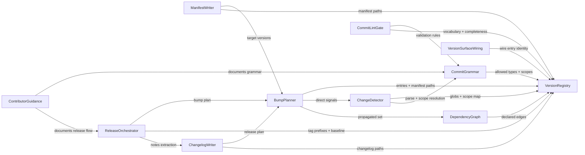

# Domain Design — Components

Sources: `inception/requirements-analysis/requirements.md`, `codekb/oxidean-app/architecture.md`, `codekb/oxidean-app/component-inventory.md`, `codekb/oxidean-app/dependencies.md`. Scope note: "component" here means a **logical building block of the new semver tooling** — the repo's own ten versioned deliverables are `versioning.toml` registry *entries* (entities), distinct from these design components.

```yaml
components:
  - name: VersionRegistry
    summary: Loads, validates, and serves the component registry (versioning.toml).
    behaviour: >
      Parses `versioning.toml` into typed entries (id, kind crate|bun|contract,
      manifest/constant path, tag prefix, changelog path, detection globs, scope
      aliases, internal dependency edges) plus [baseline] and [grammar] sections.
      Enforces registry completeness: every Cargo workspace member and Bun
      workspace package must map to exactly one entry, unregistered members fail
      validation. Never stores or reads version numbers — manifests are the
      version source of truth. Rejects non-registry files (stack presets,
      fixtures, lock-file schema versions) by scoping globs to real manifests.
    responsibilities:
      - Registry parse/validate and completeness gate
      - Scope-alias and dependency-edge lookups for all consumers
    depends_on: []
    dependents:
      - component: CommitGrammar
        interaction: supplies allowed types, scope aliases, reserved scopes
      - component: ChangeDetector
        interaction: supplies globs/scope map for commit attribution
      - component: DependencyGraph
        interaction: supplies declared internal edges
      - component: BumpPlanner
        interaction: supplies entries to plan
      - component: ManifestWriter
        interaction: supplies manifest/constant paths to rewrite
      - component: ChangelogWriter
        interaction: supplies changelog paths per component
      - component: ReleaseOrchestrator
        interaction: supplies tag prefixes and baseline
      - component: CommitLintGate
        interaction: supplies grammar + scope vocabulary for validation
      - component: VersionSurfaceWiring
        interaction: supplies the wire entry's identity and constant location
    external_dependencies:
      - name: Bun runtime + TOML parsing
        kind: other
        purpose: script runtime; TOML read for the registry file
    entities:
      - name: RegistryEntry
        identifier: id
        attributes: [id, kind, manifestPath, tagPrefix, changelogPath, globs, scopes, dependsOn]
      - name: RegistryConfig
        identifier: path
        attributes: [path, entries, baselineCommit, allowedTypes, reservedScopes]
  - name: CommitGrammar
    summary: Parses and validates Conventional Commit messages and resolves scopes.
    behaviour: >
      Owns the grammar `type(scope)!: subject` for types
      feat/fix/chore/docs/style/refactor/perf/test/build/ci/revert; detects
      breaking via `!` and `BREAKING CHANGE:` footer; recognizes exempt subjects
      (merge commits, auto-generated reverts, `chore(release):` tooling commits).
      Resolves the scope field through the registry alias map: mapped scope names
      components; unmapped scope warns and signals path fallback; reserved scope
      `release` maps to nothing and never falls back.
    responsibilities:
      - Message parse + validation
      - Scope → component resolution signal
      - Exempt-subject detection
    depends_on:
      - component: VersionRegistry
        interaction: reads allowed types, scope aliases, reserved scopes
        style: sync
    dependents:
      - component: ChangeDetector
        interaction: parses each scanned commit
      - component: CommitLintGate
        interaction: validates hook/CI message input
      - component: ContributorGuidance
        interaction: documents the grammar
    entities:
      - name: ConventionalCommit
        identifier: sha
        attributes: [sha, type, scope, breaking, subject, paths, isMerge, isExempt]
  - name: ChangeDetector
    summary: Determines which registry entries each commit touches.
    behaviour: >
      For the commit range (previous <component>-v* tag or baseline commit →
      HEAD): resolves affected components via scope mapping first, then changed-
      file path globs when scope is absent or unmapped; dedupes by component;
      exempt commits carry no bump signal but their diffs may still attribute.
      Wire entry attribution is scope-driven over its curated contract glob list
      (no blanket rpc.rs coverage). Shared-source hits are attributed to every
      consuming entry via globs on the consumers: `crates/oxidean-api/proto/`
      (the runner speaks the protocol shape — the runner entry's glob covers the
      proto path so a contract change deliberately bumps it too), and
      `crates/oxidean-cli/skill/SKILL.md` (embedded by oxidean-api's
      /cli/skill.md route) attributes to both cli and api.
    responsibilities:
      - Commit → affected-entry attribution
      - Bump-signal extraction per entry (highest type/breaking seen)
    depends_on:
      - component: VersionRegistry
        interaction: globs + scope map
        style: sync
      - component: CommitGrammar
        interaction: parse + scope resolution
        style: sync
    external_dependencies:
      - name: git
        kind: other
        purpose: commit range and per-commit file lists (git log/diff-tree)
    dependents:
      - component: BumpPlanner
        interaction: hands the attributed signal set
    entities:
      - name: Attribution
        identifier: sha
        attributes: [sha, componentIds, signal, source]
        references:
          - entity: ConventionalCommit
            owned_by: CommitGrammar
            relationship: each Attribution is derived from one parsed ConventionalCommit
  - name: DependencyGraph
    summary: Internal dependency DAG and transitive propagation over registry entries.
    behaviour: >
      Built from registry `depends_on` edges (Cargo path deps, Bun workspace
      deps, the generated-source edge oxidean-api→@oxidean/api-client, and wire
      entry dependents api/cli/api-client/web/web-ts). Shared propagation
      sources are handled by consumer-side globs, not declared edges:
      `crates/oxidean-api/proto/**` is globbed onto oxidean-runner (the runner
      consumes the protocol shape, not the .proto file — the glob makes the
      attribution deliberate), `apps/web/src/pages/**`→oxidean-web shells and
      the `@oxidean/web` dist→oxidean-web serve edge follow the same
      convention. ChangeDetector attributes a shared-file change to every
      consumer; DependencyGraph then propagates onward. Given the
      directly-affected set, computes the transitive closure of dependents
      that must also bump. Cycles are rejected at registry validation.
    responsibilities:
      - DAG construction from registry edges
      - Transitive dependent propagation
    depends_on:
      - component: VersionRegistry
        interaction: declared edges
        style: sync
    dependents:
      - component: BumpPlanner
        interaction: expands the affected set
    entities:
      - name: DependencyEdge
        identifier: edge
        attributes: [edge, from, to, kind]
        references:
          - entity: RegistryEntry
            owned_by: VersionRegistry
            relationship: each edge connects two registry entries (from depends_on to)
  - name: BumpPlanner
    summary: Applies the 0.x-aware bump table and produces the release plan.
    behaviour: >
      Per entry: direct signal → bump via the table (0.x: breaking+feat→minor,
      fix/perf/revert→patch, housekeeping→none; ≥1.0.0: breaking→major,
      feat→minor, fix/perf/revert→patch). Propagated-only bumps are patch; a
      component with both direct commits and bumped deps takes
      max(direct, patch); direct-only takes its direct bump (including none).
      Reads current versions from manifests; emits ReleasePlan entries
      (fromVersion→toVersion, level, attributed commits, propagatedFrom).
    responsibilities:
      - Bump-level computation per entry
      - ReleasePlan emission
    depends_on:
      - component: VersionRegistry
        interaction: entry list + manifest paths
        style: sync
      - component: ChangeDetector
        interaction: direct signals
        style: sync
      - component: DependencyGraph
        interaction: propagated set
        style: sync
    dependents:
      - component: ManifestWriter
        interaction: versions to write
      - component: ChangelogWriter
        interaction: plan for changelog content
      - component: ReleaseOrchestrator
        interaction: plan for tags/releases
    entities:
      - name: ReleasePlanEntry
        identifier: componentId
        attributes: [componentId, fromVersion, toVersion, bumpLevel, commits, propagatedFrom, prerelease]
        references:
          - entity: RegistryEntry
            owned_by: VersionRegistry
            relationship: each plan entry bumps one registry entry
  - name: ManifestWriter
    summary: Rewrites version fields in manifests/constants and regenerates lockfiles.
    behaviour: >
      For each bumped entry: edits the literal `version` field in its manifest
      (Cargo.toml / package.json) or the WIRE_VERSION constant for the contract
      entry; removes workspace.version inheritance once at migration time.
      Regenerates Cargo.lock and bun.lock via native tooling after edits.
      Rewrites only in-registry version fields — never fixtures, templates, or
      lock-file schema markers.
    responsibilities:
      - Version field rewrites (manifests + wire constant)
      - Lockfile regeneration
    depends_on:
      - component: BumpPlanner
        interaction: target versions
        style: sync
      - component: VersionRegistry
        interaction: manifest paths
        style: sync
    external_dependencies:
      - name: cargo
        kind: other
        purpose: Cargo.lock regeneration after version rewrites
      - name: bun
        kind: other
        purpose: bun.lock regeneration via bun install --lockfile-only
    dependents: []
    entities:
      - name: ManifestEdit
        identifier: path
        attributes: [path, field, fromValue, toValue]
  - name: ChangelogWriter
    summary: Generates per-component, wire, and consolidated root changelogs.
    behaviour: >
      Keep a Changelog format: per-component CHANGELOG.md grouped by type
      (Features/Fixes/Performance/Breaking/etc.) with commit refs; dependency-only
      bumps get a `### Dependencies` section listing internal dep bumps;
      `docs/WIRE-CHANGELOG.md` for the contract entry; root CHANGELOG.md
      consolidates each release with links to inner files. Idempotent —
      regenerating a release section is byte-identical; no pre-0.1.0 backfill.
    responsibilities:
      - Per-component + wire changelog emission
      - Global consolidated changelog emission
    depends_on:
      - component: BumpPlanner
        interaction: release plan (versions, commits, propagation causes)
        style: sync
      - component: VersionRegistry
        interaction: changelog paths
        style: sync
    dependents:
      - component: ReleaseOrchestrator
        interaction: per-component notes sections for GitHub Releases
    entities:
      - name: ChangelogEntry
        identifier: version
        attributes: [version, date, sections, links]
        references:
          - entity: ReleasePlanEntry
            owned_by: BumpPlanner
            relationship: each changelog section renders one release plan entry
  - name: ReleaseOrchestrator
    summary: Computes tags, drives release commits/tags, and produces release notes.
    behaviour: >
      Names tags `<component>-v<semver>` (annotated); `make release-tags`
      creates/pushes them (maintainer credentials — never default GITHUB_TOKEN
      for cascades). Produces the release-notes payload per tag from the
      component changelog section; owns the baseline <component>-v0.1.0 tag set
      on the recorded baseline commit. Workflow edits (ox-cli.yml,
      publish-runner.yml, generic release job) retarget triggers to component
      tags and strip the component prefix during version extraction —
      including ox-cli.yml's missing `crates/oxidean-core/**` path-filter gap
      and the FR8.2 automated release-PR workflow that invokes the same
      release-plan code path.
    responsibilities:
      - Tag plan + tag creation/push
      - Baseline tag set
      - Release-notes payload per tag
      - Release-workflow trigger alignment
      - Automated release-PR trigger (FR8.2)
    depends_on:
      - component: BumpPlanner
        interaction: bump plan for tags
        style: sync
      - component: VersionRegistry
        interaction: tag prefixes, baseline
        style: sync
      - component: ChangelogWriter
        interaction: notes extraction
        style: sync
    external_dependencies:
      - name: GitHub Releases / gh CLI
        kind: third-party-api
        purpose: release creation and notes upload in the release workflows
      - name: git push credentials
        kind: other
        purpose: annotated-tag push — maintainer auth or dedicated release credential, never default GITHUB_TOKEN
    dependents:
      - component: ContributorGuidance
        interaction: documents the release flow
    entities:
      - name: ReleaseTag
        identifier: name
        attributes: [name, componentId, version, targetSha, annotated]
        references:
          - entity: ReleasePlanEntry
            owned_by: BumpPlanner
            relationship: each tag names one plan entry's bumped component
  - name: CommitLintGate
    summary: Enforcement surfaces for the commit grammar — local hook + CI check.
    behaviour: >
      `.githooks/commit-msg` (tracked, installed by `make setup` via
      core.hooksPath) validates locally — advisory only. The CI job validates
      every commit in the PR range plus the PR title, and also runs the registry
      completeness check so new workspace members cannot evade versioning.
      Failures block merge once the check is required in repo settings.
    responsibilities:
      - Local commit-msg hook + make setup wiring
      - CI commit-range + PR-title lint job
      - Registry completeness check in CI
    depends_on:
      - component: CommitGrammar
        interaction: validation rules
        style: sync
      - component: VersionRegistry
        interaction: scope vocabulary + completeness data
        style: sync
    external_dependencies:
      - name: GitHub Actions
        kind: other
        purpose: CI job host
      - name: git
        kind: other
        purpose: commit-msg hook machinery — .githooks via core.hooksPath
    dependents: []
    entities: []
  - name: VersionSurfaceWiring
    summary: Code changes inside existing crates/apps so every surface reports the right version.
    behaviour: >
      Introduces `WIRE_VERSION: &str` in oxidean-core replacing
      RPC_PROTOCOL_VERSION (emitted into the generated client via rpc-gen) —
      the OpenAPI `info.version` field renders it too (replacing the hardcoded
      "1" at rest/spec.rs); keeps MIN_CLI_VERSION as a distinct semver floor;
      reports both on system.manifest alongside the api component version;
      the wire compatibility rule is standard SemVer caret semantics —
      while <1.0 compatible means same 0.MINOR; at ≥1.0 compatible means same
      MAJOR — enforced by the server and client checks that today compare
      RPC_PROTOCOL_VERSION/MIN_CLI_VERSION; /cli/latest reports the CLI version
      from the dist manifest the release flow writes (the manifest file is
      introduced by this work — cli_dist.rs currently scans a directory);
      deduplicates the five MCP spec-revision pin sites to one canonical
      oxidean-core constant propagated to TS through the generated client;
      removes the dead OXIDEAN_RPC_VERSION config.
    responsibilities:
      - Wire constant + consumer rewiring
      - Version-surface corrections (/cli/latest, manifest fields)
      - MCP pin-site dedupe
      - Dead config removal
    depends_on:
      - component: VersionRegistry
        interaction: which constant/entry the wire version is
        style: sync
    external_dependencies:
      - name: rpc-gen codegen pipeline
        kind: other
        purpose: propagates constants into packages/api-client
    dependents: []
    entities:
      - name: VersionSurface
        identifier: surface
        attributes: [surface, location, componentId, field]
        references:
          - entity: RegistryEntry
            owned_by: VersionRegistry
            relationship: each surface reports one registry entry's version
  - name: ContributorGuidance
    summary: Documentation and agent-skill updates for the convention and release flow.
    behaviour: >
      CONTRIBUTING/docs cover the commit grammar, bump mapping, `make setup`
      hook install, and release flow; a `.agents/skills/` semver skill teaches
      agents the convention and tooling (surfaced to Cursor/Claude via existing
      symlinks); AGENTS.md updated; Makefile help covers new targets.
    responsibilities:
      - Human-facing convention docs
      - Agent-facing skill + rules updates
      - Make target documentation
    depends_on:
      - component: CommitGrammar
        interaction: documents the grammar
        style: sync
      - component: ReleaseOrchestrator
        interaction: documents the release flow
        style: sync
    dependents: []
    entities:
      - name: GuidanceDoc
        identifier: path
        attributes: [path, audience, covers]
```

## Component Diagram

One edge per `depends_on`, drawn consumer --> supplier (the consumer "depends on" the supplier); the label is the declared interaction.



## Component Summary

| Component | Purpose | Depends On | Dependents | Entities Owned |
|---|---|---|---|---|
| VersionRegistry | versioning.toml parse/validate + completeness | — | CommitGrammar, ChangeDetector, DependencyGraph, BumpPlanner, ManifestWriter, ChangelogWriter, ReleaseOrchestrator, CommitLintGate, VersionSurfaceWiring | RegistryEntry, RegistryConfig |
| CommitGrammar | conventional-commit parse/validate + scope resolution | VersionRegistry | ChangeDetector, CommitLintGate, ContributorGuidance | ConventionalCommit |
| ChangeDetector | commit→component attribution | VersionRegistry, CommitGrammar (ext: git) | BumpPlanner | Attribution |
| DependencyGraph | internal DAG + transitive propagation | VersionRegistry | BumpPlanner | DependencyEdge |
| BumpPlanner | 0.x-aware bump table → ReleasePlan | VersionRegistry, ChangeDetector, DependencyGraph | ManifestWriter, ChangelogWriter, ReleaseOrchestrator | ReleasePlanEntry |
| ManifestWriter | version rewrites + lockfile regen | BumpPlanner, VersionRegistry | — | ManifestEdit |
| ChangelogWriter | per-component + wire + global changelogs | BumpPlanner, VersionRegistry | ReleaseOrchestrator | ChangelogEntry |
| ReleaseOrchestrator | tags, release notes, workflow trigger alignment | BumpPlanner, VersionRegistry, ChangelogWriter (ext: GitHub Releases, git credentials) | ContributorGuidance | ReleaseTag |
| CommitLintGate | hook + CI enforcement of the grammar | CommitGrammar, VersionRegistry (ext: GitHub Actions) | — | — |
| VersionSurfaceWiring | wire constant + version-surface rewiring in existing code | VersionRegistry (ext: rpc-gen pipeline) | — | VersionSurface |
| ContributorGuidance | docs + agent skill for the convention | CommitGrammar, ReleaseOrchestrator | — | GuidanceDoc |

## Entity Ownership

| Entity | Owning Component | Identifier | Attributes | References |
|---|---|---|---|---|
| RegistryEntry | VersionRegistry | id | id, kind, manifestPath, tagPrefix, changelogPath, globs, scopes, dependsOn | — |
| RegistryConfig | VersionRegistry | path | path, entries, baselineCommit, allowedTypes, reservedScopes | — |
| ConventionalCommit | CommitGrammar | sha | type, scope, breaking, subject, sha, paths, isMerge, isExempt | — |
| Attribution | ChangeDetector | sha | sha, componentIds, signal, source | ConventionalCommit → CommitGrammar |
| DependencyEdge | DependencyGraph | edge | edge, from, to, kind | RegistryEntry → VersionRegistry |
| ReleasePlanEntry | BumpPlanner | componentId | componentId, fromVersion, toVersion, bumpLevel, commits, propagatedFrom, prerelease | RegistryEntry → VersionRegistry |
| ManifestEdit | ManifestWriter | path | path, field, fromValue, toValue | — |
| ChangelogEntry | ChangelogWriter | version | version, date, sections, links | ReleasePlanEntry → BumpPlanner |
| ReleaseTag | ReleaseOrchestrator | name | name, componentId, version, targetSha, annotated | ReleasePlanEntry → BumpPlanner |
| VersionSurface | VersionSurfaceWiring | surface | surface, location, componentId, field | RegistryEntry → VersionRegistry |
| GuidanceDoc | ContributorGuidance | path | path, audience, covers | — |

## External Dependencies

| Component | Dependency | Kind | Purpose |
|---|---|---|---|
| VersionRegistry | Bun + TOML | other | runtime + registry file parse |
| ChangeDetector | git | other | commit range + file lists |
| ManifestWriter | cargo | other | Cargo.lock regeneration after version rewrites |
| ManifestWriter | bun | other | bun.lock regeneration via `bun install --lockfile-only` |
| ReleaseOrchestrator | GitHub Releases / gh | third-party-api | release + notes upload |
| ReleaseOrchestrator | git push credentials | other | annotated-tag push — maintainer auth or dedicated release credential |
| CommitLintGate | GitHub Actions | other | CI job host |
| CommitLintGate | git | other | commit-msg hook machinery — .githooks via core.hooksPath |
| VersionSurfaceWiring | rpc-gen pipeline | other | constant propagation into api-client |

## Rationale

| Component | Why a separate building block |
|---|---|
| VersionRegistry | Distinct data ownership — the registry schema and completeness gate are every consumer's shared contract; changes at a different rate than parsing/bump logic. |
| CommitGrammar | One grammar, three enforcement surfaces (hook, CI, detector) — isolating it guarantees they can never disagree. |
| ChangeDetector | Attribution policy (scope vs path fallback, reserved scopes, exempt commits) is a self-contained rule set with its own test surface. |
| DependencyGraph | Propagation is a pure graph algorithm over declared edges — testable in isolation and deliberately agnostic of commit semantics. |
| BumpPlanner | The 0.x-aware bump table + max(direct, propagated-patch) composition is the semantic core; isolating it keeps the policy in one reviewable place. |
| ManifestWriter | File-rewrite mechanics (TOML/JSON surgery + lockfile regen) have a distinct failure mode and change rate from planning. |
| ChangelogWriter | Presentation-layer concern — Keep a Changelog emission, idempotence, Dependencies sections — changes with output format, not policy. |
| ReleaseOrchestrator | Tag/release side effects are the riskiest surface; isolating them keeps the planner pure and the mutation boundary explicit. |
| CommitLintGate | Enforcement surface distinct from the grammar it shares — owns hook install + CI plumbing rather than rules. |
| VersionSurfaceWiring | Lives inside existing crates/apps (cross-cutting embeds/dedupes) — a different codebase layer than the tooling under `scripts/`. |
| ContributorGuidance | Docs/skill deliverables have a distinct audience and lifecycle from executable code. |

Alternatives Rejected: folding ChangeDetector+DependencyGraph+BumpPlanner into one "release engine" — rejected because attribution, propagation, and bump policy each carry independent test obligations and review found them separable; splitting ManifestWriter/ChangelogWriter per file type — rejected as needless duplication of one writer each.
