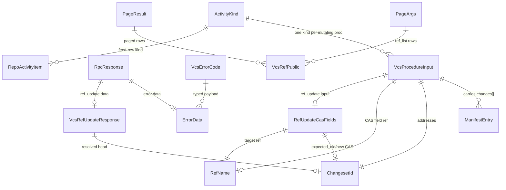

# Functional Spec — u1-vcs-wire-foundation

The wire foundation carries no business workflows of its own — its "behavior" is three flows every later unit depends on: the request/classification pipeline, the registration-completeness check, and the client regeneration cycle. Entities live in `entities.md`; the ER view below is derived from it.

## WF1 — RPC request pipeline (all 17 procedures)

1. `POST /api/rpc` (or `/api/rpc/ws` frame) carries `{procedure, input}`.
2. Decode `procedure`; unknown name → `rpc.unknown_procedure` before dispatch (BR1.1, BR1.2).
3. Classify via `proc_classes` — RepoRead / RepoWrite / RepoAdminWrite per BR1.3; unlisted → `SessionOnly`.
4. Authorize the credential against the class: session cookies satisfy RPC contexts (the settings page path); the Bearer path accepts PAT + job tokens (OAT-on-RPC is a host extension, not u1). Denial codes stay transport-layer — `auth.unauthenticated`/`auth.pat_scope` — and anti-enumeration stays `repo.not_found`; `vcs.unauthenticated`/`vcs.forbidden` are emitted by the domain layer and the `/api/vcs/*` routes, not this pipeline.
5. Decode `input` per the procedure DTO — `{owner, name}` required on all 17 (BR1.4); malformed → `rpc.bad_input`.
6. Dispatch to the u7 handler; domain errors return through the `AppError` envelope with a `VcsErrorCode` code (BR1.1). Note for u7: `rpc_status`'s HTTP-mapping whitelist doesn't know `vcs.*` codes — they serialize as HTTP 400 inside the `{ok:false}` envelope unless the mapping is extended (acceptable: the typed code is authoritative; the HTTP status extension lands with u7's surface work).

## WF2 — Registration completeness (build-time structural check)

1. `PROCEDURES` (oxidean-api) gains the 17 names → `system.manifest` advertises them (AC8.1.2).
2. `proc_classes` gains all 17 in the pinned tiers plus the two object-route aliases (`vcs.object_get` → RepoRead, `vcs.object_put` → RepoWrite) — classified but never in PROCEDURES; the fail-closed coverage test asserts the full shape (BR1.2, BR1.3).
3. Dispatch arms land WITH the PROCEDURES entries in u1 — stub arms returning `vcs.disabled` (behaviorally correct: no repo can be enabled before u4/u7); `procedures_list_matches_dispatch` stays green at every commit boundary and u7 swaps in the real handlers. Boundary note: `unit-of-work.md` lists PROCEDURES/dispatch under u7's host wiring — u1's story-map share ("rpc-gen + manifests") sanctions the PROCEDURES entries since they feed `system.manifest`; the stub arms ride along as the parity-preserving exception (same class as the WF2.5 `rpc_gen.rs` template edit — registration surfaces live in oxidean-api regardless of which unit edits them).
4. `versioning.toml` registers the component — `[[component]]` id `oxidean-vcs`, kind `crate`, globs `["crates/oxidean-vcs/**"]`, scopes `["vcs"]` — and U1 mints the `crates/oxidean-vcs` skeleton (literal `[package] version`, `src/lib.rs`, `CHANGELOG.md`, workspace member) that registration requires (AC8.2.2). `depends_on` edges land later with the real Cargo deps — u7 for `oxidean-api`, u8 for `ox`. Caveat: `vcs.*` DTO edits under `crates/oxidean-core/**` attribute to `oxidean-core` by path — the `vcs` scope mapping still applies to subjects.
5. `make rpc-gen` regenerates `packages/api-client` from the hand-maintained `rpc_gen.rs` template (the template edit lands in oxidean-api — u1's crate boundary exception for the registration surface). `rpc-sync-check` proves committed-file parity only; a separate generated-client coverage test asserts all 17 names appear in `index.ts` (BR1.8).

## WF3 — Activity-kind constant flow (write path)

1. A mutating op completes inside u7's surface layer.
2. `ActivityRecorder` writes one `repo_activity` row whose `push_type` is the op's `ActivityKind` constant (BR1.7).
3. u10's feed renderer reads the row through the extended `VALID_PUSH_TYPES` allow-list — `cs_` ids render with VCS copy, never `/commit/{sha}` links.

## State machines

None — wire types are stateless shapes. The flag lifecycle (`never-enabled → enabled → disabled`) belongs to u7's gate behavior, not the wire foundation.

## Entity-relationship view (derived from entities.md)

## Rules summary (derived from rules.md)

| id | one-line |
|----|----------|
| BR1.1 | untagged `{ok,data}`/`{ok:false,error}` envelope on every call |
| BR1.2 | exactly the 17 pinned names |
| BR1.3 | 10 read / 6 write / 1 admin tiers, unlisted → SessionOnly |
| BR1.4 | `{owner, name}` always separate fields |
| BR1.5 | absent-not-null; ref CAS nulls are semantic |
| BR1.6 | additive-only; breaking = `!` + wire_version bump |
| BR1.7 | ActivityKind constants are the sole feed-row source |
| BR1.8 | PROCEDURES + proc_classes + dispatch + core wire DTOs + client coverage + versioning parity |
