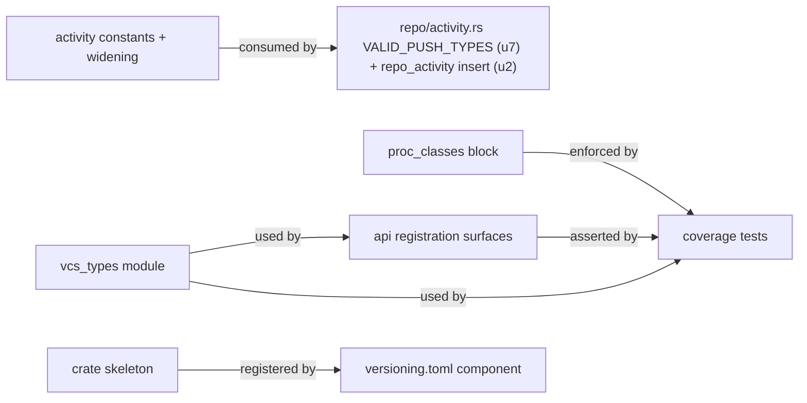

# Logical Components — u1-vcs-wire-foundation

The unit's internal decomposition — one wire-definition file plus five registration/test surfaces in host crates. This is the arrangement the functional-design entities land in.

## LC1 — `oxidean_core::vcs_types` (the wire-definition module)

`crates/oxidean-core/src/vcs_types.rs`, re-exported via `lib.rs` `pub use`. Internal layout, top to bottom:

1. **Wire helpers**: `Nullable<T>` (`pub enum` — `Null | Value(T)` + custom `Deserialize` + `is_null()`/`value()`; must be `pub` since it appears in re-exported DTO fields), `ChangesetId` as a validated string newtype (`cs_<ulid>` — construction rejected otherwise). `RefName` is **not** a newtype — entities.md pins `pub ref_name: String` + `#[serde(rename = "ref")]` (free-form values like `main`, `agent/<task>`). `ObjectId` (`sha256:`-prefixed hex) is an addition beyond entities.md's 13 — introduced for the object-route DTOs; noted delta, consistent with the identifiers tech-stack row.
2. **`VcsErrorCode`**: closed enum, per-variant `#[serde(rename = "vcs.<code>")]`, `as_str()`, `impl From<VcsErrorCode> for String`, typed `with_data` constructors for the pinned payload shapes.
3. **Shared public shapes**: `VcsChangesetPublic`, `VcsRefPublic`, `ManifestEntry`, `ErrorData`, pagination field conventions.
4. **Per-procedure blocks** (17): `Vcs{Op}Request` / `Vcs{Op}Response` pairs in PROCEDURES order — every request carries `{owner, name}` first.

Boundary: the module owns wire *shape* only — no validation of bounds (u7 handlers), no business logic, no imports beyond `serde`/`schemars`/serde_json.

## LC2 — `proc_classes` `vcs.*` block

One contiguous match block in `crates/oxidean-core/src/proc_classes.rs`: 17 procedure + 2 alias arms → pinned tiers. Sits before the existing `_ => SessionOnly` fallthrough; table-free literal-arm style.

## LC3 — Activity-kind constants + `RepoActivityItem` widening

`oxidean-core` gains the seven `vcs.*` activity-kind constants (they're a wire entity — u2's insert signature, u7's `ActivityRecorder` inside `oxidean-vcs`, and u10's renderer all consume them, and `oxidean-vcs`/`oxidean-db` can see `oxidean-core` only). `crates/oxidean-api/src/repo/activity.rs`'s `VALID_PUSH_TYPES` extends *from* those constants — the allow-list edit itself is u7's host wiring, not u1's.

`RepoActivityItem`'s five wire fields widen in `repo_types.rs` (`ref_name`/`ref_short`/`before`/`after`/`commits_count` → `Option`) — plain `Option`, **no `skip_serializing_if`** (they must render explicit `field: null` on the wire, not absent). `row_to_item` wraps `Some(...)`. Split: DTO widening + `Some()` wrap + the `apps/web` activity-row reader guards (`item.ref_short ?? item.ref_name`, `after != null && hasCommitOid(after)`, `commits_count ?? 0`) land in u1 — the regenerated client's nullable fields break `make web-lint` the moment it runs; `InsertRepoActivity`/column nullability/`RepoActivityRow` stay u2's. Two pinned follow-ups: (a) when u2 widens `RepoActivityRow` to `Option`, the `Some(row.x)` wrap stops compiling — u2 removes the wrap in `oxidean-api`'s `repo/activity.rs` (a deliberate crate-boundary exception into the host crate); (b) `repo-activity-row.tsrx` is a two-touch file — u1's null-guards now, u10's vcs-kind rendering later.

## LC4 — `oxidean-vcs` crate skeleton

`crates/oxidean-vcs/{Cargo.toml,src/lib.rs,CHANGELOG.md}` + workspace membership + `versioning.toml` `[[component]]` entry. Constraints: zero `[dependencies]` (any unused dep fails `cargo machete` in `dead-code-check`/CI), literal `version = "0.1.0"`, `edition`/`license` workspace-inherited (`oxidean-core` precedent), and `depends_on = []` — edges land in u7 (`oxidean-api`) / u8 (`ox`) alongside the real Cargo deps, since premature edges would cascade `oxidean-vcs` bumps into api/ox release plans. `[]` is correct only while `[dependencies]` is empty — the crate's *own* `depends_on` updates when u3/u4 fill it and when u8 adds it as a `client`-feature dep. The shell exists because `version-check` requires a real workspace member with a literal `[package] version` at registration time.

## LC5 — Registration surfaces in `oxidean-api`

- `PROCEDURES` + dispatch arms: 17 entries with `vcs.disabled` stubs (u7 swaps handlers). Shape pin: **17 separate single-name `"vcs.x" =>` arm lines** — the `procedures_list_matches_dispatch` scanner only counts lines starting with `"` whose text after the closing quote begins `=>`; a collapsed alternation arm is invisible to it and every `vcs.*` entry would fail parity. `system.manifest`'s `procedures` map therefore advertises them — pinned client contract: `procedures` = names dispatch recognizes, **not** enabled features; capability discovery is `vcs.status` (u7) and optionally a `capabilities.vcs` flag. u8 follow-up: today's `error_exit_code` catch-all maps all `vcs.*` → exit 1; unit-of-work pins `vcs.unauthenticated`/`vcs.forbidden` → credential exit 3 in u8's CLI pass, `vcs.disabled` stays exit 1.
- `rpc_gen.rs` template: the 17 client methods; `WIRE_VERSION` is a second hardcoded literal (`bump.ts` rewrites only `oxidean-core`'s `constant_path` and `rpc-sync-check` can't catch a stale template) — u1 adds a sync assertion (test comparing the emitted literal to `oxidean_core::WIRE_VERSION`, or template interpolation) so a wire bump can't silently desync every client's `wireCompatible` advisory. The `RepoActivityItem` widening is a breaking wire change → `wire` 0.1→0.2; it needs a `wire`-scoped breaking commit since `wire` carries `globs = []` (no path attribution). `MIN_CLI_VERSION` stays advisory — unchanged.
- `make rpc-gen` output committed in `packages/api-client`.

## LC6 — Coverage tests

- Classification coverage: every `vcs.*` PROCEDURES entry → non-`SessionOnly` tier + dispatch arm; aliases classified and absent from `PROCEDURES`.
- Generated-client coverage: all 17 names present in `index.ts` (complements `rpc-sync-check`, which proves template parity only).
- Serde round-trips: `Nullable<T>` absent/null/value trichotomy, `VcsErrorCode` dotted-code strings, `ref`-renamed field, absent-not-null optional fields.

## Dependency view

Note: the `rpc_gen.rs` template's LC5 edge is a *mirror* edge — the template is a raw string literal that describes the wire, nothing imports the Rust types. No cycles: LC1 is a leaf (serde/schemars only); host-crate surfaces depend on it, never vice versa.
