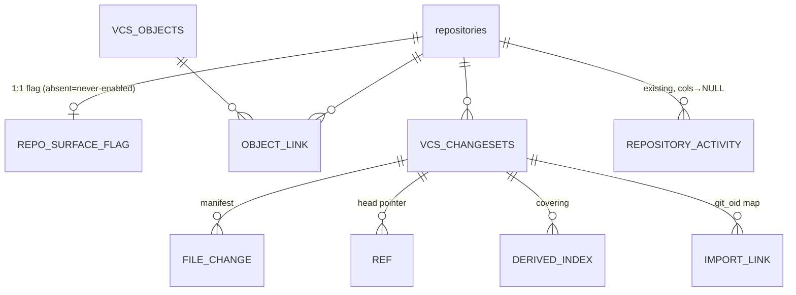

# Functional Spec — u2-vcs-persistence

## Scope

`oxidean-db::vcs` module: migration `0053_vcs_schema.sql` ×3 dialects (8 tables + `repository_activity` alteration), row types, `Database`-by-value façade per C5, repo cascade deletes, `insert_repo_activity` Option<> generalization + `RepoActivityRow` read-side widening per C4. Sanctioned exception: `RepoActivityRow` consumer de-wraps in `oxidean-api` (activity.rs/feeds.rs/users.rs — mechanical, no logic).

## ER view (derived)

## Workflows

### WF1 — repo_enable flag upsert
1. `upsert_repo_surface_flag(repo_id, enabled, enabled_by)` → INSERT ... ON CONFLICT(repo_id) UPDATE.
2. `get_repo_surface_flag(repo_id)` → Option<row>: None ⇒ never-enabled ⇒ `vcs.disabled`; Some(false) ⇒ admin-disabled (same denial, distinct provenance at read site — u7).

### WF2 — changeset create_tx (consumed by U4)
1. Caller assembles `changeset`, `file_changes[]`, `object_links[]`, `index_upserts[]`.
2. BEGIN → find_by_idempotency INSIDE tx (or retry-after-conflict): hit ⇒ return existing id.
3. INSERT changeset (insert-if-absent on idem race → re-SELECT); INSERT file_changes (assert non-delete ⇒ blob_hash); INSERT object_links **IF-ABSENT** (re-referenced blobs must not collide); upsert index rows (merge).
4. COMMIT ⇒ id; any error ⇒ ROLLBACK — zero partial state (BR2.6).

### WF3 — ref CAS
1. `cas_update(repo,name,expected_old,new)` → single statement, null-safe equality (`IS NOT DISTINCT FROM` / `<=>`).
2. pg/sqlite: `... RETURNING` or rows_affected; mysql: `rows_affected()` then `SELECT changeset_id` for actual.
3. Applied ⇒ `CasOutcome::Applied(RefRow)`; miss ⇒ read actual ⇒ `CasOutcome::Conflict{actual}` → `vcs.ref_conflict{actual}` at API.
4. Create: expected_old NULL + absent row ⇒ pg/sqlite `INSERT..ON CONFLICT..DO UPDATE..WHERE`, mysql UPDATE→INSERT in tx. Delete: `DELETE` row.

### WF4 — GC + status support (consumed by U3/U7)
1. `live_hashes()` per repo → link set (GC referenced-ness).
2. `list_orphaned_before(grace_ts)` → global object rows with no live links older than grace.
3. `count_for_repo` → `{object_count, storage_bytes}` (COUNT+SUM(size) JOIN links).
4. `changeset.count_for_repo` → i64 (C1 `vcs.status.changeset_count`).

### WF5 — activity insert + read (C4)
1. `insert_repo_activity(..., ref_name:Option, before_oid:Option, after_oid:Option, commits_count:Option<i64>, ...)`; ref-free ops write NULLs; push_type carries `VCS_ACTIVITY_KINDS` or legacy kinds.
2. Read: `map_activity!` → `try_get::<Option<..>>`; `RepoActivityRow` fields Option; consumers de-wrap — `row_to_item` already maps to U1's widened `RepoActivityItem`; `feeds.rs` uses "" / 0 display fallbacks; `users.rs` passes through (fields already Option).
3. Existing push callers pass `Some(...)` — behavior unchanged.

## State notes
- `Ref` is the only mutable entity (CAS-only writes). Changesets/FileChange/ObjectEntry insert-only; DerivedIndex upsert-only; flag toggles.
- `skipped()` DB ⇒ every method errors `db.not_configured` before SQL (BR2.2).
- `vcs.status` inputs served: flag get (enabled), ref.list (heads), changeset.count_for_repo, object count_for_repo pair.

## Acceptance mapping
- AC1.3.1/2/3: BR2.4 cascades; keys on repo_id (transfer-safe); no archive column needed.
- AC2.1.4: create_tx accepts parents=[] (façade agnostic).
- AC2.2.x: BR2.8 idempotent insert.
- AC2.3.1/2.3.2: BR2.9 merge upserts + BR2.6 single-tx.
- AC2.7.1/2.7.3: BR2.5 signature+CHECK drop (u7 owns recorder/allow-list).
- AC3.5.2: BR2.6 links inside create_tx.
- AC5.1.3: BR2.7 Conflict{actual}.
- AC5.2.1: empty ref list on fresh repo.
- AC1.2.2: BR2.2 skipped → db.not_configured.
- FR1.5: BR2.4 + global CAS.
