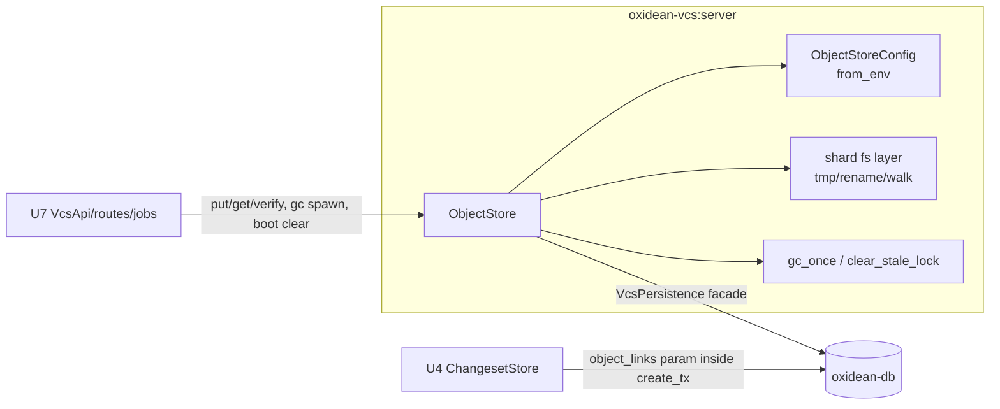

# Functional Spec — u3-vcs-object-store

## Scope

`ObjectStore` in `oxidean-vcs` (server feature): streamed content-addressed blob I/O under `OXIDEAN_VCS_OBJECTS_DIR` with tmp→rename→row PUT ordering, dedup, per-object and per-repo quota enforcement (`vcs.quota_exceeded`), hash verification, grace-windowed GC with computed referenced-ness, shard-shaped row-less/`*.tmp` sweeps, age-stale GC lock + boot clear, and the `ObjectStoreConfig` env-var contract. Sanctioned façade delta: `vcs_delete_object_if_unlinked(hash)` + `vcs_get_object_link(repo_id, hash)` inside `oxidean-db` (Q7). Route wiring, auth gating, job spawn, host config wiring are U7's; DDL is U2's.

## Structure

## Workflows

### WF1 — PUT (POST /objects body, route in U7)
1. `put(stream, repo_id)` opens `{objects_dir}/tmp/{pid}-{counter}-{nanos}.tmp`, streams chunks: hash update + byte count + write. Count > `max_object_bytes` → remove tmp → `QuotaExceeded{Object}` → `vcs.quota_exceeded` (AC3.1.3). Empty body ⇒ legal sha256-of-empty `size=0` object.
2. Finalize digest (bare 64-hex). Final path `{ab}/{cd}/{hash}`; `create_dir_all` shard; if file present drop tmp, else rename (atomic same-fs).
3. `object_entry.insert_if_absent(hash,size)` → Stored|Dedup. Then membership probe `vcs_get_object_link(repo_id, hash)`: link exists ⇒ done (re-reference, no quota charge). Absent ⇒ `count_for_repo` check: `storage_bytes + size > repo_quota` → `QuotaExceeded{Repo}` (AC3.5.3 — file stays, globally valid content; the repo link is the denial) → else `object_link.insert_if_absent`.
4. Return `{hash: "sha256:"+digest, Stored|Dedup}` (AC3.1.2 — re-upload always returns same hash).

### WF2 — GET / verify
1. `validate_hash` (bare 64-hex lowercase — local `validate_oid` clone) → shard path → open `tokio::fs::File` → return to caller; route sets `200 application/octet-stream` + `Cache-Control: immutable, max-age=31536000`.
2. Unknown hash (no row, no file, or file vanished between lookup and open — `io::ErrorKind::NotFound`) → `NotFound` → `vcs.not_found` (AC3.2.2).
3. `verify(hash)` re-hashes stored bytes — GC integrity check + tests; mismatch ⇒ internal error, bytes never served under a false hash.

### WF3 — Object links inside the create tx (C6a, consumed by U4)
- U3 ships NO standalone `insert_links_tx` — no transaction handle crosses the façade boundary. The mechanism is `vcs_create_changeset_tx`'s `object_links` param: in-tx `SELECT hash` existence check (`vcs.not_found:object`) + `INSERT … ON CONFLICT DO NOTHING` links. **Invariant U4 must satisfy:** pass *every* manifest `blob_hash` (not just new blobs) — unlinked-but-referenced objects would appear orphaned to GC while `file_changes` RESTRICT blocks their delete forever.

### WF4 — `gc_once()` (job spawn in U7)
1. Acquire lockfile via `create_new`; present ⇒ check mtime: younger than `gc_grace_secs` ⇒ skip pass; older ⇒ stale — remove and re-acquire (age-based staleness; boot's `clear_stale_lock` covers the rest).
2. `list_orphaned_before(now - grace_secs)` → per row: `vcs_delete_object_if_unlinked(hash)` then delete file. Row first — a crash leaves a sweepable file, never a live row over missing bytes. Per-object errors logged + skipped (self-healing next pass).
3. Walk dir: `*.tmp` under `tmp/` older than grace → remove; files matching `{2hex}/{2hex}/{64hex}` with no row AND mtime older than grace → remove. Everything else (dotfiles, `.gc-lock`, strays) untouched. Canonicalize-under-root, no symlink follow.
4. Log `VcsGcStats {orphans_removed, tmp_removed, rowless_removed, bytes_reclaimed}` via tracing. Absent objects dir ⇒ early-return zero stats.

### WF5 — `clear_stale_lock()` at host boot
- Removes any lockfile unconditionally — a fresh process holds none. Called by U7 startup wiring; mid-uptime staleness is WF4.1's age rule.

## State notes
- Immutable bytes, mutable only by delete (GC). Rows: ObjectEntry global, ObjectLink per-repo (U2 DDL); `list_orphaned_before`/`count_for_repo`/`get_object_link`/`delete_object_if_unlinked` are the GC+quota joins.
- Hash stored bare; `sha256:` prefix at the wire boundary only.
- Global dedup: one file serves many repos; per-repo bytes = SUM over links (logical quota, FR1.5 + ADR-010).

## Acceptance mapping
- AC3.1.1: WF1 (sha256 returned; bytes under `OXIDEAN_VCS_OBJECTS_DIR`).
- AC3.1.2: WF1.2-4 dedup re-upload returns same hash.
- AC3.1.3: WF1.1 object cap → `vcs.quota_exceeded`, tmp removed.
- AC3.2.1: WF2.1 stream + immutable cache headers (U7 applies headers).
- AC3.2.2: WF2.2-3 unknown → `vcs.not_found`; hash-verified write.
- AC3.3.1: protocol shape — store answers by hash only; no have-negotiation endpoint exists anywhere in the design.
- AC3.3.3: streamed verify + per-object resumable GETs (client cache verify is U8).
- AC3.4.1/3.4.2: share — store serves only named hashes; filtering is client-side (U8); unrequested blobs never transferred.
- AC3.5.1/3.5.2: WF3 links inside create_tx + WF4 grace — PUT→commit and concurrent-GC-tick races closed.
- AC3.5.3: WF1.3 repo quota → `vcs.quota_exceeded` at write time.
- AC1.3.x (share): repo-delete cascades rows (U2); orphaned bytes are GC-reclaimed — no eager FS delete needed.
