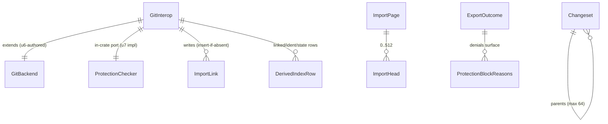

# Functional Specification — u6-vcs-git-interop

Unit: `u6-vcs-git-interop` — deterministic Git→changeset import (explicit + lazy, converging), changeset→Git export (object-mint + exactly one hook-gated ref move), `ProtectionChecker` trait port, actor-capability propagation. *(Revision 3 — architecture review pass-2 integrated: `ProtectionBlockReasons` verdicts, hook-parity intent, git-side ff fallback, lazy pagination loop, cursor byte cap.)*

## Workflow table

| ID | Workflow | In | Out |
|----|----------|----|-----|
| WF0 | Import claim/cursor state | derived `active`/`cursor` rows | `active: bool`, resumable position |
| WF1 | `import_chain` — explicit entry | `repo_id, repo, from, cursor, limit` | `ImportPage{imported,cursor?,done,skipped_tips,heads}` |
| WF2 | `lazy_import` — entry | `repo_id, repo, git_oid` | `ImportPage{done:true,cursor:None}` |
| WF3 | `import_one` — per-commit conversion | `RawCommit` | `ChangesetId` (or prior id) |
| WF4 | `export` — entry | `repo_id, repo, head, branch, force, actor_capability` | `ExportOutcome` |
| WF5 | `export_one` — per-changeset mint | export-set node | `git_oid` |

## State transitions (WF0)

| # | From | On | To |
|---|------|----|----|
| S0.1 | `idle`/none | `claim` `active` ⇒ `ImportState` | `active(nonce)` |
| S0.2 | `active(n)` | terminal + nonce match ⇒ `release` | `idle` |
| S0.3 | `active(n)` | terminal + nonce mismatch ⇒ skip release | `active(n)` |

## WF1 `import_chain` — ordered

```text
1. is_skipped → DbNotConfigured. limit → 1..=cap ⇒ InvalidInput.
   from+cursor ⇒ cursor authoritative (from ignored).
2. claim (S0.1): fresh active ⇒ ImportState; upsert+re-read nonce ⇒ verify.
3. Resolve tips:
     from ⇒ head-preferred verify_commit_oid: heads/{s} → tags/{s} → raw rev.
       All None ⇒ NotFound. dash-led from ⇒ InvalidInput.
       TipSnapshot.name = resolved shortname (or literal from).
     none ⇒ list_refs (heads+tags) each verify_commit_oid-peeled;
       peel None (tag→tree/blob) ⇒ drop + warn (logged AND counted —
       skipped_tips surfaced on the page, never silently absent).
     tips.len() > 512 ⇒ TooLarge.
4. cursor: present ⇒ parse ⇒ ImportState on malformed; absent ⇒ {v:1,tips,skip:0}.
5. rev_list(tips, 250_000) → parents-first oids (backend reverses).
   truncated ⇒ TooLarge.
   skip>0 ⇒ continuity list[skip-1]==last_oid else ImportState.
6. window = list[skip .. skip+limit] — parents-first order:
     per oid → link_lookup ⇒ skip-count | import_one ⇒ link_insert
     + linked: row.
   NEW skip += consumed window; last_oid = list[new_skip-1];
   imported counts fresh conversions only.
7. upsert cursor (nonce re-verify; covering_changeset = cumulative
   last-imported cs — stays None on a zero-import page;
   serialized CursorState bytes > cursor_payload_max_bytes ⇒ TooLarge,
   never write an unresumable cursor);
   release (nonce-verified);
   return ImportPage{imported, cursor iff !done, done, skipped_tips,
                     heads[{name,git_oid,changeset_id:Option}]}.
8. error ⇒ release (nonce-verified) still runs.
```

## WF2 `lazy_import` — specialization

```text
1. is_skipped; is_git_oid else InvalidInput; link_lookup ⇒ early {done:true}.
2. verify_commit_oid(oid) ⇒ None ⇒ NotFound.
3. LOOP: import_chain(tips=[oid], cursor=carry, limit=cap) — the lazy
   path seeds tips with the verified oid DIRECTLY, bypassing the
   heads→tags→raw `from` resolution (a branch literally named a
   40-hex oid would otherwise shadow the target — review3-F7).
   Same traversal, claims, early-skip, create, sidecars, link pair ⇒
   identical cs ids. Claim+release once per call (the claim cadence is
   per import_chain invocation — the loop inherits it per page).
   After each page: link_lookup(oid) hit ⇒ break {done:true,cursor:None};
   page.done ∧ target still unlinked ⇒ Internal (enumeration drift —
   the target was inside the tip cone yet never converted).
   page.cursor ⇒ carry forward and continue — a target deeper than one
   import_commit_cap window needs the loop, never a silent early-done (F4).
```

## WF3 `import_one` — per-commit

```text
1. cat_commit(oid) → RawCommit (malformed ident ⇒ InvalidInput).
2. parents → link_lookup each ⇒ miss ⇒ Internal.
3. rows = commit_name_status(base, sha); flat = tree_flat(sha)
   (flat.len() > import_tree_max ⇒ TooLarge);
   parent flat lazily when D/R rows exist.
4. rows → FileChange[] (A⇒add M/T⇒modify D⇒delete R⇒rename);
   either-side gitlink ⇒ skip+warn; size>blob_max ⇒ TooLarge;
   cat_blob → objects.put → VCS sha256.
5. validate message UTF-8; refusal inventory (BR6.23); identity
   ordering pinned ONCE (review3-F4): name/email sanitize
   {control,0x7f}→'?' FIRST, then refuse `<`/`>` in the sanitized
   part OR empty post-sanitize; rfc3339(a.unix) unrepresentable
   ⇒ InvalidInput.
6. store.create{parents,author,message,committed_at} ⇒ id.
7. ident:{oid}+ident-cs:{cs} sidecars (Some(cs) covering).
8. caller: link_insert(oid→cs) + linked:{cs}→oid.
```

## WF4 `export` — ordered

```text
1. is_skipped → DbNotConfigured; parse head ⇒ NotFound;
   check_refname(refs/heads/{branch}) ⇒ InvalidInput.
2. Chain walk: BFS over vcs_changeset_parents from head; linked_lookup hit
   ⇒ candidate anchor → verify_commit_oid(git_oid) probe — missing
   (gc'd) ⇒ treat as UNLINKED (re-mint heals). Set ≤ export_chain_max;
   topo-order parents-first.
3. Empty-set fast-path: head already anchored ⇒ old==anchored ⇒ early
   {git_oid:old, commits_count:0}; else continue ff gate w/ anchored tip.
4. FF gate (changeset-side, pre-mint): old = verify_commit_oid(refs/heads/{branch}):
   None ⇒ create path.
   Some ⇒ old_cs = link_lookup(old_oid) [FORWARD direction]:
     hit ∧ (old_cs ∈ set OR is_ancestor_cs(old_cs, head)) ⇒ ff.
     hit-but-not-ancestor OR miss ⇒ defer to git-side test at step 6
       (a miss is NOT yet RefConflict — an old tip minted by an earlier
       export whose link row died, or held by an alias twin, is still a
       legal ff; F7).
5. Write chain (pre-check — checker needs minted tip): per changeset
   topo-order ⇒ export_one ⇒ link_insert + linked: row.
   link_insert false+stored≠ours (same-oid alias) ⇒ still linked:{ours},
   proceed.
6. FF gate (git-side, post-mint — only when step 4 didn't pass):
   is_ancestor(old_oid, minted_tip) ⇒ ff (the EXISTING GitBackend::
   is_ancestor, backend.rs:735 — review3-F1; covers twin-alias holder
   and unlinked-but-reachable tips; F7). Else the move is non-ff and
   splits on old's provenance: UNLINKED old ⇒ RefConflict{actual: None}
   even under force — a genuine git-only tip is never clobbered
   (force overrides ff-ness, not provenance-blindness). LINKED old ⇒
   force ? continue : RefConflict{actual: old_cs}. actual NEVER carries
   a git oid — wire type is Option<ChangesetId> (F8).
7. checker.check(repo, refname, old, minted_tip, actor) — NO force
   param; the impl derives intent from (old,new) like check_ref_update
   (old absent/ZERO⇒Push, else ff-probe⇒Push|ForcePush; F2).
   → reasons non-empty ⇒ Forbidden{verdicts} (ProtectionBlockReasons
   verbatim; surviving link rows point at unreferenced objects —
   healed by step-2 probe on next run).
8. Move: !force ⇒ fast_forward_ref(…, actor); force ⇒ force_update_ref.
   Classified stderr: Denied ⇒ Forbidden{verdicts:{reasons:[push_hook]}}
   + fixed message (never stderr echo);
   Conflict ⇒ RefConflict{actual: re-read tip's forward-link cs}.
9. Return {branch, git_oid:tip, commits_count, before_oid:old}.
   gc --prune may reap minted objects pre-move — same exposure as
   commit_files; re-export heals.
   export_chain_max is an honest bound — deeper chains export by staging
   through an ancestor head (export an intermediate head first, then
   re-export; the earlier head anchors the chain).
```

## WF5 `export_one` — per-changeset

```text
1. parent oids: cs.parents → linked_lookup each ⇒ Internal on miss.
2. Build tree: fold a manifest diff (parent-tree vs cs-tree) over
   base_tree — `manifest_diff` is PRIVATE in merge_engine.rs:1059, so
   the diff semantics are MIRRORED in-crate (no u5 edit; review3-F6,
   same discipline as the local is_ancestor_cs);
   nested writes via write_commit recursion (mktree -z, {:06o} modes).
   index.tree pages accumulate mid-fold — entry count > import_tree_max
   trips DURING accumulation (u5 full_tree precedent; a per-page check
   against a per-page limit would never trip; F10).
   Unseen blobs ⇒ objects.get (take blob_max+1) → write_object;
   seen-map keyed by VCS blob hash (dedup — same content one write).
3. Idents: sidecar hit ⇒ raw bytes; miss ⇒ author→both
   committer.date=committed_at unix UTC (round-trip note: normalized
   timestamps cannot recover original tz — deterministic fallback).
4. write_commit(entries,parents,author,committer,message) ⇒ git_oid —
   deterministic mint.
5. Return oid; caller links.
```

## Derived entity relationship view



## Derived rules summary

- BR6.1 DbNotConfigured eager; BR6.2-5 import shape/convergence/ordering;
  BR6.6-12 changesets/sidecars/link pair; BR6.13-15 cursor semantics;
  BR6.16-18 export chain/ff/TOCTOU; BR6.19-23 mint fidelity/refusals;
  BR6.24-28 actor capability, force semantics, `linked:` reverse rows,
  nullable covering (u2 amendment), existence probes, error mapping —
  source of truth in `rules.md`.

## Rejected alternatives

- `update_ref` for moves (hook bypass — ADR-004).
- `--reverse` on rev-list (truncates wrong end — backend in-crate reverse instead).
- `""` covering sentinel (FK violation — u2 amendment taken).
- Persistent from-scratch manifests (u5-style fold-forward retained).
- `commit_files` per-commit pushes (N hook invocations — mint+single-move instead).
