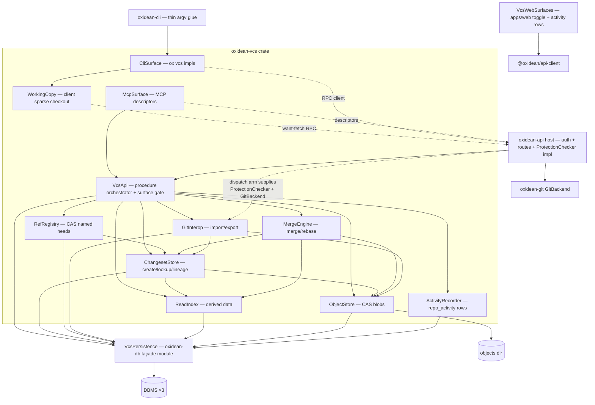

# Domain Design — Components

Side-by-side agentic VCS protocol. All server/CLI/MCP logic lives in the new `oxidean-vcs` crate except where noted (`oxidean-core` wire types, `oxidean-db` persistence module, `apps/web` toggle, `oxidean-api`/`oxidean-cli` thin glue). Decomposition follows the ratified Q1 answer: eight bounded engine components + wire-surface adapters, each owning its entities outright.

```yaml
components:
  - name: VcsApi
    summary: "vcs.* procedure orchestrator and per-repo surface gate — every call enters here"
    behaviour: >
      Receives already-authenticated call context (identity + repo ACL class + repo archived
      bit resolved by the host transport layer) and owns the per-repo enabled flag gate with
      TWO distinct cases: an absent RepoSurfaceFlag row (never-enabled) denies every vcs.*
      procedure including vcs.status with vcs.disabled; an enabled:false row (disabled)
      denies WRITES only — reads still succeed (AC1.2.1 "existing history stays readable";
      the toggle's unchecked-default state consumes both paths). Database::skipped() maps
      to db.not_configured. Applies authorization classes (RepoRead/RepoWrite/admin for
      repo_enable; git_export is write-class), the archived-write denial (host resolves the
      archived bit in call context; write-class procedures fail repo.archived per the
      ensure_not_archived convention, AC1.3.3), validates inputs (malformed ids →
      vcs.invalid_input, missing rows → vcs.not_found), and emits activity rows through
      ActivityRecorder at op granularity. Owns the lazy-import trigger seam: a read
      procedure that misses on a git-oid-shaped input (vcs.changeset_get / vcs.log)
      hands off to GitInterop's lazy import for that commit's ancestor chain, then
      re-resolves (AC7.1.2). Holds no data itself.
    responsibilities:
      - dispatch every vcs.* procedure to its owning component after flag + class gates
      - own the RepoSurfaceFlag entity and the vcs.disabled/vcs.not_configured denials
      - pin the typed error taxonomy (AC8.1.4) at the procedure boundary
      - trigger lazy import on git-oid read misses, then re-resolve
    depends_on:
      - component: ChangesetStore
        interaction: commit/log/read procedures resolve lineage + manifests
        style: sync
      - component: ObjectStore
        interaction: object PUT/GET procedures (RPC + /api/vcs/…/objects routes) stream blobs
        style: sync
      - component: RefRegistry
        interaction: ref_list/ref_update CAS ops
        style: sync
      - component: ReadIndex
        interaction: log/tree/diff/blame/path_history/merge_base reads over index tables
        style: sync
      - component: MergeEngine
        interaction: merge + rebase procedures
        style: sync
      - component: GitInterop
        interaction: git_import/git_export procedures
        style: sync
      - component: ActivityRecorder
        interaction: one activity row per mutating op (AC2.7.1 granularity)
        style: sync
      - component: VcsPersistence
        interaction: RepoSurfaceFlag reads/writes (vcs.repo_enable, flag gate)
        style: sync
    dependents:
      - component: McpSurface
        interaction: tool descriptors map 1:1 onto these procedures
    external_dependencies:
      - name: host authz context (identity + PAT scope resolved by oxidean-api transport)
        kind: other
        purpose: never re-resolves credentials; cookie-only requests are denied upstream
    entities:
      - name: RepoSurfaceFlag
        identifier: repo_id
        attributes: [enabled, enabled_by, enabled_at]

  - name: ObjectStore
    summary: content-addressed blob storage — bytes on disk, metadata rows in DB
    behaviour: >
      PUT writes bytes under OXIDEAN_VCS_OBJECTS_DIR/{ab}/{cd}/{hash} (LFS/packages sharding
      precedent) using temp→rename→row order ("row implies file"), dedups identical
      re-uploads (idempotent no-op), verifies content against the hash, and enforces repo
      size limits → vcs.quota_exceeded. GET streams verified bytes with immutable cache
      headers. ObjectEntry is a GLOBAL CAS row keyed by hash (shared CAS per FR1.5); per-repo
      reference/quota attribution rides ObjectLink rows (repo_id + hash) inserted in the
      committing changeset's transaction. Referenced-ness is COMPUTED at GC time by joining
      links (LFS's self-healing model — repo-delete cascades can't drift a stored counter);
      objects with no live links expire only after a configurable grace window protecting
      the PUT→changeset-create race (AC3.5.x). GC also sweeps row-less files and stale
      *.tmp PUTs, and clears its lock at boot (LFS-cloned gaps closed: lock uses create_new
      with no staleness check upstream). No auth inside — VcsApi gates first.
      Operator surface (env-var docs rule): OXIDEAN_VCS_OBJECTS_DIR, OXIDEAN_VCS_GC_INTERVAL_SECS,
      OXIDEAN_VCS_GC_GRACE_SECS, OXIDEAN_VCS_MAX_OBJECT_BYTES, OXIDEAN_VCS_REPO_QUOTA_BYTES —
      all documented in .env.example + docs/CONFIGURATION.md and wired through the compose
      env block + ./var bind, docs/DEPLOYMENT.md volume table, and .railway/railway.ts,
      with the standard "must not share dir with other content stores" caveat; the objects
      dir joins the factory-reset wipe sweep alongside OXIDEAN_REPOS_DIR/OXIDEAN_LFS_DIR.
    responsibilities:
      - own ObjectEntry + ObjectLink rows and on-disk blob bytes; GC job handoff
      - blob-integrity verification (hash-on-write and hash-on-read boundary)
    depends_on:
      - component: VcsPersistence
        interaction: ObjectEntry + ObjectLink rows
        style: sync
    dependents:
      - component: ChangesetStore
        interaction: commit verifies every referenced blob hash exists
      - component: MergeEngine
        interaction: diff3 text merge reads blob contents
      - component: GitInterop
        interaction: export writes git objects derived from blobs; import may backfill blobs
      - component: VcsApi
        interaction: object PUT/GET procedures
    external_dependencies:
      - name: filesystem objects dir (OXIDEAN_VCS_OBJECTS_DIR)
        kind: object-store
        purpose: sha-sharded immutable blob bytes; streamed reads/writes
      - name: GC background job (oxidean-api jobs/mod.rs precedent)
        kind: other
        purpose: grace-windowed refcounted object expiry (AC3.5.x)
    entities:
      - name: ObjectEntry
        identifier: hash
        attributes: [size, created_at]
      - name: ObjectLink
        identifier: "repo_id + hash"
        attributes: [created_at]

  - name: ChangesetStore
    summary: server-side changeset creation, lookup, and lineage — the WAL-equivalent core
    behaviour: >
      Creates changesets as server-authored, immediately-available records (write-ahead-log
      semantics per the Scion model): parents verified to exist (typed not-found otherwise),
      manifest carries FileChange entries {path, kind, mode, blob_hash}; idempotent resubmit
      returns the existing id for byte-identical input (AC2.2.x); same-parent commits always
      succeed with distinct ids (AC2.3.1); empty-parent commits bootstrap history (AC2.1.4).
      Canonical author identity (Name <email>) is a pinned hash input for deterministic ids.
      On create it transactionally updates ReadIndex rows (incremental derived data, ADR-005)
      and optionally hands new head positions to RefRegistry.
    responsibilities:
      - own Changeset + FileChange entities and the commit/create path
      - idempotency key derivation from canonical inputs
      - transactional trigger of incremental index maintenance
    depends_on:
      - component: ObjectStore
        interaction: verify referenced blob hashes exist AND insert ObjectLink rows — same create tx (AC3.5.2)
        style: sync
      - component: ReadIndex
        interaction: same-transaction incremental update of blame/path-history/graph rows (upsert/merge semantics — concurrent same-parent children must not collide, AC2.3.1)
        style: sync
      - component: VcsPersistence
        interaction: changeset + file-change + import-link-adjacent tables
        style: sync
    dependents:
      - component: VcsApi
        interaction: changeset_create/log/get procedures
      - component: RefRegistry
        interaction: ref_update verifies the target changeset exists
      - component: MergeEngine
        interaction: merge/rebase write their result through the same create path
      - component: GitInterop
        interaction: import creates changesets deterministically; export reads chains
    external_dependencies: []
    entities:
      - name: Changeset
        identifier: changeset_id
        attributes: [repo_id, parents, author, message, committed_at, manifest_hash]
      - name: FileChange
        identifier: "changeset_id + path"
        attributes: [path, kind, mode, old_path, blob_hash]
        references:
          - entity: ObjectEntry
            owned_by: ObjectStore
            relationship: each non-delete FileChange points at one stored blob

  - name: RefRegistry
    summary: minimal named-head pointers with compare-and-swap — never on the commit path
    behaviour: >
      Named heads (e.g. main, agent/task-77) are the ONLY mutable pointers; they are not
      consulted during commit creation (FR5 split). ref_update is strict CAS: expected_old
      must match the stored value or the call fails vcs.ref_conflict carrying the actual
      value; create uses expected-absent; delete uses null target. Fresh repos return an
      empty ref_list — no conventional heads are auto-provisioned (AC5.2.1). Non-idempotent
      retries surface the conflict (no silent swallow).
    responsibilities:
      - own Ref entity; CAS semantics, create/delete, list with pagination
    depends_on:
      - component: ChangesetStore
        interaction: ref targets must resolve to existing changesets
        style: sync
      - component: VcsPersistence
        interaction: ref rows + CAS write path
        style: sync
    dependents:
      - component: VcsApi
        interaction: ref_list/ref_update procedures
    external_dependencies: []
    entities:
      - name: Ref
        identifier: "repo_id + name"
        attributes: [changeset_id, updated_at]
        references:
          - entity: Changeset
            owned_by: ChangesetStore
            relationship: each Ref points at exactly one Changeset head

  - name: ReadIndex
    summary: derived data — history walks, diff, blame, path-history, merge-base over index tables
    behaviour: >
      Materializes derived structures incrementally on changeset create (ADR-005): the
      changeset's delta-from-parent is exactly what the index rows record, so reads are
      O(index) and never walk full chains at request time. Serves vcs.log (graph walk with
      cursor pagination), vcs.tree (paginated manifest listing), vcs.diff, vcs.blame,
      vcs.path_history, vcs.merge_base, vcs.changeset_get, vcs.file_get. Blame rows carry
      per-line {changeset_id, author} attribution (AC4.3.x). vcs.file_get inline payloads
      are size-capped — bulk bytes go through the objects GET route instead of JSON-RPC
      (contract-design owns the bound). Index tables are internal —
      the wire contract doesn't expose them, so the derivation strategy can move to a
      background job later without wire churn.
    responsibilities:
      - own DerivedIndex rows; incremental maintenance from ChangesetStore's create tx
      - serve all read-side derived queries with {limit, cursor} pagination
    depends_on:
      - component: VcsPersistence
        interaction: DerivedIndex tables + changeset/file-change row reads for index
          maintenance and lineage walks (reads the tables directly — no component-level
          edge back into ChangesetStore, which keeps the graph acyclic)
        style: sync
    dependents:
      - component: VcsApi
        interaction: all read procedures
      - component: ChangesetStore
        interaction: create tx calls the incremental update hook (co-designed
          one-way hook — ChangesetStore → ReadIndex only)
      - component: MergeEngine
        interaction: merge_base answered from the commit-graph index
    external_dependencies: []
    entities:
      - name: DerivedIndex
        identifier: "repo_id + kind + key"
        attributes: [kind, key, payload, covering_changeset]
        references:
          - entity: Changeset
            owned_by: ChangesetStore
            relationship: index rows attribute content to the covering Changeset

  - name: MergeEngine
    summary: server-side merge + rebase — diff3 text merge, file-level conflicts elsewhere
    behaviour: >
      merge resolves merge_base via ReadIndex, performs diff3-style line merges for text
      files, and returns file-level conflicts for binary/mode/type/rename cases as typed
      {path, kind} entries in a vcs.conflict envelope (AC2.4.x granularity — pinned in
      user-stories). Clean merges produce a merge changeset (two parents) through
      ChangesetStore's normal create path. rebase replays a chain onto a target and emits
      the same conflict shape (AC2.5.2). No ref is moved implicitly — ref advance stays a
      separate CAS op (G5 invariant). diff3 work is CPU-bound: it runs under spawn_blocking
      offload with input caps (blob size + changed-file count), not on the async executor.
    responsibilities:
      - own merge/rebase computation and conflict classification
    depends_on:
      - component: ChangesetStore
        interaction: read input chains; write merge/rebase result changesets
        style: sync
      - component: ObjectStore
        interaction: blob contents for diff3 inputs
        style: sync
      - component: ReadIndex
        interaction: merge_base lookup
        style: sync
    dependents:
      - component: VcsApi
        interaction: merge + rebase procedures
    external_dependencies: []
    entities: []

  - name: GitInterop
    summary: deterministic Git import + export — the human-trust landing path
    behaviour: >
      Import is explicit (vcs.git_import): walks Git history via the GitBackend port,
      creates changesets with deterministic ids (pinned canonical inputs incl. author
      identity), and records ImportLink rows so git_oid ↔ changeset_id is queryable
      (AC7.1.1). Export (vcs.git_export) converts a changeset chain to commits and moves
      ONE Git branch through the same protection-verdict path as git push (AC7.2.2):
      ProtectionChecker is a trait defined HERE (port); oxidean-api supplies the real
      protection-hook implementation at dispatch — dependency direction host→crate
      preserved (ADR-006). The branch move goes through GitBackend's hook-driven path
      (fast_forward_ref / force_update_ref — temp worktree → receive-pack → hooks/update),
      NEVER the bare update_ref primitive which bypasses hooks and can clobber a concurrent
      push. --force overrides fast-forward only, never protection verdicts. Import is
      bounded (commits-per-call cap + resumable cursor — contract-design owns the exact
      bound); export pays an O(repo) temp clone per call, accepted for v1 (recorded debt).
      Lazy import (AC7.1.2): exposes a single-chain entry point VcsApi calls when a read
      misses on a git-oid-shaped input — walks that commit's ancestor chain through the
      GitBackend port, creates the deterministic changesets, writes ImportLink rows,
      returns; VcsApi then re-resolves. Shares the same commits-per-call bound as
      explicit import.
    responsibilities:
      - own ImportLink entity; deterministic import hashing; export conversion + branch move
      - single-chain lazy-import entry point for the read-miss path (AC7.1.2)
    depends_on:
      - component: ChangesetStore
        interaction: import creates changesets; export reads chains
        style: sync
      - component: ObjectStore
        interaction: blob read/backfill during conversion
        style: sync
      - component: VcsPersistence
        interaction: ImportLink rows
        style: sync
    dependents:
      - component: VcsApi
        interaction: git_import/git_export procedures
    external_dependencies:
      - name: GitBackend (oxidean-git, Arc<dyn> passed by host)
        kind: other
        purpose: commit conversion + Git ref write for import/export
      - name: ProtectionChecker (trait port defined in-crate, implemented by oxidean-api)
        kind: other
        purpose: identical protection verdicts to git push — the trust invariant
    entities:
      - name: ImportLink
        identifier: "repo_id + git_oid"
        attributes: [changeset_id, imported_at]
        references:
          - entity: Changeset
            owned_by: ChangesetStore
            relationship: each ImportLink maps one Git commit to one Changeset

  - name: WorkingCopy
    summary: client-side sparse checkout — manifest filter, want-fetch, materialize, cache
    behaviour: >
      Client-side only (AC3.4.1): resolves a changeset manifest via vcs.changeset_get,
      filters paths locally, fetches ONLY the needed blob hashes (want-based, no
      have-negotiation), dedups through a shared local object cache (bounded, AC6.2.x —
      repeated checkouts fetch 0 blobs), and materializes files with mode/symlink fidelity
      (US6.3). Non-empty/conflicting target dirs fail as a typed local error (AC6.1.3),
      not a vcs.* code. Returns a typed CheckoutResult {files_written, blobs_fetched,
      cache_hits, skipped_outside_filter} — the contract the CLI's pinned output lines
      ("materialized N files (skipped M blobs outside filter)" / "0 fetched — all cached")
      render from. Cache dir + bound are CLI-local config (XDG/flag), not OXIDEAN_* server
      vars. Never touches server state — pure library in oxidean-vcs, no DB/server deps
      (client feature — ADR-011).
    responsibilities:
      - own CheckoutCache entity (local, never crosses the wire)
      - sparse fetch planning + materialization + CheckoutResult reporting
    depends_on: []
    dependents:
      - component: CliSurface
        interaction: checkout command delegates to WorkingCopy
    external_dependencies:
      - name: vcs.* RPC transport (host-provided client)
        kind: other
        purpose: changeset_get + object GETs against the server
    entities:
      - name: CheckoutCache
        identifier: cache_dir
        attributes: [entries, size_bytes, last_used_at]

  - name: CliSurface
    summary: "ox vcs command implementations — argv-parse results → Out::Rpc responses"
    behaviour: >
      Implements the 16-command set (enable status commit log diff show cat blame history
      merge-base merge rebase checkout ref import export; show/cat are DISTINCT commands).
      Server-backed commands produce Out::Rpc {envelope, pretty} — verbatim envelope under
      --json, typed errors on stderr as `ox: <code>: <message>`, exit via
      rpc::error_exit_code (vcs.unauthenticated/vcs.forbidden join the auth tier at 3 —
      match-list extension recorded in the mockups). checkout delegates to WorkingCopy and
      may surface local typed errors; empty results print the pinned zero-state lines
      ("no changesets" / "[]"). oxidean-cli keeps only thin argv glue; the dependency
      edge cli→vcs uses the crate's client feature so no server deps (sqlx/oxidean-git)
      get dragged into `ox` (ADR-007/ADR-011).
    responsibilities:
      - command impls, flag parsing (--change grammar path:kind:mode:blobspec, CAS
        --expect/--expect-absent/--delete, --json, pagination flags incl. --all,
        --lookup on import)
      - "ox: prefixed human text, zero-state lines, non-zero exit discipline"
    depends_on:
      - component: WorkingCopy
        interaction: checkout materialization
        style: sync
    dependents: []
    external_dependencies:
      - name: ox RPC client transport (oxidean-cli provides at call time)
        kind: other
        purpose: POST /api/rpc with Bearer PAT; ox api vcs.* stays the escape hatch
    entities: []

  - name: McpSurface
    summary: MCP tool descriptors for the 12-tool agent surface
    behaviour: >
      Emits name/description/input-schema descriptors for the FR13.1 tool set
      (vcs_status, vcs_log, vcs_diff, vcs_tree, vcs_file_get, vcs_blame, vcs_path_history,
      vcs_merge_base, vcs_changeset_create, vcs_merge, vcs_rebase, vcs_ref_list). Args carry
      separate owner/name fields — the convention the host's fg_repo_access_check reads.
      Deliberate absences (not shipped as tools): vcs_repo_enable, vcs_ref_update,
      vcs_changeset_get (contract-design owns whether to add), vcs_git_import,
      vcs_git_export, checkout. oxidean-api::mcp wraps them with Access gating and maps
      domain denials to isError tool content.
    responsibilities:
      - tool descriptor generation from the same procedure metadata as the RPC surface
        (1:1 for the FR13.1 subset — the absence list is deliberate, not a mirror gap)
      - arg-shape parity with RpcRequest input conventions
    depends_on:
      - component: VcsApi
        interaction: descriptors mirror its FR13.1 procedure subset
        style: sync
    dependents: []
    external_dependencies:
      - name: oxidean-api MCP endpoint (Access gate + isError mapping)
        kind: other
        purpose: transport + authorization wrapper
    entities: []

  - name: ActivityRecorder
    summary: writes repo_activity rows through the oxidean-db façade — op-granular
    behaviour: >
      One row per mutating vcs op (AC2.7.1), attributed to the authenticated identity. The
      vcs.* activity kind strings are declared as constants in oxidean-core (ADR-002
      pattern) so BOTH ends share them: this recorder writes them and the host's
      VALID_PUSH_TYPES filter allow-list (oxidean-api repo/activity.rs — currently private,
      gates the push_type param to rpc.bad_input) extends from the same constants — without
      that extension, kind-filtering 400s on vcs.* kinds (AC2.7.3). Never per-object rows.
      Calls Database::insert_repo_activity directly — the dependency-correct path
      (crate→db façade, no host callback). Constraint handed to contract-design: the façade
      signature is push-shaped (ref_name/before_oid/after_oid/commits_count are required
      fields) — refless ops (changeset_create touching no ref, repo_enable) need either
      nullable push columns or a generalized signature; the op→row mapping table and the
      nullability call are contract/functional-design owned.
    responsibilities:
      - activity row composition at the right granularity
    depends_on:
      - component: VcsPersistence
        interaction: insert_repo_activity façade call
        style: sync
    dependents:
      - component: VcsApi
        interaction: called once per mutating procedure
    external_dependencies: []
    entities: []

  - name: VcsWebSurfaces
    summary: the web-UI delta — repo-settings VcsToggle control + activity-feed kind rendering
    behaviour: >
      Two surfaces in apps/web. (1) VcsToggle: Octane .tsrx checkbox in the "Source control
      protocols" section of [owner]/[repo]/settings — reads the flag via vcs.status
      (vcs.disabled on a never-enabled repo renders unchecked-default, not error), mutates
      via vcs.repo_enable, carries loading/saving/success/error/read-only states per the
      interaction spec; note the "caller lacks admin class" disabled-input prong is a DEAD
      state (the settings page gates on can_admin wholesale — non-admins never render it);
      meets the WCAG checklist. (2) Activity-feed integration: repo-activity-row's
      actionCopy/commitHref must render vcs.* kinds instead of falling through to
      "pushed to {branch}" + a commit link (a cs_ id would produce a git-commit 404), and
      the activity filter chips gain the vcs.* kinds — the consumer side of AC2.7.x.
    responsibilities:
      - the only human-facing surfaces; delegates all domain logic to VcsApi
    depends_on: []
    dependents: []
    external_dependencies:
      - name: "@oxidean/api-client (generated typed client)"
        kind: other
        purpose: vcs.status read + vcs.repo_enable mutation via TanStack Query/Form
    entities: []

  - name: VcsPersistence
    summary: the oxidean-db façade module — VCS tables, row types, migrations ×3 dialects
    behaviour: >
      Holds ALL dialect SQL for the feature (hard boundary — nothing outside oxidean-db
      writes SQL). Migrations land ×3 under migrations/{postgres,mysql,sqlite} with
      filename parity; façade methods take the usual Database-by-value signature and fail
      closed when Database::skipped() (db.not_configured). insert_repo_activity is the
      pre-existing façade method ActivityRecorder reuses. Deletion cascades ride the repo
      row; CAS objects are refcounted and never eagerly deleted (US1.3/GC rules).
    responsibilities:
      - own table DDL ×3 + façade methods + row types for every entity above
    depends_on: []
    dependents:
      - component: VcsApi
        interaction: RepoSurfaceFlag + activity-adjacent reads
      - component: ObjectStore
        interaction: ObjectEntry rows
      - component: ChangesetStore
        interaction: changeset/file-change tables
      - component: RefRegistry
        interaction: ref table + CAS write
      - component: ReadIndex
        interaction: DerivedIndex tables
      - component: GitInterop
        interaction: ImportLink rows
      - component: ActivityRecorder
        interaction: insert_repo_activity
    external_dependencies:
      - name: DBMS (Postgres / MySQL / SQLite via sqlx)
        kind: database
        purpose: the only dialect-SQL site; parity-gated
    entities: []
```

## Component Diagram



## Component Summary

| Component | Lives in | Purpose | Depends On | Dependents | Entities Owned |
|---|---|---|---|---|---|
| VcsApi | oxidean-vcs | procedure orchestrator + surface gate | ChangesetStore, ObjectStore, RefRegistry, ReadIndex, MergeEngine, GitInterop, ActivityRecorder, VcsPersistence | McpSurface | RepoSurfaceFlag |
| ObjectStore | oxidean-vcs | CAS blob bytes + refcounts + GC handoff | VcsPersistence | ChangesetStore, MergeEngine, GitInterop, VcsApi | ObjectEntry, ObjectLink |
| ChangesetStore | oxidean-vcs | changeset create/lookup/lineage, idempotent resubmit | ObjectStore, ReadIndex, VcsPersistence | VcsApi, RefRegistry, MergeEngine, GitInterop | Changeset, FileChange |
| RefRegistry | oxidean-vcs | CAS named heads | ChangesetStore, VcsPersistence | VcsApi | Ref |
| ReadIndex | oxidean-vcs | derived-data reads + incremental maintenance | VcsPersistence (changeset rows read at table level) | VcsApi, ChangesetStore, MergeEngine | DerivedIndex |
| MergeEngine | oxidean-vcs | diff3 merge, file conflicts, rebase replay | ChangesetStore, ObjectStore, ReadIndex | VcsApi | — |
| GitInterop | oxidean-vcs | deterministic import (explicit + lazy read-miss path); export via ProtectionChecker/GitBackend ports | ChangesetStore, ObjectStore, VcsPersistence | VcsApi | ImportLink |
| WorkingCopy | oxidean-vcs | client sparse fetch/materialize/cache | — (RPC transport external) | CliSurface | CheckoutCache |
| CliSurface | oxidean-vcs | `ox vcs` command impls → Out::Rpc | WorkingCopy | — (oxidean-cli calls it) | — |
| McpSurface | oxidean-vcs | MCP tool descriptors | VcsApi | — (oxidean-api::mcp consumes) | — |
| ActivityRecorder | oxidean-vcs | op-granular repo_activity rows | VcsPersistence | VcsApi | — |
| VcsWebSurfaces | apps/web | settings toggle + activity-row rendering/filter chips | — (api-client external) | — | — |
| VcsPersistence | oxidean-db | tables/rows/migrations ×3 dialects | — (DBMS external) | all store components + VcsApi + ActivityRecorder | — |

## Entity Ownership

| Entity | Owning Component | Identifier | Attributes | References |
|---|---|---|---|---|
| RepoSurfaceFlag | VcsApi | repo_id | enabled, enabled_by, enabled_at | — |
| ObjectEntry | ObjectStore | hash (global CAS row) | size, created_at | — |
| ObjectLink | ObjectStore | repo_id + hash | created_at | — (joins ObjectEntry same-component; refcount = live link count) |
| Changeset | ChangesetStore | changeset_id | repo_id, parents, author, message, committed_at, manifest_hash | — |
| FileChange | ChangesetStore | changeset_id + path | path, kind, mode, old_path, blob_hash | → ObjectEntry |
| Ref | RefRegistry | repo_id + name | changeset_id, updated_at | → Changeset |
| DerivedIndex | ReadIndex | repo_id + kind + key | kind, key, payload, covering_changeset | → Changeset |
| ImportLink | GitInterop | repo_id + git_oid | changeset_id, imported_at | → Changeset |
| CheckoutCache | WorkingCopy | cache_dir | entries, size_bytes, last_used_at | — |

`repo_activity` rows deliberately absent from this table — owned by the existing repo domain in `oxidean-db`; ActivityRecorder writes through its façade method.

## External Dependencies

| Component | Dependency | Kind | Purpose |
|---|---|---|---|
| VcsApi | host authz context | other | identity + PAT scope resolved upstream; cookies never authorize |
| ObjectStore | `OXIDEAN_VCS_OBJECTS_DIR` filesystem | object-store | sha-sharded immutable blob bytes |
| ObjectStore | GC job (`jobs/mod.rs` precedent) | other | grace-windowed refcounted expiry |
| GitInterop | `GitBackend` (oxidean-git) | other | commit conversion + Git ref writes |
| GitInterop | `ProtectionChecker` port (host impl) | other | identical protection verdicts to `git push` |
| WorkingCopy | `vcs.*` RPC transport | other | changeset_get + object GETs (first-party API) |
| CliSurface | ox RPC client transport | other | POST /api/rpc Bearer PAT (first-party API) |
| McpSurface | oxidean-api MCP endpoint | other | Access gate + isError mapping |
| VcsWebSurfaces | `@oxidean/api-client` | other | typed vcs.status/vcs.repo_enable calls |
| VcsPersistence | Postgres/MySQL/SQLite (sqlx) | database | sole dialect-SQL site |

## Rationale

| Component | Why separate |
|---|---|
| VcsApi | single gate point — flag check + authz class + typed taxonomy stay uniform across 17 procedures; changes when the surface contract changes |
| ObjectStore | distinct lifecycle (immutable bytes + GC) and storage medium (FS dir) from row data; LFS-precedent pattern is proven |
| ChangesetStore | the WAL core — highest write rate, strictest invariants (idempotency, canonical hashing); must stay small and verifiable |
| RefRegistry | the ONLY mutable pointer surface; CAS semantics are a distinct correctness domain from append-only changesets |
| ReadIndex | derived data has a different change rate and scale profile; isolating it lets derivation strategy evolve behind the wire contract |
| MergeEngine | conflict computation is self-contained pure-ish logic over blobs+index — separately testable |
| GitInterop | touches a foreign model (Git oids/objects); the ProtectionChecker port keeps the trust invariant explicit |
| WorkingCopy | client-side only; changes with CLI/UX needs, not server needs; sharing it keeps CLI thin |
| CliSurface | output/flag conventions live close to `ox` but the logic is shareable (e.g. reuse in future harness surfaces) |
| McpSurface | descriptor generation is one narrow translation — kept thin so the RPC surface stays source of truth |
| ActivityRecorder | isolates the one cross-domain write (repo_activity) and its allow-list rule |
| VcsWebSurfaces | the only browser surfaces — settings toggle (Octane) + activity-row kind rendering/consumer-side feed integration |
| VcsPersistence | hard dialect boundary: sole SQL site, migration parity ×3, façade-by-value |

**Decomposition option block (Q1).** Option A (single VcsEngine) was rejected: it would merge storage, lineage, merge, interop, and client code with different change rates into one blob, weakening testability and entity ownership. Option B (the catalogue above) was chosen — see ADR-001.

## Integration seams (host components — not new)

- `oxidean-api`: `PROCEDURES`/`dispatch` arms + `proc_classes` + `rpc_gen.rs` template rows for `vcs.*`; route nest under `/api/vcs/` (`DefaultBodyLimit` raised on the objects PUT route — Axum's 2 MiB default would 413 before the quota check; LFS precedent sets 2 GiB); `AppState` gains `Arc<dyn …>` VCS slot (GitBackend-slot precedent); dispatch supplies `ProtectionChecker` impl + `Arc<dyn GitBackend>`; write-class `vcs.*` dispatch arms call `ensure_not_archived` like other repo writes; `VALID_PUSH_TYPES` extends with the `vcs.*` kind constants from `oxidean-core`; MCP `Access` gating wraps McpSurface descriptors; factory-reset sweep gains `OXIDEAN_VCS_OBJECTS_DIR`; GC job joins `jobs/mod.rs` spawn list (stats logged via `tracing::info`, `LfsGcStats` precedent).
- `oxidean-cli`: argv glue only — `Command` variants + USAGE rows + `required_procedures` manifest entries; depends on `oxidean-vcs` with the `client` feature only (ADR-011 — no sqlx/oxidean-git in `ox`).
- `oxidean-core`: wire DTOs + `proc_classes` `vcs.*` entries (ADR-002) + shared `vcs.*` activity-kind constants.
- `apps/web`: `VcsToggle` in settings + `repo-activity-row`/`actionCopy`/`commitHref` updates for `vcs.*` kinds + activity filter chips (VcsWebSurfaces).
- Repo meta: `versioning.toml` gains the `oxidean-vcs` component registration + scope mapping (FR15.4), and `docs/ARCHITECTURE.md`'s decision log cites the ADR ids from `decisions.md`.
