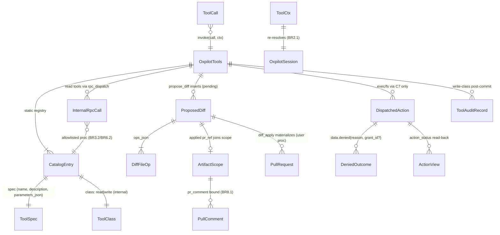

# Functional Spec — oxpilot-tools (U5)

## Sources

- [unit] `inception/units-generation/unit-of-work.md` §U5 — repo read
  tools, Actions run/job/log reads (read-only), ProposedDiff creation +
  patch view, branch+PR materialization on explicit confirm with PR-body
  provenance, agent-artifact comments only, per-tool authorization +
  write-tool audit, exec/fs tool definitions + validation dispatching
  into `ConnectorGateway` ("tools never reach a target directly; they
  enqueue `Action` rows").
- [stories] `unit-of-work-story-map.md` — US2.1/US2.2/U2.3 (proposals +
  materialization), US3.1/US3.2 (CI read surface + fix proposals),
  US4.3 (exec/fs through U5→U6→U7), US5.3 (audit split), US5.5
  (permissions + registration rules).
- [contract] `contract-summary.md` — C1 `oxpilot.diff_{list,get,apply}`
  (payload `ProposedDiff{id, session_id, base, files[{path, patch}],
  status}`; errors `[forbidden, not_found, diff_not_pending]`); C6
  `ToolExecutor{catalog, invoke}` + `ToolCtx`/`ToolOutput`/`ToolError`;
  C7 `dispatch_action`/`action_status` + `Denied{reason, grant_id?}`.
- [req] FR2.3, FR3.1–FR3.3, FR4.1–FR4.3, FR5.2/FR5.3/FR5.5,
  FR7.1–FR7.5; NFR1/NFR2/NFR5/NFR9.
- [u3-fd] `construction/agent-runtime/functional-design/` — WF2: turn
  start pins `{provider, model, executor}` via `turn_parts()`;
  `invoke_call` mints `ToolCtx{proposal_id: None}`, persists the card
  durable-first, races `invoke` under TOOL_CALL_TIMEOUT=60 s +
  cancellation + turn wall, bounds MAX_TOOL_ROUNDS=8.
- [u6-fd] `construction/connector-gateway/functional-design/` — WF2:
  dispatch check order session→target→caps→live grant→pending dedupe→
  insert; `consent_required` denial carries `grant_id`; U5 output on
  consent = "consent requested (grant_id)" + U8 renders from
  `grant_get`.
- [shipped] `oxidean-api-core/src/oxpilot.rs` — `ToolSpec` (3 fields —
  no class member), `ToolCtx`, `ToolOutput`, `ToolError`, `NullTools`
  (`invoke` ⇒ code `no_tools`), `denied()`/`denied_reason`,
  `ActionView` (7-state vocab), `dispatch_action`/`action_status`/
  `list_targets` — every gateway verb takes `client: &ClientMeta`
  first and server-side callers pass `&ClientMeta::default()`;
  `dispatch_action` returns the full `OxpilotActionRow` — and
  `OxpilotRuntimeSlot.tools` carried across rebuilds;
  `oxidean-api-oxpilot/src/runtime.rs` — `emit_frame` `pub(crate)`
  frame sink taking `&ActiveTurn` (session.rs's `card{queued}`
  precedent — reached via `state.oxpilot.turns().get(session_id)`;
  `OxpilotTools` therefore lives inside `oxidean-api-oxpilot`);
  `oxidean-api-core/src/app.rs` — `build_rpc_ctx_with_session` +
  `AppState.rpc_dispatch` + the `AppState.oxpilot` port
  (`sessions()`/`gateway()`/`turns()` — `AppState.sessions` is the
  AUTH SessionService, not the oxpilot seam); `oxidean-db` —
  `oxpilot_proposals` (0087) + `insert_/find_/mark_oxpilot_proposal_*`
  DB verbs (service verbs: `save_proposal`, `proposal`,
  `mark_applied(user_id, proposal_id, pr_ref)`);
  `audit::record_with(db, client, actor, event, target, detail)`;
  `pull.comments.create` shipped in oxidean-api-pulls (unanchored ⇒
  general PR conversation comment).

## Scope

Owns the model-callable tool surface and the user-facing
`oxpilot.diff_*` procs that materialize its output. Does NOT own the
turn loop (U3), session persistence (U2), the gateway/grant machinery
(U6), the connector (U7), or card rendering (U8). The catalog is a
closed registry of flat provider-legal names backed by existing
procedures — U5 adds the `diff_*` proc trio; every other proc it
touches already ships.

## Entity view (derived from entities.md)

## Rules summary (derived from rules.md)

| Group | Rules | Essence |
|---|---|---|
| Catalog | BR1.1–1.4 | closed static registry; provider-legal flat names; `unknown_tool`; schema gate |
| Binding | BR2.1–2.5 | re-resolve session; session-bound repo injection; `ToolCtx` sole identity; internal class; per-class write gates |
| Repo reads | BR3.1–3.4 | `rpc_dispatch`-only; literal allowlist; arg bounds; verbatim error mapping |
| Proposals | BR4.1–4.6 | pending insert; zero git mutation; diff↔ops coherence; bounds; diff card; session-scoped get |
| Materialize | BR5.1–5.7 | user-only `diff_apply`; ordered branch→ops→PR; provenance line; `pr_ref` + audit; never push/merge/default; fail-stop |
| Actions | BR6.1–6.4 | six read tools; control procs absent; bounded log reads, no `wait_ms` |
| Computer-use | BR7.1–7.7 | C7-only dispatch; per-kind schemas ≤ 2 KiB; target resolution; `denied` marker mapping; async status; no raw-arg retention |
| Comments | BR8.1–8.3 | ArtifactScope bound; `pull.comments.create` (unanchored); bounded + redacted body |
| Audit | BR9.1–9.5 | post-commit write events; read exemption; redacted detail; output ceilings |

## Workflows

### WF1 — Catalog pin + invocation cycle (BR1, BR2)

1. Turn start: U3's `provider_for_turn()`/`turn_parts()` reads the slot
   ONCE — `OxpilotTools` travels inside that pin (`slot.tools` survives
   provider/settings rebuilds, oxpilot.rs:1046). `catalog()` output is
   the `ToolSpec` set the provider sees; a `None` executor ⇒ `NullTools`
   (empty catalog, code `no_tools` — "no tool executor installed" — on
   any call; `unknown_tool` is U5's own registry-miss code, BR1.3) —
   the U5 failure mode is already shipped.
2. Provider emits `tool_calls`; the loop mints `call_id` if absent,
   persists the card row durable-first (running), then calls
   `invoke(call, ToolCtx{session_id, user_id, repo_id, proposal_id:
   None})` under the 60 s race.
3. `invoke`: registry lookup ⇒ `unknown_tool` on miss (BR1.3) → schema
   validate ⇒ `invalid_args` on miss (BR1.4) → `get_session(user_id,
   session_id)` ⇒ `not_found` on dead/foreign (BR2.1) → handler by
   `CatalogEntry.class` (BR2.4).
4. Handler returns `ToolOutput` (bounded, summary redacted) or
   `ToolError`; U3 maps both into the card + provider feedback.
   Write-class handlers may also have emitted `card{...}` frames and
   (post-commit) audit rows inside step 3.

### WF2 — Repo/issue/pull read (BR2, BR3)

1. Handler receives validated args (e.g. `repo_file_read{path, ref?}`).
2. Resolve session (BR2.1); inject `{owner, name}` from the session's
   repo binding; default `ref` to the session branch (BR2.2/BR3.3).
3. Synthesize `RpcCtx` via `build_rpc_ctx_with_session` on the ctx's
   `user_id` + `ClientMeta::default()` — session-equivalent context so
   `require_verified`-class proc guards still execute (BR3.1).
4. `(ctx.rpc_dispatch)(&mut ctx, RpcRequest{procedure, input})` — the
   proc's repo read ACL/feature flags apply verbatim.
5. `RpcResponse::Err` ⇒ `ToolError` with the proc code verbatim
   (BR3.4). `Ok` ⇒ bound to TOOL_OUTPUT_MAX (+`truncated` marker),
   `oxidean_core::redact` the summary, return `ToolOutput`. No audit row (BR9.2);
   the durable card is the read trail.

### WF3 — CI inspection (BR6)

1. `actions_list_runs{status?, branch?, workflow?, per_page?}` /
   `actions_get_run{run_id}` / `actions_get_job{job_id}` /
   `actions_job_annotations{run_id, job_id?}` / `actions_list_workflows`
   — same WF2 pipeline against the six pinned read procs (BR6.2);
   `run_id`/`job_id` are opaque ids, never treated as repo refs.
2. `actions_get_job_log{run_id, job_id, offset?}`: never passes
   `wait_ms` (BR6.4). `repo.actions.getJobLog` returns
   `ActionJobLogResponse{content, next_offset, size, done}` — `offset`
   is an input-only field; the tool output carries `{content
   (tail-bounded), next_offset, done}` derived from that response so
   the model pages a large log across calls within the 32 KiB cap.
3. Failure analysis (US3.2): the model reads run → jobs → failed job →
   log tail + annotations, then proposes a fix THROUGH WF4 — the CI
   surface can never reach a rerun/cancel/approve/dispatch verb
   (BR6.3: absence, not filtering).

### WF4 — `propose_diff` (BR4)

1. Validate `{title ≤200, files ≤50 (MAX_PROPOSAL_FILES — pinned to
   the shipped `UPLOAD_MAX_FILES` so the single batched upload stays
   reachable), diff_body ≤256 KiB}` + per-op
   rules (rename needs `new_path`; create/update need `content_b64`)
   (BR4.4).
2. Coherence: `set(files[].path ∪ new_path) == set(diff --git header
   paths)` (BR4.3) — mismatch ⇒ `invalid_args` naming the disagreeing
   paths, no insert.
3. `svc.save_proposal{session_id, title, base: session.branch,
   diff: diff_body}` + `ops_json` — `status: pending`, `pr_ref: null`
   unconditionally (BR4.1/BR4.2). `diff_body`/`title` are redacted
   INSIDE `save_proposal` via `oxidean_core::redact` (free function)
   at the service boundary like every user-visible body.
4. Emit `card{card_kind:"diff", ref_id: proposal_id}` via
   `state.oxpilot.turns().get(ctx.session_id)` → `emit_frame` (the
   `card{queued}` precedent — U8 renders the
   diff card + patch view from `oxpilot.diff_get`; a terminalled turn
   drops the emit silently, BR4.5), then
   `oxpilot.proposal_created` audit (BR9.1), then `ToolOutput`
   "proposal <id> created — pending review".
5. `proposal_get{proposal_id}` (read) returns the session-owned row
   with `files[]` derived from `diff_body` headers; `svc.proposal` is
   user-scoped, so the tool pins post-fetch `row.session_id ==
   ctx.session_id` — foreign/other-session ⇒ `not_found` (BR4.6).

### WF5 — `oxpilot.diff_apply` — explicit-confirm materialization (BR5)

USER proc, no model-callable equivalent (BR5.1):

1. Gates: session auth → `require_enabled` → `require_verified` →
   owned session (foreign ⇒ `not_found`).
2. `svc.proposal(user_id, proposal_id)` ⇒ `not_found` — user-scoped:
   a same-user OTHER-session proposal is deliberately reachable here
   (the repo binding comes from the row's own session; the
   same-session pin applies only to the model-facing read path,
   BR5.2/BR4.6);
   `status != pending` ⇒ `diff_not_pending` (BR5.2).
3. On the CALLER's `ctx.rpc_dispatch` (real session ctx — BR5.3):
   a. `repo.branchCreate{owner, name, branch:
      "oxpilot/proposal-<id8>", start: proposal.base}` — exists ⇒
      `apply_failed:branch_exists` (BR5.7).
   b. `ops_json` in order — `repo.file.upload` batches all
      create/update ops into ONE commit (≤ `UPLOAD_MAX_FILES` = 50 ops
      per upload call — the bound MAX_PROPOSAL_FILES is pinned to,
      BR5.3); `repo.file.delete` /
      `repo.file.rename` one call per op. A failure ⇒
      `apply_failed:<proc>`; the proposal stays `pending` (BR5.7).
   c. `pull.create{base_ref: proposal.base, head_ref: <branch>,
      title: proposal.title, body: summary + provenance}` where
      provenance is `Produced by an /oxpilot agent session:
      <session_id> (proposal <proposal_id>).` (BR5.4).
4. `svc.mark_applied(user_id, proposal_id,
   "owner/name#<number>")` → `oxpilot.diff_applied` audit →
   `{proposal_id, pr_ref}` (BR5.5 — the service re-enforces ownership +
   `status != "pending" ⇒ diff_not_pending`; the proc re-checks). The
   applied row feeds
   `ArtifactScope` for WF7 and `diff_get`/`diff_list` render `pr_ref`.
5. Never: push to an existing branch, force-update a ref, merge, or
   write the default branch (BR5.6).

### WF6 — exec/fs dispatch (BR7)

1. Schema validate per-kind args (BR7.2 — serialized ≤ 2 KiB).
2. Resolve `target_id` (BR7.3): arg present ⇒ dispatch with it;
   absent ⇒ `list_targets` → one with `lifecycle == "connected"` ⇒
   auto-select; zero ⇒
   `ToolError{no_target}`; multiple ⇒ `ToolError{ambiguous_target}`
   whose message tells the model to pass `target_id` (code is
   internal-only — guidance rides the message string, BR3.4).
3. `gateway.dispatch_action(&ClientMeta::default(), user_id,
   session_id, target_id, kind, args)` — the gateway runs its own
   session→target→caps→grant chain. Success returns the full
   `OxpilotActionRow`; the tool reads `id`/`state` off it.
4. Outcome mapping (BR7.4):
   - Success ⇒ `ToolOutput` `{action_id, state: queued}` + summary —
     the tool does NOT wait for the connector (BR7.5).
   - `oxpilot.action_denied` + `data.denied.reason`:
     `consent_required` ⇒ emit `card{card_kind:"consent", ref_id:
     grant_id}` + `ToolOutput` "consent requested — grant <grant_id>
     pending; the action queues on approval, so do not re-issue this
     call" (a success result — a pending grant is progress). `respond_grant` on allow
     MATERIALIZES the Action atomically from the pending grant's
     stored `action_kind`/`action_args`, audits
     `oxpilot.action_dispatched`, and calls `notify_waiters` — the
     action queues on user approval with NO model involvement. An
     identical re-dispatch while the grant is still `pending`
     dedupes to the same `grant_id`; after approval the model MUST
     NOT re-issue — under `action_once` scope the consumed grant no
     longer matches the pending-grant dedupe so a SECOND pending
     grant mints (second consent card, second execution if
     approved), and under `action_session` scope the live-grant arm
     inserts a SECOND identical action. The model holds `grant_id`,
     not `action_id`, and no grant→action lookup exists
     (`action_status` takes `action_id` only) — the tool output does
     not promise status follow-up on the consent path.
     `not_connected`|`offline`|`capability` ⇒ `ToolError
     {action_denied}` carrying the reason. Malformed/absent marker ⇒
     `ToolError{internal}` — fail closed (BR7.4).
   - Any other `AppError` ⇒ verbatim code mapping (BR3.4).
5. `action_status{action_id}` (read) surfaces `ActionView` via
   `gateway.action_status(&ClientMeta::default(), user_id,
   action_id)` — `state`
   `done`/`failed`/`cancelled` carry the gateway-redacted
   `result_summary`
   (BR7.5/BR7.6). `targets_list{}` enumerates the user's targets for
   `target_id` selection.

### WF7 — `pr_comment` (BR8)

1. Resolve session; build ArtifactScope = `pr_ref`s of THIS session's
   `applied` proposals (BR8.1).
2. `owner/name#<args.number>` ∈ scope else `ToolError{forbidden}`.
3. `body`: non-empty, ≤ 4 KiB, `oxidean_core::redact` applied by the
   handler pre-dispatch (BR8.3) → `pull.comments.create{owner, name,
   number, body}` via the WF2 dispatch path — no `path`/`side`/`line`,
   so the comment lands as a general PR conversation comment (BR8.2).
   `issue.comments.create` is unreachable here on purpose: PRs share
   the issue number counter but live in `pull_requests`/`pull_comments`,
   not the issues table.
4. Audit `oxpilot.artifact_comment{session_id, pr_ref, comment_id}`
   post-commit (BR9.1); `ToolOutput` "comment posted on
   <owner/name#number>".

## Contract deltas this unit carries

- **C1 additive procs** — `oxpilot.diff_list{session_id} →
  {diffs: [ProposedDiff]}`, `oxpilot.diff_get{proposal_id} →
  ProposedDiff (+pr_ref when applied)`, `oxpilot.diff_apply
  {proposal_id} → {proposal_id, pr_ref}` registered on the
  `oxpilot.*` PROCEDURES set (SessionOnly, `require_enabled`,
  `require_verified` on the write). `files[]` derives from `diff_body`
  `diff --git` headers — the wire shape matches C1 verbatim.
- **C6 carried verbatim with two notes** — shipped `ToolSpec` is
  `{name, description, parameters_json}` (the C6 sketch's `class`
  member stays internal on `CatalogEntry` — deviation D-01);
  `ToolCtx.proposal_id` ships `None` from `invoke_call` — tools bind
  proposals via explicit validated args instead (gap G-2, Q8-A).
- **C7 consumed verbatim** — `dispatch_action`/`list_targets`/
  `action_status`; the `Denied{reason, grant_id?}` marker read out of
  `AppError.data` (never message-sniffed).
- **Tool names resolved** — C1's open question ("exact repo-read tool
  names vs existing procs") resolves to the flat `domain_verb` set in
  BR1.2/BR3.2/BR6.2 (Q1-A): `repo_tree`, `repo_file_read`, `repo_log`,
  `repo_commit_get`, `repo_refs`, `issue_list`, `issue_get`,
  `pull_list`, `pull_get`, `actions_list_runs`, `actions_get_run`,
  `actions_get_job`, `actions_get_job_log`, `actions_list_workflows`,
  `actions_job_annotations`, `propose_diff`, `proposal_get`,
  `targets_list`, `exec_shell`, `fs_read`, `fs_write`,
  `action_status`, `pr_comment` — 23 tools.

## Procedure deltas

- Register `oxpilot.diff_list`, `oxpilot.diff_get`, `oxpilot.diff_apply`
  in `oxidean-api-oxpilot` PROCEDURES + dispatch + `rpc-gen` regen.
- Additive DB verbs (all three dialects): `find_oxpilot_proposals_by_
  session(session_id)` for `diff_list`/ArtifactScope; and the `ops_json`
  additive chain (Q3-B): a NEW migration
  `NNNN_oxpilot_proposals_ops.sql` in all three dialects — applied
  migrations are append-only, 0087 is never edited — plus
  `NewOxpilotProposal`, `OxpilotProposalRow`, `ProposalWrite`, and the
  `save_proposal` impl.
- No other proc additions — every read/write the tools need already
  ships (BR3.2/BR6.2 + `repo.branchCreate`/`repo.file.*`/`pull.create`
  on the apply path, `pull.comments.create` on the comment path).

## Negative paths

| Trigger | Result |
|---|---|
| Unregistered tool name | `ToolError{unknown_tool}` — card shows error, no dispatch (BR1.3) |
| Schema violation | `ToolError{invalid_args}` naming the field (BR1.4) |
| Dead/foreign session | `ToolError{not_found}` (BR2.1) |
| Arg tries to rebind identity/repo | schema rejects (`additionalProperties:false`) (BR2.3) |
| Proc `AppError` | verbatim `ToolError.code` mapping (BR3.4) |
| Diff↔ops path mismatch | `invalid_args` naming disagreeing paths; no row (BR4.3) |
| `diff_apply` on non-pending | `diff_not_pending` (BR5.2) |
| Apply mid-sequence failure | `apply_failed:<step>`; proposal stays pending; leftover branch user-deletable (BR5.7) |
| `consent_required` denial | consent card + success-shaped "queued on approval" output; `respond_grant` materializes the action from the grant's stored args on approval — model must NOT re-issue (BR7.4) |
| `not_connected`/`offline`/`capability` denial | `ToolError{action_denied}` carrying the reason (BR7.4) |
| Denial without `denied` marker | `ToolError{internal}` — fail closed (BR7.4) |
| No/multiple connected targets | `ToolError{no_target}`/`{ambiguous_target}` (BR7.3) |
| `pr_comment` on foreign PR | `ToolError{forbidden}` (BR8.1) |
| `action_status` on foreign action | `ToolError{not_found}` (gateway anti-enumeration, BR7.6) |

## Observability

- Durable: the U3 tool-call card row per invocation (name, bounded
  args/output summaries, status) — the read trail for every tool.
- Audit (`audit::record_with(&state.db, &ClientMeta::default(), actor,
  …)`, post-commit, best-effort — BR9.1/BR9.3):
  `oxpilot.proposal_created`, `oxpilot.diff_applied`,
  `oxpilot.artifact_comment`. Consent/dispatch/result lifecycle rows
  are U6's (`oxpilot.action_*`) — no duplication.
- Cards: `card{diff|consent, ref_id}` emitted through the turn frame
  sink — buffered for replay + fanned out to live SSE clients (same
  seam `message_queue` uses).

## Pins (constants)

| Pin | Value | Source |
|---|---|---|
| TOOL_OUTPUT_MAX | 32 KiB | U3 shipped |
| ARGS_SUMMARY_MAX / OUTPUT_SUMMARY_MAX | 2 KiB | U3 shipped |
| ACTION_ARGS_MAX | 2 KiB | U6 shipped |
| TOOL_CALL_TIMEOUT | 60 s | U3 shipped |
| MAX_TOOL_ROUNDS | 8 | U3 shipped |
| DIFF_BODY_MAX | 256 KiB | U5 pin (BR4.4) |
| MAX_PROPOSAL_FILES | 50 (= shipped `UPLOAD_MAX_FILES`) | U5 pin (BR4.4) |
| TITLE_MAX | 200 | U5 pin (BR4.4) |
| COMMENT_MAX | 4 KiB | U5 pin (BR8.3) |
| Exec/fs arg bounds | command ≤1 KiB; path ≤4 KiB; args ≤2 KiB serialized | U5 pin (BR7.2) |
| Apply branch name | `oxpilot/proposal-<id8>` | U5 pin (BR5.3) |
| `pr_ref` format | `owner/name#number` | U5 pin (Q10-A) |
| Audit events | `oxpilot.proposal_created`, `oxpilot.diff_applied`, `oxpilot.artifact_comment` | U5 pin (BR9.1) |
| Provenance line | `Produced by an /oxpilot agent session: <session_id> (proposal <proposal_id>).` | U5 pin (BR5.4, AC2.2.4) |
