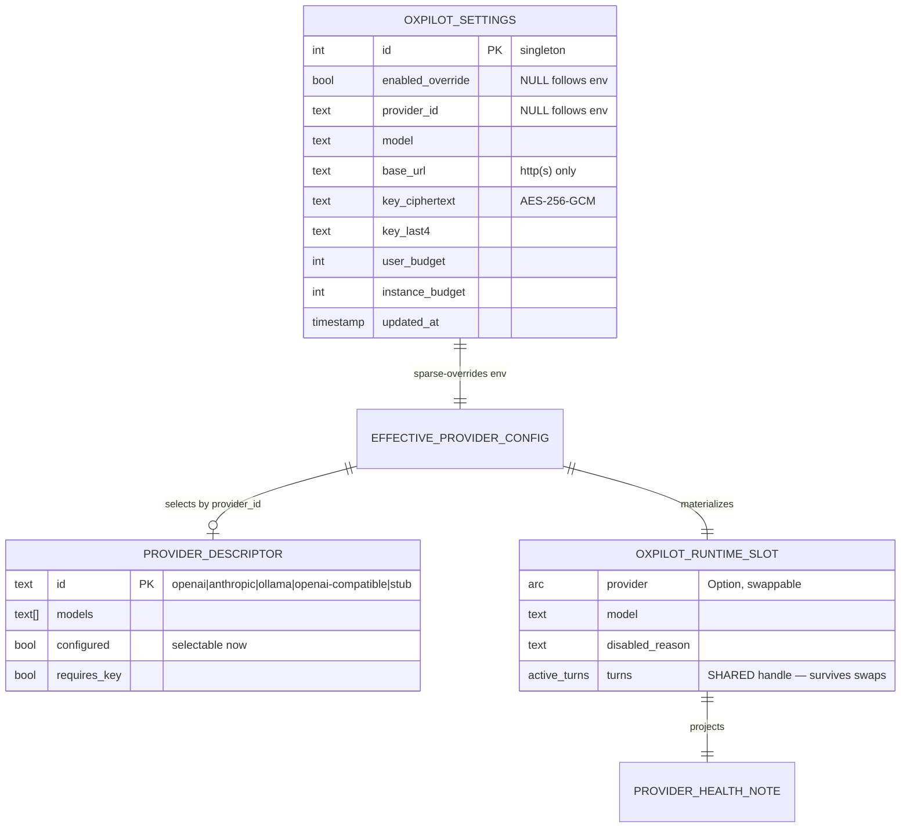

# Functional Specification — providers (U4)

Owns `LlmProviderRegistry`: the OpenAI/Anthropic/Ollama adapters over the
U1 `LlmProvider` trait, the registry that rebuilds the provider slot, the
`oxpilot_settings` override table + `admin.oxpilot.*` procs, and
provider-key AES-256-GCM custody.

## Sources

- `unit-of-work.md` §U4 — unit scope and ownership.
- `unit-of-work-story-map.md` — assigned stories US5.1, US5.4; US5.5 spanning
  duties (table pairing, proc-set pinning) inherited for U4's new artifacts.
- `requirements.md` — FR6.4, FR6.5, FR6.7, NFR1, NFR4, NFR9.
- `components.md` — `LlmProviderRegistry` component boundary.
- `contract-summary.md` — C1 admin procs, C4 `LlmProvider` seam.

## Entity-relationship view (derived from entities.md)

## Rules summary (derived from rules.md)

Custody pins write-only keys, a closed registry, and construction-required
enablement (BR1.x); resolution merges sparse row over env, `settings_get`
returns effective values + `*_overridden` flags (BR2.x); validation binds
the RESOLVED config — registry ids, models, SSRF bound on resolved
provider, positive budgets, explicit key/clear conflict semantics
(BR3.x); call discipline pins connect-phase-only retry, timeouts, no
redirects, keyless Ollama, and the mutex-serialized build→persist→swap
critical section (BR4.x); vocabulary, value-free audit, wiremock-only
testing, new-table dialect pairing, the U1 seam delta, and env-var doc
pairing close the set (BR5.x).

## WF1 — Effective-config resolution

1. Load the singleton `oxpilot_settings` row (absent ⇒ all-NULL).
2. For each field: DB value when non-NULL else the matching
   `OXIDEAN_OXPILOT_*` env var (BR2.1).
3. Classify the resolved `provider_id`: absent ⇒ the deterministic `stub`
   default (sys-admin-gated downstream; `no_provider` survives only as a
   defensive backstop for hand-built slots); not in the
   registry ⇒ `misconfigured`; present ⇒ construction decides (BR1.3).
4. Emit `EffectiveProviderConfig` — resolved fields plus
   `disabled_reason ∈ {flag_off, no_provider, misconfigured, null}`.
   Plaintext key material exists only inside this in-memory shape for the
   construction step — never persisted, logged, or emitted.
5. Enablement = `enabled AND construction succeeded`; `oxpilot.status`
   projects `ProviderHealthNote` from the slot (BR2.2).

## WF2 — `admin.oxpilot.settings_set` (write path)

ONE critical section under the rebuild mutex (BR4.3):

1. `require_admin` — non-admin ⇒ `auth.forbidden` (BR1.1).
2. Request semantics (BR3.4): `clear_overrides` nulls the whole row and
   wins over same-payload field writes; `api_key`+`clear_key` together ⇒
   `bad_input`; empty/whitespace `api_key` ⇒ `bad_input`; absent fields
   leave stored values, explicit null clears them (BR2.3).
3. Build the CANDIDATE row (stored row + applied payload, not yet
   persisted) and resolve it over env → candidate
   `EffectiveProviderConfig`.
4. Validate the RESOLVED config (BR3.1–BR3.3): provider checks bind only
   when a `provider_id` resolves — present-but-unknown ⇒ `invalid_provider`,
   `model` ∉ advertised models ⇒ `invalid_provider`. NO resolved
   `provider_id` ⇒ the write is valid (flag-only/budget-only/
   `clear_overrides` always pass). `base_url` http(s) + SSRF bound keyed on
   the resolved provider; budgets positive ⇒ else `bad_input`.
5. When a `provider_id` resolves AND the payload touches provider-affecting
   fields (`provider_id`/`model`/`base_url`/`api_key`/`clear_key`/
   `clear_overrides`), build the provider from the candidate (BR1.3,
   BR4.3) — key-requiring adapters need resolvable key material, so
   `api_key` is effectively mandatory at this point. Build failure ⇒
   `invalid_provider`, NOTHING persisted, old slot untouched. No resolved
   provider ⇒ no build; the slot installs `provider: None` + reason.
   Writes touching ONLY `enabled_override`/budgets skip the build — they
   must never wedge on an already-broken resolved provider (BR3.1).
6. Persist the row (encrypt `api_key` → ciphertext+last4 first, BR1.2).
7. Swap the slot (WF3 step 4). Return the `settings_get` shape (BR2.4).
8. Audit the mutation — field names only (BR5.2).

Steps 2–8 are ONE serialized section under the rebuild mutex (BR4.3):
concurrent `settings_set` calls order on the mutex, so the persisted row,
installed slot, and audit order can never diverge.

## WF3 — Provider construction + slot rebuild

1. Resolve `EffectiveProviderConfig` (WF1). `provider_id` absent ⇒
   `no_provider`; unknown ⇒ `misconfigured`.
2. For key-requiring adapters: resolve key plaintext — DB ciphertext
   decrypted in memory, else env var; absent ⇒ `misconfigured`. Ollama
   skips the key (BR4.4).
3. Construct the adapter with bounded timeouts (BR4.2) and
   `redirect(Policy::none())` (BR4.5).
4. Swap: write-lock the `RwLock<OxpilotRuntimeSlot>` holder and install
   a fresh slot — new provider Arc + model + reason — reusing the SAME
   `Arc<ActiveTurns>` handle (shipped `ActiveTurns` isn't `Clone`; the
   Arc is). In-flight turns keep their captured provider Arc and map
   entries (U1's captured-Arc contract; R-03/R-04).
5. `OXIDEAN_OXPILOT_PROVIDER=stub` still resolves the U1 `StubProvider` —
   dev/test stacks keep working without real keys; `stub` is
   registry-internal only (BR1.4) — omitted from `providers_list`,
   refused by `settings_set` on release builds, resolved as the unset
   default, and sys-admin-gated at every surface (post-build BR2.6).
6. `openai-compatible` reuses the OpenAI chat-completions adapter against
   an operator `base_url` (LiteLLM, vLLM, NIM, llama.cpp-style servers):
   `base_url` required, API key optional (a keyless endpoint sends no
   `Authorization` header), and private/LAN egress exempt like `ollama`
   (post-build registry addition).

## WF4 — Stream adaptation (per adapter)

1. `stream(ChatRequest)` posts the provider-native request (chat-
   completions SSE for OpenAI, messages SSE for Anthropic, `/api/chat`
   NDJSON for Ollama).
2. Provider frames decode through a shared line-decoder into
   `ChatStreamItem`: `Delta`, `ToolCall{id,name,args_json}`, `Done{usage}`,
   `Error{code,msg}` (C4).
3. HTTP/protocol failures classify into `ProviderError.code`; the runtime
   maps them to C2 terminal frames.
4. Retry: at most once, ONLY on connect-phase transport failure — the
   request never reached the wire (BR4.1). Once transmitted the call
   never retries; redirects are never followed (BR4.5).

## WF5 — `admin.oxpilot.settings_get` / `providers_list` (read paths)

1. `settings_get` → `require_admin` then the effective resolved view
   (BR2.4): `enabled` (resolved) + `enabled_overridden`, `provider_id`,
   `model`, `base_url`, `user_budget`, `instance_budget`, each with its
   `*_overridden` flag distinguishing DB override from env default; key
   surfaces as `key_set` + `key_last4` computed against the resolved
   source (stored last4 or env-key last4) — never ciphertext or
   plaintext (BR1.2).
2. `providers_list` → `require_admin` then one `ProviderDescriptor` per
   registry entry: `{id, models, configured}` — `configured` = selectable
   now: key material resolvable (env `OXIDEAN_OXPILOT_API_KEY` or stored
   key) for key-required adapters; always true for `ollama`/`stub` and
   `openai-compatible` (key-optional);
   `stub` is omitted from the response (BR1.4).

## Negative paths

- Flag off ⇒ every gated surface denies `oxpilot.disabled` (403);
  `oxpilot.status` AND `admin.oxpilot.*` stay gate-exempt — the admin
  procs are the recovery path and must work while disabled (BR1.1, BR2.2).
- Flag-off/budget writes always succeed — they skip the build and never
  wedge on an already-broken resolved provider (BR3.1).
- `provider_id`/model invalid ⇒ `invalid_provider` on write — resolved,
  not raw, input is validated (BR3.1). Provider-less resolved configs
  (flag-only, budget-only, `clear_overrides`) are valid writes that
  install a `provider: None` + reason slot (BR3.1).
- Build failure on write ⇒ `invalid_provider`, nothing persisted, old
  provider keeps serving (BR4.3).
- Missing/undecryptable key ⇒ `misconfigured`; a half-written key row is
  impossible (ciphertext+last4 move together).
- Concurrent `settings_set` ⇒ serialized on the rebuild mutex — row and
  slot stay in lockstep (BR4.3).
- Provider mid-stream failure ⇒ `Error{code}` maps to C2 terminal
  `error`; redirect answers surface as `ProviderError`, never followed.
- Sent-but-unanswered requests never retry — at most the connect phase
  retries once (BR4.1).

## State machines

`EnablementState`: `flag_off | no_provider | misconfigured | enabled` —
pure function of the resolved config; no persisted transition.

`OxpilotRuntimeSlot`: the holder is `RwLock`-swappable; states
`empty → building → installed → (rebuilding → installed | unchanged)*`.
A rebuild constructs the whole new slot (reusing the `turns` handle)
then swaps atomically; a failed build leaves the previous slot installed
and nothing persisted. Disabled states (`no_provider`/`misconfigured`/
`flag_off`) install as slots with `provider: None` + reason — so a
clear-override can legitimately remove a provider.

## Acceptance criteria coverage

AC5.1.1 (explanatory disabled state naming envs/docs —
`ProviderHealthNote.reason`), AC5.1.2 (three providers + key/base-url env
vars — BR1.3, BR4.4), AC5.1.3 (`admin.mcp.*` override pattern — BR2.1,
BR2.3), AC5.1.4 (env-var doc pairing — BR5.6), AC5.1.5 (server-enforced
`oxpilot.disabled` — BR2.2, BR5.5), AC5.4.1 (Ollama adapter — BR4.4),
AC5.5.1/AC5.5.3 spanning duty (closed proc set + dialect pairing —
BR5.4), NFR9 (closed PROCEDURES set — BR5.4), AC5.2.1-Deferred (ceiling
storage — BR3.3 + budget env docs — BR5.6; counters+refusal are U2).
