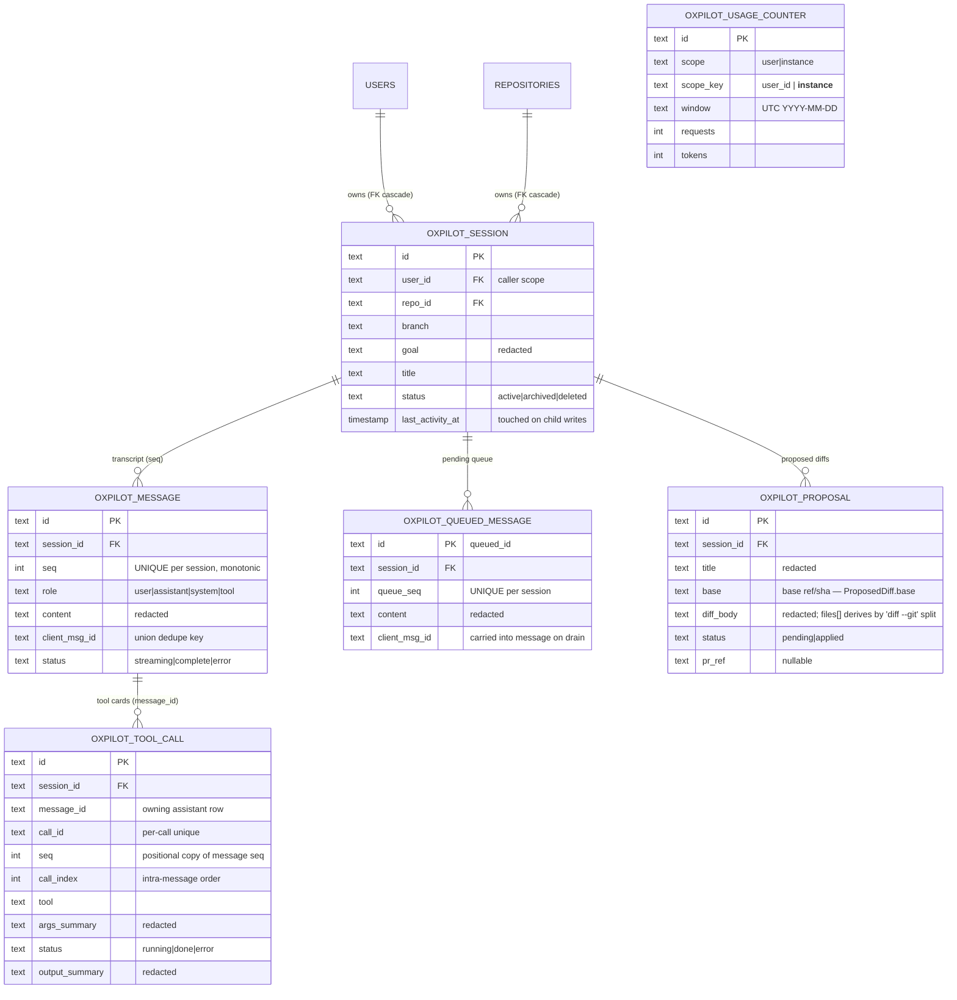

# Functional Specification — session-core (U2)

Owns `SessionService`: the persistence and integrity layer for every
/oxpilot conversational artifact — sessions, messages, tool-call cards,
the mid-stream follow-up queue, proposed diffs, and usage counters —
with caller-scoped access, redaction-on-write, and the C8 delete-hook
seam. Exposed through the trait port `trait SessionService` in
`oxidean-api-core` (LlmProvider precedent); the concrete
`OxpilotSessionService` lives in `oxidean-api-oxpilot`.

## Sources

- `unit-of-work.md` §U2 — unit ownership boundary.
- `unit-of-work-story-map.md` — assigned stories US1.5, US1.8, US5.2;
  US1.3 contributing clauses (AC1.3.3 transcript persistence, AC1.3.6
  tool cards); spanning clauses of AC5.5.1 (proc pinning) and
  US5.3/AC5.3.3 (redaction-on-write).
- `requirements.md` — FR1.2, FR1.7, FR2.4, FR5.6, FR6.6, FR6.7;
  NFR1, NFR2, NFR9.
- `components.md` — `SessionService` component boundary.
- `contract-summary.md` — C5 service API + rules; C8 delete-hook;
  C1 proc families (`session_*`, `message_queue`, `queue_list`,
  `usage_get`) + gate semantics; C2 409 `turn_active` + queued-card +
  snapshot contract.
- `entities.md`, `rules.md` — this unit's entity model and BR set
  (source of truth; the views below are derived).
- Review-1 corrections folded: R-01 contract-pinned queue mechanics,
  R-02 `queue_list` naming, R-03 trait port, R-04 status vocabulary,
  R-05 tool-call identity, R-06 budget axes/timezone, R-07 atomic
  drain, R-08–R-13 minors.

## Entity-relationship view (derived from entities.md)



`OXPILOT_USAGE_COUNTER` is standalone by design (no FK): counters are
the audit-grade rollup and survive session/user deletion.

## Rules summary (derived from rules.md)

| Rule | Category | Summary |
|------|----------|---------|
| BR1.1 | authorization | `user_id` on every call; foreign/missing ⇒ `not_found` |
| BR1.2 | authorization | `user_id` bound from caller context, never the payload |
| BR1.3 | authorization | New procs SessionOnly + `oxpilot.disabled` gate first |
| BR2.1 | constraint | `seq` monotonic, minted inside the message insert |
| BR2.2 | constraint | `client_msg_id` union-dedupe across messages + queued |
| BR2.3 | validation | Transcript = {complete, error} rows ordered by `seq` |
| BR2.4 | calculation | `last_activity_at` touched on every child write |
| BR3.1 | policy | `redact()` at the service boundary on all body-bearing writes |
| BR4.1 | validation | `message_queue` proc — client-driven enqueue after 409 |
| BR4.2 | constraint | `drain_queue` single-tx DELETE+INSERT — exactly-once |
| BR4.3 | validation | `queue_list` read-only for chip + queued-card resolution |
| BR5.1 | constraint | C8 hooks run in registration order before the cascade |
| BR5.2 | constraint | Hook failure aborts the delete; nothing is removed |
| BR5.3 | constraint | Single `DELETE`; FK cascade; counters survive |
| BR6.1 | calculation | UTC-day rollup; requests always, tokens when reported |
| BR6.2 | policy | One configured V caps requests AND tokens; over ⇒ refuse |
| BR6.3 | policy | Absent budget ⇒ unbounded (the generous default) |
| BR7.1 | constraint | Trait port in api-core; impl in api-oxpilot |
| BR7.2 | policy | Full ordered transcript; no `transcript` proc (SSE snapshot covers remount) |
| BR7.3 | constraint | Tool calls keyed (message_id, call_id); status update path |

## Workflows

### WF1 — Create session (`oxpilot.session_create`, shipped in U1)

1. Authenticate session caller → `user_id`; enablement gate (BR1.3).
2. Validate repo binding (`repo_id` resolvable, `branch` non-empty).
3. Redact `goal`; derive `title` from the redacted goal.
4. `insert_session` with caller `user_id` (BR1.2).
5. Return the created row.

### WF2 — Send user message (chat POST — contract-pinned live-turn arm)

1. Owned session (BR1.1) → `not_found` if foreign/absent.
2. Union-dedupe `client_msg_id` against messages AND queued (BR2.2);
   a resend of the in-flight send re-attaches via `resend_matches`,
   a resend of a queued send answers **409 `turn_active`** (the send is
   already queued — the POST has no queued-position return shape).
3. **If a turn is live** (`ActiveTurns`): answer **409 `turn_active`**
   — the C2 pin. Auto-enqueue and silent accept are both forbidden; the
   client calls `oxpilot.message_queue` (WF2a).
4. **If no turn is live**: redact `content` (BR3.1), `append_message`
   mints `seq` (BR2.1), persists role=user, touches `last_activity_at`
   (BR2.4), and the turn starts (U3).

### WF2a — Queue a follow-up (`oxpilot.message_queue`)

1. SessionOnly + enablement gate (BR1.3).
2. Owned session (BR1.1) → `not_found`.
3. Require a live turn — none ⇒ `session_active_turn_absent` (a
   follow-up without a live turn belongs on the plain POST).
4. `check_budget(user_id)` → over ⇒ `budget_exceeded` (BR6.2).
5. Union-dedupe `client_msg_id` (BR2.2): resend ⇒ existing queued_id +
   position; no duplicate.
6. Redact `content` (BR3.1); insert queued row minting `queue_seq`;
   touch `last_activity_at`.
7. Return `{queued_id, position}`; the SSE stream can emit
   `card{card_kind: queued, ref_id: queued_id}` which resolves via
   `oxpilot.queue_list` (BR4.3).

### WF3 — Record a tool call (consumed by U3/U5)

1. Owned session check at the service boundary (BR1.1).
2. Redact `args_summary`/`output_summary` (BR3.1).
3. Insert `OxpilotToolCall` keyed `(message_id, call_id)` with a
   positional `seq` copy of the owning assistant message — repeated
   same-tool calls persist as distinct rows (BR7.3).
4. On completion, `set_tool_call_status(session_id, call_id, done|error)`
   updates the row; unknown call_id ⇒ `not_found`.
5. Touch `last_activity_at` (BR2.4). The row is the durable form of the
   SSE `tool` frame — U8 renders cards from it (AC1.3.6) and the C2
   snapshot merges it by `message_id`.

### WF4 — Transcript read (service-internal + SSE snapshot)

1. Owned session (BR1.1).
2. Return messages `WHERE session AND status IN (complete, error)
   ORDER BY seq` (BR2.3) — `streaming` excluded (in-flight), `error`
   included (interrupted messages render on remount).
3. The C2 SSE snapshot composes transcript + tool_calls (by message_id)
   + `pending_queue` — remount flows ONLY through the snapshot; there
   is no `oxpilot.transcript` proc (BR7.2).
4. U3's prompt assembly calls the same service read and windows for its
   prompt budget (BR7.2).

### WF5 — Queue drain (U3 turn end)

1. On turn end, U3 calls `drain_queue(session_id)` — ONE transaction:
   claim+delete the session's queued rows in `queue_seq` order
   (DELETE…RETURNING / FOR UPDATE per dialect) and insert each as a
   role=user `oxpilot_messages` row minting `seq`, carrying
   `client_msg_id` (BR4.2, BR2.2).
2. Atomicity: a crash mid-drain leaves queued rows intact (nothing
   lost); a committed drain can't double-deliver (deleted). One
   drainer per session by construction (one-active-turn invariant).
3. **Residual rule**: `drain_queue` also runs at turn START before the
   new turn's own message consumes — rows orphaned by a crash between
   drain points deliver in `queue_seq` order at the next turn start,
   never out-of-order relative to each other, never silently dropped.
4. Each delivered row is then the seed of the next turn's user message
   in U3's loop.

### WF6 — Delete session (`oxpilot.session_delete`, US1.5)

1. SessionOnly + enablement gate (BR1.3).
2. Owned-session check (BR1.1) → `not_found` for foreign/absent.
3. Run registered `SessionDeleteHook`s in registration order (BR5.1)
   — U2 ships zero; U3's abort-live-turns and U6's revoke-grants
   inject at shell construction.
4. Any hook error aborts the delete and propagates (BR5.2).
5. Single `DELETE FROM oxpilot_sessions` — FK cascade removes
   messages, tool_calls, queued, proposals (BR5.3).
6. The session stops appearing in the user-scoped list (AC1.5.3).

### WF7 — Budget check + usage record (US5.2)

1. Turn start (U3) and `message_queue` (WF2a): `check_budget(user_id)`
   reads today's UTC `(user, user_id)` and `(instance, '__instance__')`
   rows (BR6.2).
2. Missing rows read as zero; absent budgets allow + report
   `cap: null` (BR6.3).
3. Either axis at/over ⇒ `BudgetExceeded` → typed refusal
   (`budget_exceeded` on the proc / 429 + in-session terminal on the
   turn path) — US5.2.2, never silent.
4. On completed exchange, `record_usage` upsert-increments both rows:
   `requests+1` always, `tokens+=usage` when reported (BR6.1).
5. `oxpilot.usage_get` returns `{period, tokens_used, tokens_cap,
   requests_used, requests_cap}` — caps mirror the configured V or null.

### WF8 — Proposal lifecycle (C5: save_proposal/proposal/mark_applied)

1. U5's diff tool produces a diff → `save_proposal(session_id, title,
   diff_body)` — owned session (BR1.1), redact title+body (BR3.1),
   insert status=`pending`, touch activity (BR2.4); the SSE `card`
   frame with `card_kind: diff, ref_id` links it in-transcript.
2. `proposal(id)` — owned-scope read returning the row; resolves
   `not_found` cross-user.
3. `mark_applied(id, pr_ref)` — the U5/U8 materialize path flips
   pending → applied and records `pr_ref`; `applied` is terminal.
   `diff_apply`'s `diff_not_pending` error derives from a non-pending
   status here.

## State machines

### OxpilotMessage.status

```
insert (turn starts)        insert (user row / drain delivery)
   │                             │
   ▼                             ▼
streaming ──done──▶ complete    complete (terminal)
   │
   ├──error──▶ error            error
   │             ▲   (terminal — provider failure, abort)
   └──boot──▶ sweep → error    (U1 orphan sweep, restart recovery)
```

`streaming` is only the in-flight assistant row — excluded from
transcript reads (BR2.3), always swept to `error` on boot.
C2 terminal `done|error|aborted` ⇒ `complete|error|error` on the row.

### OxpilotQueuedMessage lifecycle

```
oxpilot.message_queue ──▶ queued ──drain_queue (atomic)──▶ delivered
                                       │
                                       └──▶ OxpilotMessage row
                                            (seq minted, cmid carried)
```

Presence in the table IS the pending state; `queue_list` reads it
without consuming; drain deletes+appends in one transaction.

### OxpilotProposal.status

```
pending ──materialize(U5/U8)──▶ applied  (+pr_ref recorded)
```

`applied` is terminal; `diff_apply` on a non-pending row ⇒
`diff_not_pending` (C1).

### OxpilotToolCall.status

```
running ──▶ done
        └─▶ error
```

`running` only in-flight; terminal states match the C2 tool-frame
vocabulary.

## New procs (all SessionOnly + `oxpilot.disabled` gate, C1 vocabulary)

| Proc | Input | Output | Errors |
|------|-------|--------|--------|
| `oxpilot.session_get` | `{ session_id }` | session payload (C1 session_* shape) | `forbidden`, `not_found`, `oxpilot.disabled`, `oxpilot.internal` |
| `oxpilot.session_delete` | `{ session_id }` | `{}` on success | `forbidden`, `not_found`, `oxpilot.disabled`, `oxpilot.internal`, hook error |
| `oxpilot.message_queue` | `{ session_id, content, client_msg_id? }` | `{ queued_id, position }` | `forbidden`, `not_found`, `oxpilot.disabled`, `budget_exceeded`, `session_active_turn_absent` |
| `oxpilot.queue_list` | `{ session_id }` | `{ queued: [QueuedMessage] }` | `forbidden`, `not_found`, `oxpilot.disabled` |
| `oxpilot.usage_get` | `{}` | `{ period, tokens_used, tokens_cap, requests_used, requests_cap }` | `forbidden`, `oxpilot.disabled` |

All bind `user_id` from the session credential; cross-user resolves
`not_found` (BR1.1). Registering them extends the U1
`OXPILOT_PROCEDURES` pin — the closed-set test updates with them.
`oxpilot.diff_*` procs land with U5's builder tools over this unit's
proposal store (the store ships here, the procs with the tool surface).

## U1 seam deltas (what changes vs what U1 shipped)

- `oxpilot_sessions`/`oxpilot_messages` schemas are unchanged — U2 adds
  tables, it does not alter U1's.
- The chat POST keeps its 409 `turn_active` live-turn answer — queueing
  is the client's explicit `message_queue` call, unchanged route code.
- `OXPILOT_PROCEDURES` grows by five; dispatch maps the new names.
- `oxidean-api-core` gains `trait SessionService` beside `LlmProvider`;
  `RpcCtx`/`OxpilotRuntimeSlot` gains `services: Arc<dyn SessionService>`
  — a trait object, not a concrete api-oxpilot type (no crate cycle).
  `OxpilotSessionService` implements it in `oxidean-api-oxpilot` and is
  constructed at shell assembly with the delete-hook registry injected.
