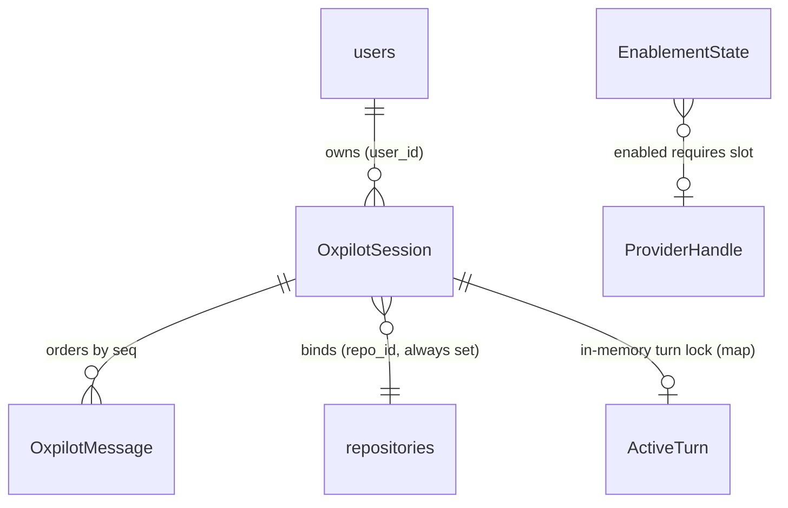

# Functional Spec — u1-skeleton-slice

The walking skeleton carries five workflows: the enablement gate that
wraps everything, session create/list, the chat round-trip, stream
resume, and the registration/anti-enumeration invariants. Entities in
`entities.md`; decision logic in `rules.md`; derived views below.

Consumes: `inception/units-generation/unit-of-work.md` §U1,
`inception/requirements-analysis/requirements.md`,
`inception/domain-design/components.md` (OxpilotApi/OxpilotWeb
responsibilities), `inception/contract-design/contract-summary.md`
(C1, C2, C4).

## WF1 — Enablement resolution (every gated call)

1. Caller hits any `oxpilot.*` proc (except `oxpilot.status`) or either
   SSE route.
2. Resolve `EnablementState`: read `oxpilot_settings` override row when
   present (U4 ships the table; U1 ships the seam — absent row/table ⇒
   env), else `OXIDEAN_OXPILOT_ENABLED` env default (unset ⇒ off, BR2.2);
   then check the `RpcCtx` provider slot (BR2.1, BR2.5). `reason`
   precedence: `flag_off` → `misconfigured` (provider env set but not a
   value U1 recognizes) → `no_provider` (env unset).
3. Disabled ⇒ deny `oxpilot.disabled` (typed domain error on RPC; typed
   JSON pre-stream on the HTTP routes) (BR2.3).
4. `oxpilot.status` skips step 3 — gate-exempt; it returns
   `{enabled, provider, reason}` for the flag-off UI (BR2.3, BR5.4).

## WF2 — Session lifecycle (skeleton subset)

1. `session_create {repo_owner, repo_name, branch?, goal?}` → resolve
   repo under caller visibility (BR3.1) → insert `OxpilotSession`
   (status=active, title from goal) → return the row.
2. `session_list {}` → caller's rows, newest-first (BR3.2).
3. Any session-scoped access by a non-owner ⇒ `not_found`,
   indistinguishable from an absent row (BR3.3).

## WF3 — Chat round-trip (the skeleton's core)

1. `POST /api/oxpilot/sessions/{id}/chat` `{content, client_msg_id}`
   → ordered checks: session auth → gate (BR4.1) → ownership (BR3.3)
   → body validation → idempotency (BR3.6): a persisted
   `client_msg_id` short-circuits — live turn ⇒ attach to its stream,
   ended turn ⇒ answer with the persisted transcript, never a second
   row → atomic insert-if-absent into the `ActiveTurn` map — occupied
   ⇒ 409 `turn_active` (BR4.2); the winner computes the next message
   `seq` and inserts the entry fully-formed — fresh `turn_id`,
   `started_seq` = that next seq, the assistant `message_id` —
   so a mid-window `snapshot.active_turn` is always emit-conformant,
   plus the fan-out channel + delta buffer.
2. Persist the user `OxpilotMessage` (redacted, BR3.5; stores
   `client_msg_id`) at the claimed `seq` (= `started_seq`); bump
   `last_activity_at`.
3. Resolve `ProviderHandle` (stub in U1, BR4.5) → open assistant
   `OxpilotMessage` (status=streaming) under the pre-minted
   `ActiveTurn.message_id`.
4. Emit `append` deltas through the fan-out channel (wire field `seq`
   per C2 — design name `delta_seq`, per-message monotonic and distinct
   from the message-seq order key, BR4.3); each emitted frame also lands
   in `emitted_deltas` for mid-turn replay; `ping` keep-alives fill
   gaps ≥30 s.
5. On stub completion: mark the assistant row complete, emit
   `terminal{result:done}`; on any mid-stream failure:
   `terminal{result:error,code}` and row status=error — the transcript
   keeps the partial content either way (BR3.4).
6. Release: the turn task owns the row to its terminal status and the
   `ActiveTurn` entry is removed when the task finishes — transport
   close only detaches readers (detach-to-complete); `cancel` fires on
   explicit abort/delete-hook/shutdown; a process-death orphan is swept
   to `error` at startup (BR4.6, R-15).

## WF4 — Stream resume / reopen

1. `GET /api/oxpilot/sessions/{id}/chat/stream` → same auth/gate/owner
   checks → emit one `snapshot` frame (all persisted messages,
   `active_turn{turn_id, started_seq, message_id, last_delta_seq}`
   copied from the `ActiveTurn` map or null, and `pending_queue` — always present,
   always `[]` in U1 since queueing is U2's) → then buffered replay +
   live `append`/`terminal` frames from the fan-out channel (BR4.4).
2. No live turn ⇒ `active_turn:null`, `pending_queue:[]`; the stream
   stays open on `ping` cadence so a subsequent POST's appends still
   reach the open reader (readers attach, never own the turn).
3. Mid-turn attach: the snapshot's `active_turn.last_delta_seq` is the
   watermark — the in-flight row's persisted content is the base, the
   server replays buffered appends, and the client applies only deltas
   with `seq` > watermark (R-17).
4. Client semantics: snapshot **replaces** local transcript state;
   appends dedupe by `(message_id, seq)` — exactly-once without
   `Last-Event-ID` (C2).

## WF5 — Flag-off experience

1. `/oxpilot` loads; server-side loaders query `oxpilot.status`
   (gate-exempt, BR2.3).
2. `enabled=false` ⇒ the page renders the operator-disable state naming
   `OXIDEAN_OXPILOT_ENABLED` + provider env vars +
   `docs/CONFIGURATION.md` (BR5.4); composer and create form are
   inert — and every server surface would still deny (defense in
   depth, AC5.1.5).

## WF6 — Registration invariants (build-time)

1. `oxidean-api-oxpilot` is a workspace member depended on by the shell
   (BR1.3).
2. `PROCEDURES` gains exactly the three names (BR1.1); dispatch gains a
   first-claim arm; `proc_classes` adds nothing for `oxpilot.*` —
   SessionOnly by omission (BR1.2), proven by a closed-set test that
   also guards PAT-tier leakage.
3. `versioning.toml` `[[component]]` + crate `CHANGELOG.md`;
   `make rpc-gen` regenerates the client; `procedures_list_matches_dispatch`
   stays green.
4. `dialect_oxpilot.rs` + `db-dialects -E` filter + `TESTING.md` row
   land in the same change (BR1.4).
5. Web registration: SHELLS + astro shell + `.tsrx` route +
   `RESERVED_TOP_SEGMENTS += "oxpilot"` + regenerated routeTree +
   coverage-manifest rows for `/oxpilot` and `/oxpilot/$session` (BR5.1).

## State machines

**OxpilotSession.status**: `active → deleted` (hard delete removes rows;
the status exists for in-request marking and future soft-delete if ever
needed). **OxpilotMessage.status**: `streaming → complete | error |
aborted` (skeleton emits complete/error; aborted arrives with U3's
cancel). **EnablementState**: computed, no transitions stored —
`disabled{flag_off|misconfigured|no_provider} ⇄ enabled` per resolution
(precedence as WF1). **Turn presence** (per session, owned by the
`ActiveTurn` map): `none → streaming → none` — insert-if-absent at POST
makes the transition atomic; the turn task owns the row to terminal
status and the entry is removed when the task finishes (transport close
detaches readers only); a POST during `streaming` is 409 (BR4.2);
queueing arrives with U2.

## Entity-relationship view (derived from entities.md)

`oxpilot_targets`/`computer_use_target_id` intentionally absent — U6
creates both together so the FK lands with its referent.

## Rules summary (derived from rules.md)

| id | one-line |
|----|----------|
| BR1.x | pinned proc set, SessionOnly, registration + dialect parity, env-docs parity |
| BR2.x | flag AND provider; env default off; `status` gate-exempt; override beats env; provider-slot resolution |
| BR3.x | caller-scoped CRUD, anti-enumeration `not_found`, persist+redact on write, client_msg_id idempotency |
| BR4.x | ordered SSE frames, one terminal, snapshot-resume, atomic turn claim + release, stub provider |
| BR5.x | full route-registration set, auth-only gate, minimal-by-design page, explanatory flag-off |
