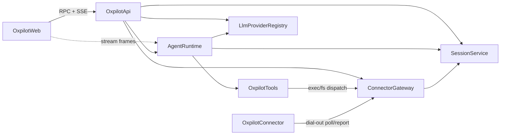

# Domain Design — Component Catalogue (`/oxpilot`)

Provenance: consumes `inception/requirements-analysis/requirements.md`,
`inception/user-stories/stories.md`, `codekb/oxidean-app/architecture.md`,
`codekb/oxidean-app/component-inventory.md`,
`inception/practices-discovery/team-practices.md`; answers in
`domain-design-questions.md`. Entities are at ownership+shape level only —
full schema belongs to Functional Design.

```yaml
components:
  - name: OxpilotWeb
    summary: Octane `.tsrx` UI for `/oxpilot` — index, session workspace, consent surfaces.
    behaviour: >
      Renders session/target lists, streamed transcript, tool-call and
      diff cards, consent cards, and all dialogs (new session, connect,
      confirms). Sends user inputs; never holds grants or provider config.
      Server denials (oxpilot.disabled, over-budget, cross-user) render as
      specified in refined-mockups; composer and consent states are
      server-driven — the UI enforces nothing itself.
    responsibilities:
      - Render index + workspace + consent surfaces per interaction-spec
      - Own SSE client lifecycle (POST fetch-reader send stream, GET resume stream, snapshot-replace + append)
      - Local UI state only (drawer, rail collapse, queued-message row)
    depends_on:
      - component: OxpilotApi
        interaction: all control-plane calls (sessions, targets, grants, status, budget reads)
        style: sync
      - component: AgentRuntime
        interaction: stream frames (text deltas, tool-call, consent-request, terminal) — transported on OxpilotApi's SSE routes; the frame contract is fixed in contract-design
        style: async
    dependents: []
    entities: []

  - name: OxpilotApi
    summary: `oxidean-api-oxpilot` domain crate — `oxpilot.*` RPC surface + `/api/oxpilot/*` HTTP routes (SSE chat send/resume, connector claim/report/heartbeat).
    behaviour: >
      SessionOnly-classified procedures; fail-closed `oxpilot.disabled`
      when the feature flag is off, and for non-sys-admin callers under
      the sys-admin-only resolved `stub` provider (post-build BR2.6 —
      anonymous/PAT callers keep their own `auth.*` denials);
      per-user scoping on
      every read/write (cross-user denial). Mounts three HTTP route
      families under `/api/oxpilot/`: the SSE chat send/resume pair
      (session-cookie auth) and the connector claim/report/heartbeat
      routes (verifier-class connector credentials — NOT user sessions,
      NOT SessionOnly; OxpilotApi delegates credential verification to
      ConnectorGateway, which owns the verifier check). Emits audit
      events for lifecycle/security-relevant operations; rate-limits
      credential-accepting endpoints per the FailedAuthLimiter pattern.
    responsibilities:
      - PROCEDURES + dispatch arms + `OXPILOT_PROCEDURES` pinned SessionOnly set
      - HTTP route handlers (SSE chat send/resume, connector poll/report)
      - Feature enablement gate + per-user budget refusal
      - Audit emission (secret-free detail)
    depends_on:
      - component: SessionService
        interaction: session/transcript/tool-call CRUD, queued sends, delete cascade
        style: sync
      - component: AgentRuntime
        interaction: run a user turn; resume stream state
        style: async
      - component: ConnectorGateway
        interaction: target list/pair/revoke, grant answers, connector poll/report
        style: sync
      - component: LlmProviderRegistry
        interaction: status reads for flag/provider state
        style: sync
    dependents:
      - component: OxpilotWeb
        interaction: serves all UI calls
    external_dependencies:
      - name: oxidean-api-core (RpcCtx, gate, audit, crypto, rpc_dispatch)
        kind: other
        purpose: session auth, audit, secret custody, in-process domain calls

  - name: SessionService
    summary: Session/transcript/tool-call persistence, queued sends, budget counters, deletion cascade.
    behaviour: >
      Owns Session, Message, ToolCall, QueuedMessage, ProposedDiff and
      UsageCounter rows and every per-user invariant: only the owner may
      read/write/delete; the delete cascade removes session + transcript +
      tool-call + diff rows directly and CALLS ConnectorGateway's
      revoke/cancel path for the session's grants and actions so every
      transition stays audited (no raw grant-row deletes). Budgets are
      persistent UsageCounter rows (per-user and per-instance windows)
      incremented atomically with accepted turns; over-budget turns get
      a typed refusal owned here (FR6.7's sliding-window limiters remain
      a separate per-process surface for credential endpoints).
      Transcript content is secrets-redacted on write (NFR1).
    responsibilities:
      - Session/Message/ToolCall/QueuedMessage entities + persistence
      - Budget accounting + over-budget refusal
      - Delete cascade (session, transcript, tool-call, grant rows)
      - Per-user scoping enforcement helper used by OxpilotApi
    depends_on: []
    dependents:
      - component: OxpilotApi
        interaction: CRUD + budget checks from handlers
      - component: AgentRuntime
        interaction: persist messages/tool calls/diffs; read history for prompts
      - component: ConnectorGateway
        interaction: grant-row cleanup on session delete; session existence checks
    external_dependencies:
      - name: oxidean-db
        kind: database
        purpose: owns the oxpilot session/message/tool_call tables (all dialects)
    entities:
      - name: Session
        identifier: session_id
        attributes: [user_id, repo_owner, repo_name, branch, title, status, created_at, updated_at]
      - name: Message
        identifier: message_id
        attributes: [session_id, role, content_redacted, state, queued, created_at]
        references:
          - entity: Session
            owned_by: SessionService
            relationship: each Message belongs to one Session
      - name: ToolCall
        identifier: tool_call_id
        attributes: [message_id, name, inputs_summary, status, artifact_ref]
        references:
          - entity: Message
            owned_by: SessionService
            relationship: each ToolCall belongs to one Message
      - name: QueuedMessage
        identifier: queued_id
        attributes: [session_id, content, position, created_at]
        references:
          - entity: Session
            owned_by: SessionService
            relationship: each QueuedMessage belongs to one Session

  - name: AgentRuntime
    summary: Turn loop — assembles prompt + tools, streams provider output, executes tool calls, produces diffs/patches and PR materialization.
    behaviour: >
      One active turn per session; a pinned provider instance is captured
      at turn start so a mid-turn settings rebuild never swaps providers
      half-stream. Streams deltas to the SSE frame sink; executes tool
      calls through OxpilotTools (the ONLY authz seam — including
      branch/PR materialization, which requires the user's explicit
      confirm and never pushes/merges autonomously); persists every step
      via SessionService (which owns the ProposedDiff rows it writes);
      emits the terminal frame on success/error. Drains QueuedMessage
      rows on turn end; OxpilotApi aborts the live turn before a session
      delete runs the cascade. PR body carries the provenance disclosure
      line (AC2.2.4).
    responsibilities:
      - Prompt assembly (repo context + transcript window)
      - Provider streaming loop + tool-call orchestration
      - ProposedDiff production + branch/PR materialization via existing RPC
      - Terminal-frame semantics + reconnect snapshot
    depends_on:
      - component: SessionService
        interaction: load transcript, persist messages/tool-calls/diffs, budget gate
        style: sync
      - component: LlmProviderRegistry
        interaction: chat-complete stream with declared tools
        style: async
      - component: OxpilotTools
        interaction: tool definition list + tool call execution
        style: sync
    dependents:
      - component: OxpilotApi
        interaction: handlers start/resume turns
      - component: OxpilotWeb
        interaction: consumes frames
    external_dependencies:
      - name: Provider HTTP APIs (OpenAI/Anthropic/Ollama)
        kind: third-party-api
        purpose: chat completions via registry adapters (outbound only)
    entities: []

  - name: OxpilotTools
    summary: Agent tool registry — repo read tools, proposal tools, actions-log reads, computer-use exec/fs; per-tool authorization.
    behaviour: >
      Declares the tool surface to the provider and executes each call on
      behalf of the session's user. Read tools route through rpc_dispatch
      (never direct DB/git); write tools are proposal-scoped (diffs,
      agent-created issue/PR comments only — FR7.5); exec/fs tools forward
      to ConnectorGateway and fail when no live consented target exists.
      Every call produces a ToolCall row (inputs summarized, secrets
      redacted).
    responsibilities:
      - Tool catalog + input validation
      - Per-tool authorization (session owner, repo scope, grant checks) — the single authz seam incl. PR materialization
      - Routing: rpc_dispatch reads/writes vs gateway exec/fs
      - Audit emission for every write/scoped tool call (secret-free)
    depends_on:
      - component: ConnectorGateway
        interaction: exec/fs tool calls await grant + connector result
        style: async
    dependents:
      - component: AgentRuntime
        interaction: executes model-requested calls
    external_dependencies:
      - name: rpc_dispatch (oxidean-api-core)
        kind: other
        purpose: repo.*, repo.actions.*, issues/pulls read+limited write procedures
    entities: []

  - name: LlmProviderRegistry
    summary: Provider trait + adapters (OpenAI, Anthropic, Ollama, OpenAI-compatible) + enablement/config resolution; rebuildable slot on RpcCtx.
    behaviour: >
      `Arc<RwLock<Arc<dyn LlmProvider>>>` slot (email_slot shape, Q2):
      resolved from `OXIDEAN_OXPILOT_*` env with `oxpilot_settings`
      DB-override via `admin.oxpilot.*`. An unset provider resolves the
      deterministic `stub` default (sys-admin-gated); misconfigured → `None` →
      `oxpilot.disabled` denials (fail-closed). Provider keys are
      retrievable secrets: AES-256-GCM at rest under the OXPILOT key chain;
      never emitted to RPC/SSE/logs.
    responsibilities:
      - LlmProvider trait + adapters (openai, anthropic, ollama, openai-compatible, stub)
      - Enablement resolution (env + DB override) + slot rebuild
      - Provider-key custody (encrypted retrievable class)
    depends_on: []
    dependents:
      - component: OxpilotApi
        interaction: status reads
      - component: AgentRuntime
        interaction: completion streams
    external_dependencies:
      - name: Provider HTTP APIs (OpenAI/Anthropic/Ollama)
        kind: third-party-api
        purpose: outbound completions
      - name: oxidean-db
        kind: database
        purpose: oxpilot_settings override row
    entities: []

  - name: ConnectorGateway
    summary: Server side of computer use — pairing, target registry, consent grants, action dispatch over the outbound channel.
    behaviour: >
      Pairing is device-grant-style: short-lived single-use code shown
      once; registered target gets verifier-class credential material
      (hash-verified at rest) that ConnectorGateway itself verifies on
      every connector request. Access is scoped by `user_id` — a target
      or grant is only ever resolved for its owner (AC5.5.4). Grants have
      two shapes: connect grants (session_id null, from the connect
      dialog) and action grants (session-scoped, from the consent card).
      Connector long-polls claim and POSTs results; a grant must be
      `allowed` for its Action to leave the queue — pending, denied,
      expired, revoked and cancelled grants block dispatch. Expiry is
      lazy: `expires_at` is checked at claim/read time (no timer thread).
      Revoke sets in-flight actions to `cancel_requested`; the connector's
      claim/heartbeat response carries the cancel set so a claimed action
      is killed locally, and its report still closes the row. Every
      transition is audited (secret-free detail).
    responsibilities:
      - Pairing lifecycle (code mint → register → credential issue) + verifier check on connector requests
      - Target registry + liveness + per-user scoping
      - Grant state machine (pending/allowed/denied/expired/revoked/cancelled; connect + action grants)
      - Action entity lifecycle (queued→claimed→running→done/failed/cancel_requested→cancelled) + cancel propagation in claim/heartbeat responses
      - Session-delete cascade entrypoint (revoke/cancel, audited)
    depends_on:
      - component: SessionService
        interaction: grant rows tied to sessions; cascade on session delete
        style: sync
    dependents:
      - component: OxpilotApi
        interaction: pair/list/revoke + grant answer calls
      - component: OxpilotTools
        interaction: exec/fs dispatch + results
      - component: OxpilotConnector
        interaction: poll/report protocol endpoints
    external_dependencies:
      - name: oxidean-db
        kind: database
        purpose: oxpilot_target / oxpilot_grant / pairing rows
      - name: audit::record (oxidean-api-core)
        kind: other
        purpose: consent lifecycle audit events
    entities:
      - name: Target
        identifier: target_id
        attributes: [user_id, name, kind, caps, status, verifier_hash, created_at, last_seen_at]
      - name: Grant
        identifier: grant_id
        attributes: [target_id, session_id_nullable, kind, state, action_summary, expires_at, resolved_at]
        references:
          - entity: Target
            owned_by: ConnectorGateway
            relationship: each Grant belongs to one Target
          - entity: Session
            owned_by: SessionService
            relationship: action Grants belong to one Session (null for connect grants)
      - name: Action
        identifier: action_id
        attributes: [grant_id, kind, payload_summary, state, result_summary, created_at, finished_at]
        references:
          - entity: Grant
            owned_by: ConnectorGateway
            relationship: each Action is dispatched under one Grant
      - name: Pairing
        identifier: pairing_id
        attributes: [user_id, code_hash, target_name, kind, caps, state, expires_at]

  - name: OxpilotConnector
    summary: User-run client (`ox pilot connect`) — pairs, then long-polls for actions and executes shell/fs locally.
    behaviour: >
      Outbound-only: registers via pairing code, then runs a
      claim→execute→report loop (Actions-runner precedent) with
      reconnect/backoff. Executes only the granted capability set
      (shell exec, fs read/write — no GUI); refuses anything else at
      parse time. Credential custody stays user-side; the client never
      echoes secrets into results.
    responsibilities:
      - Pairing + credential custody (user-side)
      - Claim/execute/report loop with backoff
      - Local exec + fs sandbox for granted actions
    depends_on:
      - component: ConnectorGateway
        interaction: pair, claim, report, heartbeat
        style: sync
    dependents: []
    external_dependencies:
      - name: Local shell/filesystem
        kind: other
        purpose: executes granted actions on the user's system
    entities: []
```

## Component Diagram



## Component Summary

| Component | Purpose | Depends On | Dependents | Entities Owned |
|---|---|---|---|---|
| OxpilotWeb | UI surfaces | OxpilotApi, AgentRuntime | — | — |
| OxpilotApi | RPC + SSE/HTTP routes, gates, audit | SessionService, AgentRuntime, ConnectorGateway, LlmProviderRegistry | OxpilotWeb | — |
| SessionService | Session/message/tool-call/diff/budget store, delete | — | OxpilotApi, AgentRuntime, ConnectorGateway | Session, Message, ToolCall, QueuedMessage, ProposedDiff, UsageCounter |
| AgentRuntime | Turn loop, diffs, PR materialize | SessionService, LlmProviderRegistry, OxpilotTools | OxpilotApi, OxpilotWeb | — |
| OxpilotTools | Tool registry + authz + routing | ConnectorGateway | AgentRuntime | — |
| LlmProviderRegistry | Provider trait/adapters + enablement | — | OxpilotApi, AgentRuntime | — |
| ConnectorGateway | Pairing, targets, grants, dispatch | SessionService | OxpilotApi, OxpilotTools, OxpilotConnector | Target, Grant, Pairing |
| OxpilotConnector | User-side exec client | ConnectorGateway | — | — |

## Entity Ownership

| Entity | Owning Component | Identifier | Attributes | References |
|---|---|---|---|---|
| Session | SessionService | session_id | user_id, repo_owner, repo_name, branch, title, status, created_at, updated_at | — |
| Message | SessionService | message_id | session_id, role, content_redacted, state, queued, created_at | → Session |
| ToolCall | SessionService | tool_call_id | message_id, name, inputs_summary, status, artifact_ref | → Message |
| QueuedMessage | SessionService | queued_id | session_id, content, position, created_at | → Session |
| ProposedDiff | SessionService | diff_id | session_id, tool_call_id, patch, file_stats, state, pr_ref | → Session, → ToolCall |
| UsageCounter | SessionService | counter_id | scope, user_id_nullable, window_start, messages, tokens | — |
| Action | ConnectorGateway | action_id | grant_id, kind, payload_summary, state, result_summary, created_at, finished_at | → Grant |
| Target | ConnectorGateway | target_id | user_id, name, kind, caps, status, verifier_hash, created_at, last_seen_at | — |
| Grant | ConnectorGateway | grant_id | target_id, session_id_nullable, kind, state, action_summary, expires_at, resolved_at | → Target, → Session (action grants) |
| Pairing | ConnectorGateway | pairing_id | user_id, code_hash, target_name, kind, caps, state, expires_at | — |

## External Dependencies

| Component | Dependency | Kind | Purpose |
|---|---|---|---|
| OxpilotApi | oxidean-api-core | other | RpcCtx, gate, audit, crypto, rpc_dispatch |
| SessionService | oxidean-db | database | session/message/tool_call tables |
| AgentRuntime | provider APIs | third-party-api | completions (outbound) |
| AgentRuntime | rpc_dispatch | other | repo/actions/issues reads + PR writes |
| OxpilotTools | rpc_dispatch | other | domain procedures on session user's behalf |
| LlmProviderRegistry | provider APIs | third-party-api | completions |
| LlmProviderRegistry | oxidean-db | database | settings override |
| ConnectorGateway | oxidean-db | database | target/grant/pairing rows |
| ConnectorGateway | audit::record | other | consent lifecycle events |
| OxpilotConnector | local shell/fs | other | executes granted actions |

## Rationale

| Component | Why a separate building block |
|---|---|
| OxpilotWeb | Distinct lifecycle (browser-side, Octane); the only piece that runs untrusted-origin UI logic |
| OxpilotApi | Repo-mandated boundary: new RPC family requires its own domain crate (affirmed Q5); owns fail-closed gates + audit |
| SessionService | Distinct data ownership — every entity keyed by owner-user; the deletion cascade + budget invariants live exactly here |
| AgentRuntime | Distinct change rate: prompt/tool-loop logic evolves per provider release, independent of persistence or transport |
| OxpilotTools | Single authorization seam for everything the model can trigger — the security boundary between model output and repo/connector effects |
| LlmProviderRegistry | Distinct concern: third-party adapters + credential custody; provider list changes without touching the turn loop |
| ConnectorGateway | Distinct security lifecycle: pairing, consent state machine, action dispatch — the consent-critical core the reviewers flagged |
| OxpilotConnector | Runs off-platform on user systems; independent release cadence inside `ox` |

**Alternatives Rejected** (see decisions.md):
- 5-component merge (SessionService into OxpilotApi, tools into AgentRuntime): rejected — couples persistence invariants to HTTP handlers and hides the tool-authz seam.
- WebSocket connector channel: rejected — no in-repo WS precedent; long-poll mirrors the runner loop.
- Standalone connector binary: rejected — `ox` distribution + PAT auth already exists.
