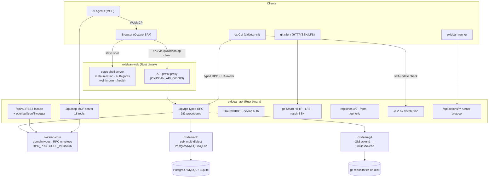
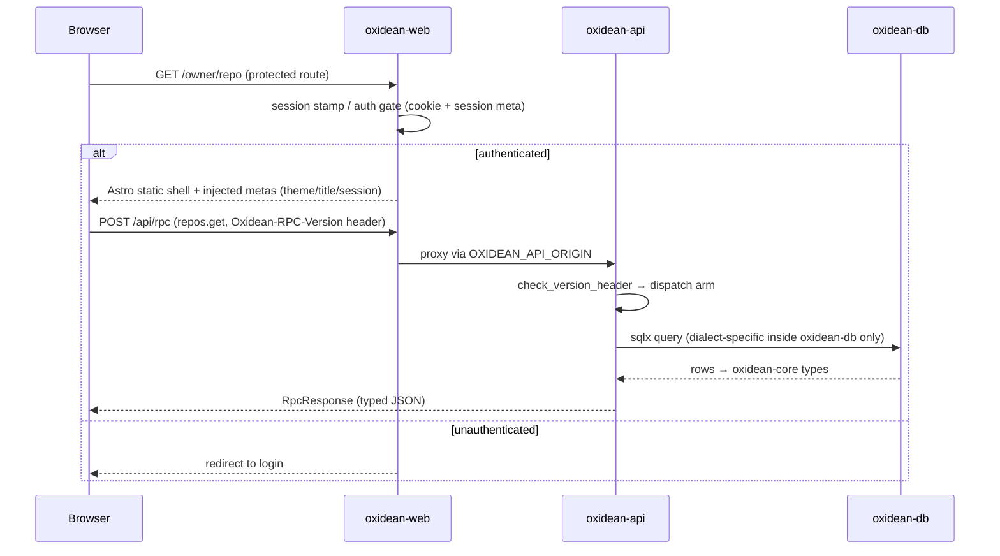
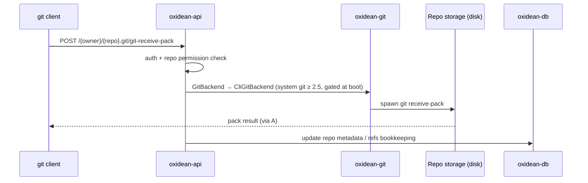
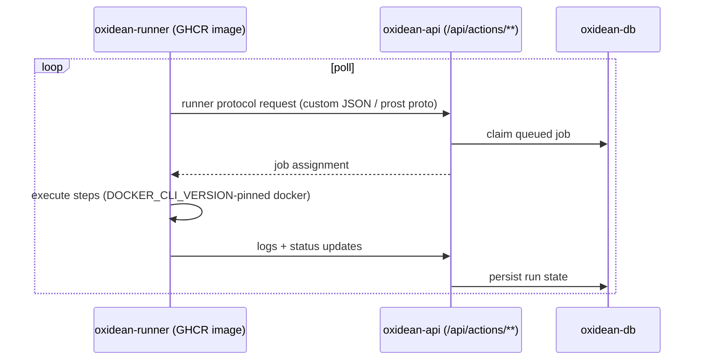
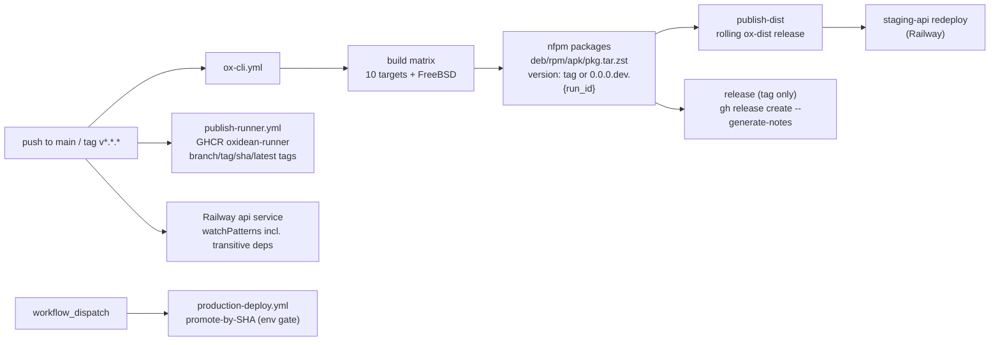
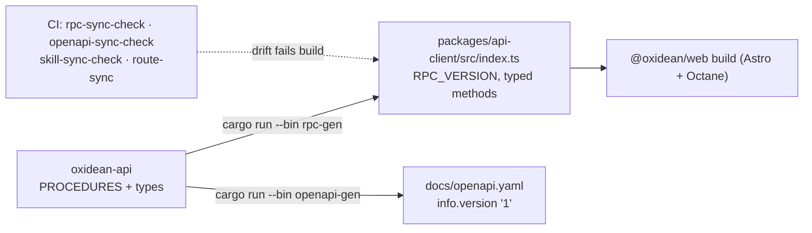

# Architecture — Oxidean monorepo

## Architecture Analysis

### System Overview

Oxidean is a **modular monolith delivered as a monorepo**: one Rust Cargo
workspace (`crates/*`, resolver 2) and one Bun/Turborepo workspace
(`apps/*`, `packages/*`). The runtime system is two long-lived Rust
binaries plus a static SPA bundle:

- **`oxidean-web`** (Rust) serves the Astro-built static shells, injects
  per-request theme/title/session metas, gates protected routes, exposes
  `/health` + well-known endpoints, and reverse-proxies API prefixes via
  `OXIDEAN_API_ORIGIN`.
- **`oxidean-api`** (Rust/Axum) is the single backend: typed JSON-RPC
  (283 procedures), a `/api/v1` REST facade, MCP endpoint, OAuth/OIDC,
  git Smart HTTP + LFS + in-process russh SSH, package registries
  (OCI/npm/generic), the `/cli/*` ox-distribution channel, and the Actions
  runner protocol.
- **`@oxidean/web`** (Astro + Octane `.tsrx` islands, 213 `.tsrx` files) is
  the SPA; **`@oxidean/api-client`** is the generated typed RPC client it
  consumes.

Out-of-process components: **`ox`** (`oxidean-cli`, companion CLI with
self-update) and **`oxidean-runner`** (self-hosted Actions runner, published
to GHCR). `oxidean-core` is the shared domain/RPC-envelope crate;
`oxidean-db` is the sole crate allowed to branch on DB dialect
(Postgres/MySQL/SQLite via sqlx); `oxidean-git` wraps the system `git`
binary behind a `GitBackend` trait (`CliGitBackend`, git ≥ 2.5 boot gate in
`version.rs`).

### Architectural Style

**Modular monolith** (single deployable API binary with explicit internal
crate boundaries) + **static-shell/islands frontend** + **codegen-mediated
client contract**. Evidence:

- All server logic compiles into one `oxidean-api` binary (lib + 4 bins in
  one crate); crate boundaries are enforced by path dependencies, not
  network hops.
- Dialect isolation is a hard boundary: SQL lives only in `oxidean-db`
  (AGENTS.md hard boundary; 46 postgres migrations mirrored to mysql/sqlite).
- The API contract is generated, not hand-maintained: `rpc-gen` emits
  `packages/api-client/src/index.ts` (5427 lines) and `openapi-gen` emits
  `docs/openapi.yaml`; CI drift gates (`rpc-sync-check`,
  `openapi-sync-check`, `skill-sync-check`, `route-sync`) make the
  generated artifacts read-only.

### Component Relationships



### Data Flow

Primary request path: `Browser → oxidean-web (shell) → /api/* proxy →
oxidean-api → {oxidean-db → DBMS | oxidean-git → repos on disk}`.
Domain types and the RPC envelope are shared through `oxidean-core`, which
everything else depends on (highest fan-out node in the workspace — see
`dependencies.md`).

Version-bearing responses flow through `env!("CARGO_PKG_VERSION")` embeds:
`system.manifest` (server_version, min_cli_version, procedures map),
`system.health` (→ web `/status` page), MCP `serverInfo`, and `/cli/latest`
(see `api-documentation.md` § Version & Contract Surfaces).

### Key Design Decisions

| Decision | Evidence | Implication |
|---|---|---|
| Typed JSON-RPC is the primary contract; REST is a generated facade | `rpc.rs` PROCEDURES (283) + `rest/` RouteDef tables → `docs/openapi.yaml` | One authoritative procedure list; REST/OpenAPI drift is CI-gated |
| Generated TS client, never hand-edited | `rpc_gen.rs` → `packages/api-client/src/index.ts`; `make rpc-sync-check` | Wire changes are Rust-first; client drift fails CI |
| Single workspace version `0.1.0` for all crates | `Cargo.toml` `[workspace.package]`, `version.workspace = true` in every crate | Every `CARGO_PKG_VERSION` embed currently reports the same string — per-component SemVer (the active intent) must assign semantics per surface |
| Dialect branching confined to `oxidean-db` | AGENTS.md hard boundary; `migrations/{postgres,mysql,sqlite}` | API never branches on dialect; test matrix covers 3 dialects |
| `oxidean-web` is the edge when `OXIDEAN_API_ORIGIN` set; else edge is in front | `main.rs` behind-proxy handling, `OXIDEAN_WEB_BEHIND_PROXY` | Same SPA ships dev (Compose/Traefik) and prod (Railway/gateway) topologies |
| CLI binaries distributed via the API itself | `cli_dist.rs`, `install.{sh,ps1}`, `ox self-update` (version OR sha256 → swap) | `/cli/latest` conflates api version with cli binaries — flagged in `code-quality-assessment.md` |
| Assets embedded via `include_dir` | `assets/cli/*`, `stack-presets/**`, `skill/SKILL.md` | Binaries are self-contained; preset manifests carry scaffold-only versions (`0.0.0`/`1.0.0`) that are NOT repo versions |

### Improvement Opportunities

Cross-reference `code-quality-assessment.md` § Technical Debt for the full
list; architecturally significant items:

- `/cli/latest` reports `oxidean-api`'s version while serving
  `oxidean-cli` binaries — correct today only because all crates share
  `0.1.0`; per-component versioning forces a decision (server vs CLI vs
  dist-channel semantics).
- Dependency-aware change detection exists as precedent
  (`.railway/railway.ts` `watchPatterns` lists transitive crate deps) but
  `ox-cli.yml` path filters omit `crates/oxidean-core/**`.
- `OXIDEAN_RPC_VERSION` env var is dead config — documented but never read;
  the wire version is compile-time.
- MCP protocol-version lists are hand-synced between
  `apps/web/src/lib/webmcp.ts` and `crates/oxidean-web/src/wellknown.rs`
  with no CI gate.

## Interaction Diagrams

How representative business transactions execute across components.

### 1. Browser session: load a protected page and call the API



### 2. `ox` CLI: authenticated call + self-update

```mermaid
sequenceDiagram
    participant U as User
    participant Ox as ox CLI (oxidean-cli)
    participant A as oxidean-api
    participant GH as GitHub Releases (ox-dist)

    U->>Ox: ox repos list
    Ox->>A: POST /api/rpc (token creds; User-Agent: ox/{ver}; Oxidean-RPC-Version)
    A->>A: check_version_header vs RPC_PROTOCOL_VERSION
    A-->>Ox: RpcResponse
    Ox->>A: GET /cli/latest (during self-update check)
    A-->>Ox: { version: CARGO_PKG_VERSION(api) }
    Note over Ox: needs_binary_update(current, latest,<br/>local_sha, expected_sha) —<br/>version ≠ OR sha256 ≠ → swap
    Ox->>GH: download new binary (ox-dist rolling release / tag)
    Ox->>Ox: verify sha256 → swap binary
```

### 3. Git push over Smart HTTP



### 4. Actions runner job loop



### 5. Release pipeline (existing machinery the SemVer intent wires into)



Notes: no `v*` tag has ever been cut (`git tag -l` → only rolling
`ox-dist`); release notes come from `--generate-notes` only — there is no
changelog infrastructure (see `code-quality-assessment.md`).

### 6. Codegen contract pipeline (build-time)


