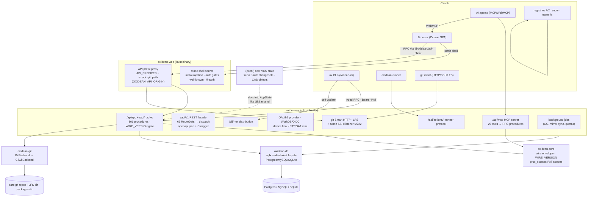
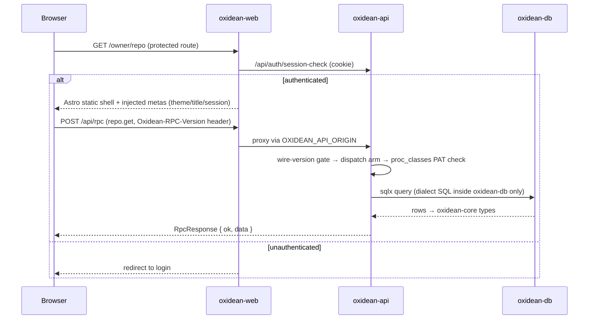
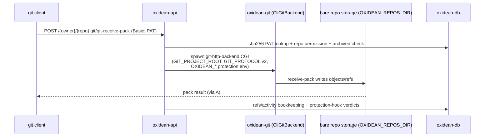
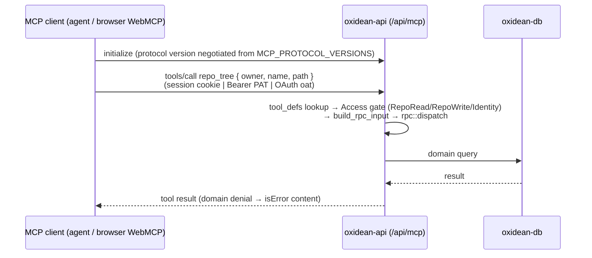
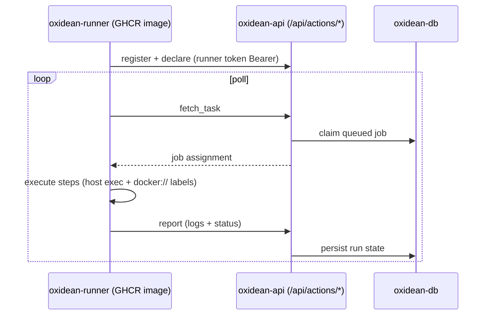
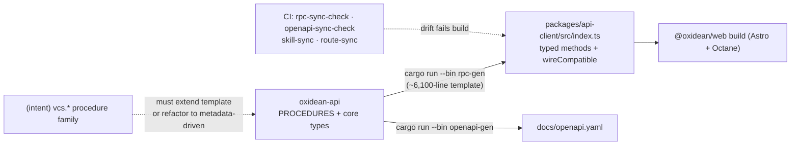

# Architecture — Oxidean monorepo

## Architecture Analysis

### System Overview

Oxidean is a **modular monolith delivered as a monorepo**: one Rust Cargo
workspace (`crates/*`, 7 members, resolver 2) and one Bun/Turborepo
workspace (`apps/*`, `packages/*`). The runtime system is two long-lived
Rust binaries plus a static SPA bundle:

- **`oxidean-web`** (Rust) serves the Astro-built static shells, injects
  per-request theme/title/session metas, gates protected routes via
  `/api/auth/session-check`, exposes `/health` + `/.well-known/{webmcp,mcp}`,
  and reverse-proxies API prefixes (`API_PREFIXES` in `proxy.rs`) via
  `OXIDEAN_API_ORIGIN`.
- **`oxidean-api`** (Rust/Axum 0.8) is the single backend: typed JSON-RPC
  (**306 procedures**, `PROCEDURES` manifest at `rpc.rs:150-457`), a
  `/api/v1` REST facade (65 `RouteDef` rows) + OpenAPI, an MCP endpoint
  (`POST /api/mcp`, 20 tools), OAuth2 provider + WorkOS/OIDC/device auth,
  git Smart HTTP + LFS + in-process russh SSH listener, package registries
  (OCI/npm/generic), the `/cli/*` ox-distribution channel, the Actions
  runner protocol, and background jobs (`jobs/mod.rs`).
- **`@oxidean/web`** (Astro static shells + Octane `.tsrx` islands) is the
  SPA; **`@oxidean/api-client`** is the generated typed RPC client.

Out-of-process components: **`ox`** (`oxidean-cli`, companion CLI with
self-update, device auth, `ox mcp`/`ox skill` harness installers) and
**`oxidean-runner`** (self-hosted Actions runner, GHCR image).
`oxidean-core` is the shared domain/wire crate (`RpcRequest`/`RpcResponse`/
`AppError`, `WIRE_VERSION`, `wire_compatible`, `MCP_PROTOCOL_VERSIONS`,
`proc_classes` PAT classification); `oxidean-db` is the sole crate allowed
to branch on DB dialect (Postgres/MySQL/SQLite via sqlx 0.9); `oxidean-git`
wraps the system `git` binary behind a `GitBackend` trait (`CliGitBackend`,
git ≥ 2.5 boot gate).

### Architectural Style

**Modular monolith** (single deployable API binary with explicit internal
crate boundaries) + **static-shell/islands frontend** + **codegen-mediated
client contract** + **multi-transport edge** (HTTP/WS/SSH). Evidence:

- All server logic compiles into one `oxidean-api` binary (lib + 4 bins);
  crate boundaries are path dependencies, not network hops. Aux listeners
  (russh SSH) spawn from the same `main` (`main.rs:83`).
- Dialect isolation is a hard boundary: SQL lives only in `oxidean-db`
  (AGENTS.md hard boundary; 50 numbered migrations ×3 dialects, filename
  parity enforced by test).
- The API contract is generated, not hand-maintained: `rpc-gen` emits
  `packages/api-client/src/index.ts` (~6,000 lines) from a template;
  `openapi-gen` emits `docs/openapi.yaml`; CI drift gates
  (`rpc-sync-check`, `openapi-sync-check`, `skill-sync`, `route-sync`) make
  generated artifacts read-only.
- PAT authorization is **fail-closed by classification**: unlisted
  procedures default to `SessionOnly` (`oxidean-core/src/proc_classes.rs`),
  so machine-token access must be explicitly granted per procedure.

### Component Relationships



### Data Flow

Primary request path: `Browser → oxidean-web (shell) → /api/* proxy →
oxidean-api dispatch → {oxidean-db → DBMS | oxidean-git → repos on disk}`.
Domain types and the RPC envelope are shared through `oxidean-core`, the
highest fan-out node (`api`, `cli`, `db`, `web` all depend on it — see
`dependencies.md`).

Auth resolution is centralized per transport: session cookie for web RPC,
Bearer PAT (`oxidean_pat_`/`oxidean_fg_`) or OAuth `oxidean_oat_` for
machine RPC/MCP, **HTTP Basic with PAT-as-password** for git Smart HTTP and
LFS (session cookies never authorize git — decision D-12), SSH pubkey
fingerprint (`ssh_public_keys` or per-repo `deploy_keys`) for the russh
listener. PAT Bearer callers are then scope-gated at dispatch
(`pat::bearer::authorize_rpc` + `proc_classes`, fail-closed).

### Key Design Decisions

| Decision | Evidence | Implication for the VCS intent |
|---|---|---|
| `GitBackend` trait seam hides the VCS engine | `crates/oxidean-git/src/backend.rs:410-771` (~40 methods); `Arc<dyn GitBackend>` on `AppState` (`app.rs:62`, set `app.rs:186`); `GixGitBackend` documented-but-unimplemented | The canonical pattern for "another VCS engine": a sibling crate can expose its own trait/`Arc<dyn …>` slot on `AppState` without touching `repo/*` handlers |
| Five parallel registration surfaces per RPC family | `PROCEDURES` const (`rpc.rs:150-457`) + `dispatch()` arm + types in `oxidean-core` + `PatProc` class in `proc_classes.rs` + `rpc_gen.rs` template (+ optional `RouteDef`) | A `vcs.*` procedure family must update all five (sync-tested); group under one domain module like `crate::repo` |
| Multiple edge-transport precedents | Smart HTTP (`routes/git_smart_http.rs`), LFS (`routes/git_lfs.rs` + `lfs/`), SSH (`ssh/server.rs` russh listener spawned `main.rs:83`), packages `.nest()`ed routers | Every auth flavor exists: Basic-PAT, Bearer, pubkey, per-repo enable flags, quotas, GC jobs — the protocol can pick its envelope |
| MCP is a thin tools→RPC map | `mcp.rs` self-contained streamable-HTTP JSON-RPC (JSON mode, no SSE); `tool_defs()` ~612, `build_rpc_input`, `Access` gates (RepoRead/RepoWrite/Identity), `oxidean://` resource templates | A VCS MCP surface mirrors this shape; `ox mcp` already installs/points clients |
| Content-addressed storage precedent ×2 | LFS `OXIDEAN_LFS_DIR` OID-sharded `{ab}/{cd}/{oid}` + refcount + GC; packages `OXIDEAN_PACKAGES_DIR/{algo}/{aa}/{bb}/{digest}` | The new object store clones the dir-layout + quota + GC-job pattern (`app.rs:95-152` env-dir pattern, `jobs/mod.rs` spawn) |
| Persistence is ×3 dialects, façade-owned | `Database` façade (`oxidean-db/src/lib.rs`, `Clone`, `skipped()` no-DB mode); `migrations/{postgres,mysql,sqlite}` parity-tested | New VCS tables need SQL ×3 + a `Database` method module + row types; accept `Database` by value, tolerate `is_skipped` |
| Edge parity is 3-place sync | `oxidean-web` `API_PREFIXES`/`is_api_git_path` (`proxy.rs:16-86`), Traefik labels (`docker-compose.yml`), `deploy/cloud/Caddyfile` | Any new path prefix (`/vcs/…` or `/{owner}/{repo}.vcs`) must be added in all three; greedy `/{owner}/{repo}.git` top-level route constrains URL design |
| Wire compatibility is gated at handshake | `Oxidean-RPC-Version` header vs `WIRE_VERSION` (SemVer, `0.1.0`, legacy `"1"` accepted); WS `/api/rpc/ws` re-resolves credentials per frame (`app.rs:802-844`) | Streaming/want-fetch protocol can reuse the WS per-frame auth precedent |

### Improvement Opportunities

Cross-reference `code-quality-assessment.md` § Technical Debt for the full
list; architecturally significant items:

- `rpc_gen.rs` is a ~6,100-line **hand-maintained mirror** — a whole new
  `vcs.*` family means a large template addition (or first refactoring
  codegen to emit from metadata).
- `AppState` carries **per-process limiters/stores** (`login_begin_limiter`,
  `git_auth_limiter`, `two_factor_store`, `SshAuthLimiter`) — single-node
  only; a new server component joining the process inherits in-memory state.
- `/{owner}/{repo_git}` Smart HTTP route is **greedy at the top level** —
  a new protocol sharing URL space must be checked against
  `is_api_git_path` (`proxy.rs:82`) and Traefik `PathRegexp` before routes
  are designed.
- `notify/` (fan-out) vs `notification/` (RPC) dual modules — confusingly
  named; don't repeat the pattern for a VCS events surface.

## Interaction Diagrams

How representative business transactions execute across components.

### 1. Browser session: load a protected page and call the API



### 2. `ox` CLI: PAT-authenticated RPC call

```mermaid
sequenceDiagram
    participant U as User
    participant Ox as ox CLI (oxidean-cli)
    participant A as oxidean-api
    participant D as oxidean-db

    U->>Ox: ox repo get o/r  (or raw escape hatch: ox api <procedure>)
    Ox->>Ox: resolve instance + token (XDG config / keyring)
    Ox->>A: POST /api/rpc (Bearer oxidean_pat_*; Oxidean-RPC-Version)
    A->>A: pat::bearer::authorize_rpc<br/>→ proc_classes scope check (fail-closed)
    A->>D: sqlx query
    D-->>A: rows → core types
    A-->>Ox: { ok, data } | { ok:false, error:{code,message} }
    Ox->>U: rendered output (--jq via jaq optional)
```

### 3. Git push over Smart HTTP (existing VCS path — the side-by-side model)



Note: session cookies never authorize git transports (D-12). SSH pushes
take the parallel in-process russh listener (`ssh/server.rs`, port 2222,
`git` user forced, pubkey fingerprint identity, exec allowlist =
upload-pack/receive-pack).

### 4. MCP agent: tools/call bridged to typed RPC



This is the exact shape the intent's "MCP surface" clones: JSON-RPC
streamable-HTTP in JSON mode (no SSE, GET→405, no `Mcp-Session-Id`),
gated by `OXIDEAN_MCP_ENABLED` + `admin.mcp.*` DB override.

### 5. Actions runner job loop



### 6. Codegen contract pipeline (build-time)



## Where the New VCS Crate Plugs In (intent map)

Boot/plumbing order (`main.rs:7-128`): version gate → CORS →
`Database::from_env` → auto-migrate → seed → spawn aux listeners (SSH) →
`AppState::new` → background jobs → `router_with_state` → `axum::serve`.
A side-by-side protocol server most naturally either (a) mounts Axum
routes on the same API port inside `router_with_state` (`app.rs:268-407`),
or (b) spawns its own listener from `main` like `ssh::maybe_spawn_from_env`.
Either way it should take `Arc<dyn …>`/`Database` by clone, reuse
`sha256` PAT lookup + `FailedAuthLimiter` (`pat/rate_limit.rs`), and keep
its `OXIDEAN_*` env vars grouped.
