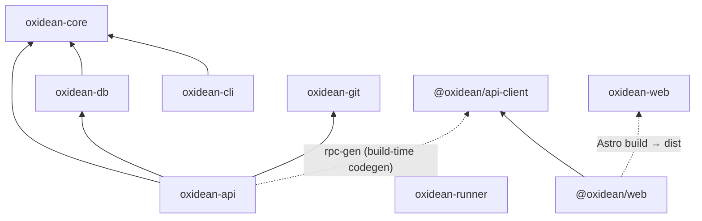

# Dependencies — Oxidean monorepo

Canonical record of internal cross-package dependencies and the external
dependency surface. Exact library versions live in `technology-stack.md`;
component manifests and health in `component-inventory.md`.

## Internal Dependency Graph (manifest-declared)

| Component | Depends on (internal) | Mechanism |
|---|---|---|
| `oxidean-api` | `oxidean-core`, `oxidean-db`, `oxidean-git` | Cargo path deps |
| `oxidean-cli` | `oxidean-core` | Cargo path dep |
| `oxidean-db` | `oxidean-core` | Cargo path dep |
| `oxidean-git` | — | none |
| `oxidean-runner` | — | none |
| `oxidean-web` | — | none (serves `apps/web` build output at runtime) |
| `oxidean-core` | — | none — **root of the DAG, highest fan-out** |
| `@oxidean/web` | `@oxidean/api-client` | `workspace:*` |
| `@oxidean/api-client` | — (peer: `@octanejs/tanstack-query`) | peer dep |
| `oxidean` (root) | `apps/*`, `packages/*` | Bun workspaces |

## Generated-Source / Sync Edges (change-propagation graph)

These edges matter for dependency-aware release detection — a change in the
producer requires the consumer artifact to be regenerated:

| Producer | Consumer artifact | Drift gate |
|---|---|---|
| `oxidean-api` (`rpc-gen` bin) | `packages/api-client/src/index.ts` | `make rpc-sync-check` |
| `oxidean-api` (`openapi-gen` bin) | `docs/openapi.yaml` (+ `/api/v1/openapi.json`) | `make openapi-sync-check` |
| `oxidean-cli` `skill/SKILL.md` | `/cli/skill.md` route + `ox skill` output | `make skill-sync-check` |
| `apps/web/src/pages/**` route corpus | `oxidean-web` `SHELLS` | `scripts/check-route-sync.ts` |
| `proto/runner.proto` | `oxidean-api` + `oxidean-runner` wire types | prost-build at compile time |
| `apps/web/src/lib/webmcp.ts` ↔ `oxidean-web/src/wellknown.rs` | `MCP_PROTOCOL_VERSIONS` list | **manual only — no gate** |

## Build / Packaging Dependency Edges

- Docker `api` image: cargo-chef build of `oxidean-api`; optional
  `OXIDEAN_CLI_DIST_URL` stages the ox binary matrix into the image —
  the `image-matrix`/`image-matrix-pr` jobs in `ox-cli.yml` prove
  digest-lockstep between the staged binaries and the matrix artifacts.
- Docker `web` image: Bun build of `@oxidean/web` → served by the
  `oxidean-web` Rust binary.
- `oxidean-runner` image → GHCR (`publish-runner.yml`).
- `deploy/cloud` gateway: Caddy in front of api+web.
- `.railway/railway.ts` api `watchPatterns` already lists transitive crate
  deps (`oxidean-api`, `oxidean-cli`, `oxidean-core`, `oxidean-db`,
  `oxidean-git`, `packages/api-client`) — **working precedent** for
  dependency-aware change detection. Contrast: `ox-cli.yml` path filters
  omit `crates/oxidean-core/**` even though `oxidean-cli` depends on it
  (debt — `code-quality-assessment.md`).

## External Dependency Surface

Exact pins in `technology-stack.md`. Summary by component:

| Component | Principal external dependencies |
|---|---|
| `oxidean-api` | axum 0.8, tokio 1, sqlx 0.9, serde, schemars, tower-http, reqwest (rustls), russh + ssh-key, prost, utoipa-swagger-ui, lettre, openidconnect, workos, argon2, aes-gcm, image, zip, include_dir, thiserror, jaq-* |
| `oxidean-cli` | reqwest, serde/schemars, dialoguer, indicatif, keyring, termimad, thiserror |
| `oxidean-db` | sqlx 0.9 (all three dialects), serde |
| `oxidean-git` | std::process over system git (≥ 2.5.0 runtime floor) |
| `oxidean-runner` | tokio, prost (runner protocol), docker CLI 29.9.0 (image pin) |
| `oxidean-web` | axum, tower-http, reqwest (proxy) |
| `@oxidean/web` | astro ^7.3.8, octane ^0.11.0 + `@octanejs/*` (astro, base-ui, tanstack-query, tanstack-form, dropzone, lucide, recharts, zustand, vite-plugin, testing-library), tailwindcss ^4.3.3, unified/remark/rehype/shiki, spdx-license-list |
| `@oxidean/api-client` | peer `@octanejs/tanstack-query` only |

## Dependency Management Gaps

- **No dependabot/renovate** config — dependency updates are manual.
- `ssh-key =0.7.0-rc.11` is an exact-pinned pre-release — deliberate pin.
- Multiple independent version pins that a SemVer/release automation must
  keep coherent: bun 1.4.0, nfpm 2.47.0, DOCKER_CLI_VERSION 29.9.0,
  gh 2.96.0 parity pin, `skills-lock.json` hash pins.
