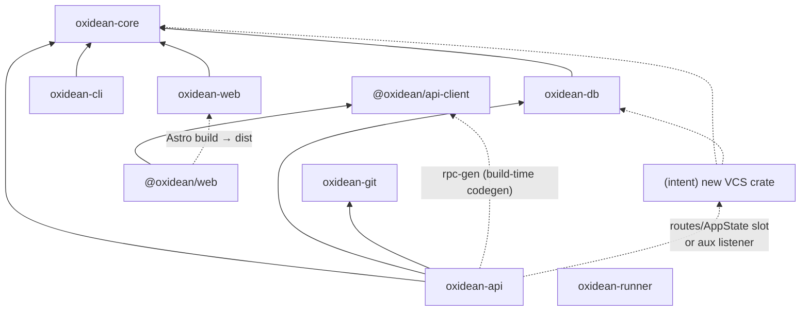

# Dependencies — Oxidean monorepo

Canonical record of internal cross-package dependencies and the external
dependency surface. Exact library versions live in `technology-stack.md`;
component manifests and health in `component-inventory.md`.

## Internal Dependency Graph (manifest-declared)

| Component | Depends on (internal) | Mechanism |
|---|---|---|
| `oxidean-api` | `oxidean-core`, `oxidean-db`, `oxidean-git` | Cargo path deps |
| `oxidean-cli` | `oxidean-core` | Cargo path dep |
| `oxidean-db` | `oxidean-core` | Cargo path dep |
| `oxidean-web` | `oxidean-core` | Cargo path dep |
| `oxidean-git` | — | none |
| `oxidean-runner` | — | none (no internal deps) |
| `oxidean-core` | — | none — **root of the DAG, highest fan-out** |
| `@oxidean/web` | `@oxidean/api-client` | `workspace:*` |
| `@oxidean/api-client` | — (peer: `@octanejs/tanstack-query`) | peer dep |
| `oxidean` (root) | `apps/*`, `packages/*` | Bun workspaces |

## Versioning Edges (`versioning.toml`)

10-component SemVer registry drives per-component tags + changelogs from
commit-subject grammar (`type(scope): subject`, enforced by
`.githooks/commit-msg` + CI `commit-lint`).

- A virtual **`wire`** component is pinned to
  `crates/oxidean-core/src/lib.rs#WIRE_VERSION`.
- `oxidean-api`, `oxidean-web`, `ox`, `api-client`, `web` all declare
  `depends_on = ["wire"]` — a wire-version change cascades bumps to every
  wire-speaking component.
- **New crate must register here**; if its protocol shares the RPC wire
  types it should `depends_on = ["wire"]` too.

## Generated-Source / Sync Edges (change-propagation graph)

A change in the producer requires the consumer artifact to be regenerated
(or the gate fails):

| Producer | Consumer artifact | Drift gate |
|---|---|---|
| `oxidean-api` (`rpc-gen` bin, ~6,100-line embedded TS template) | `packages/api-client/src/index.ts` | `make rpc-sync-check` + `procedures_list_matches_dispatch` test |
| `oxidean-api` (`openapi-gen` bin) | `docs/openapi.yaml` + `/api/v1/openapi.json` | `make openapi-sync-check` |
| `oxidean-cli` `skill/SKILL.md` | `/cli/skill.md` route + `ox skill` | `skill-sync` check |
| `apps/web/src/pages/**` route corpus | `oxidean-web` shell corpus | `scripts/check-route-sync.ts` |
| `proto/runner.proto` | `oxidean-api` + `oxidean-runner` wire types | prost-build at compile time |
| `apps/web/src/lib/webmcp.ts` ↔ `oxidean-web/src/wellknown.rs` | `MCP_PROTOCOL_VERSIONS` list | **manual only — no gate** |
| `rest/spec.rs` RouteDef rows ↔ `PROCEDURES` | REST surface | manual — REST rows are opt-in per procedure |
| `assets/stack-presets`, workflow templates ↔ docs | scaffold manifests | `check-stack-presets` / `check-workflow-templates` scripts |

## Build / Packaging Dependency Edges

- Docker `api` image: cargo-chef build of `oxidean-api`; CLI binaries
  staged for `/cli/bin/*` distribution.
- Docker `web` image: Bun build of `@oxidean/web` → `dist` served by the
  `oxidean-web` Rust binary.
- `oxidean-runner` image → GHCR (`images.yml`, sha/pr/tag channels,
  Railway deploys).
- CI base images `ghcr.io/<owner>/oxidean-ci:{dev,release,cov,tools}` from
  `docker/ci-base/Dockerfile` (`ci-base.yml`); `ci.yml` pins each to
  `@sha256` per run via `scripts/ci-image-tag.sh`. Dependency artifacts
  are cargo-chef-cooked into the image; workspace crates always compile
  fresh (no cross-run Rust cache).
- `deploy/cloud` gateway: Caddy in front of api+web; Traefik v3.3 labels
  in compose route edge prefixes.
- `.railway/railway.ts` `watchPatterns` — dependency-aware redeploy
  precedent.

## External Dependency Surface

Exact pins in `technology-stack.md`. Summary by component:

| Component | Principal external dependencies |
|---|---|
| `oxidean-api` | axum 0.8, tokio 1, sqlx 0.9 (via db), serde, schemars 1.2, tower-http 0.7, reqwest 0.13 (rustls), russh 0.64 + ssh-key =0.7.0-rc.11, prost 0.14, utoipa-swagger-ui 10, lettre 0.11.23, openidconnect 4.0, workos 3.4, webauthn-rs 0.5.2, argon2 0.6, aes-gcm 0.11, sha2/sha1/hmac, image 0.25, zip 8.6, include_dir 0.7.4, thiserror 2 |
| `oxidean-cli` | reqwest, serde/schemars, anstyle, dialoguer 0.12, indicatif 0.18.6, termimad 0.35.5, jaq-* 3.x, keyring 4.2 |
| `oxidean-db` | sqlx 0.9 (all three dialects + migrate + macros + chrono), serde |
| `oxidean-git` | std::process over system git (≥ 2.5.0 runtime floor) — **no git library crates** |
| `oxidean-web` | axum, tower-http, reqwest, hyper/hyper-util/tower (WS splice) |
| `oxidean-runner` | tokio, reqwest, prost (runner protocol) |
| `@oxidean/web` | astro ^7.3.8, octane ^0.11.0 + `@octanejs/*`, tailwindcss ^4.3.3, unified/remark/rehype/shiki, @simplewebauthn/browser, spdx-license-list |
| `@oxidean/api-client` | peer `@octanejs/tanstack-query` only |

## Dependency Management Notes

- **No dependabot/renovate** — dependency updates are manual.
- `ssh-key =0.7.0-rc.11` is a deliberate exact pre-release pin.
- **New VCS crate implications**: it will need `oxidean-core` (wire types)
  and `oxidean-db` (persistence façade) as path deps; it must NOT
  path-depend on `oxidean-git` (sibling engine, not substrate) and must
  NOT add dialect SQL (db owns that). Any new third-party crate (e.g.
  hashing/serialization for content addressing) should come from
  `[workspace.dependencies]` where already vendored (`sha2`,
  `data-encoding`, `base64`) before adding new ones — `cargo-machete`
  + `clippy -D dead_code` gate unused/missing deps.
